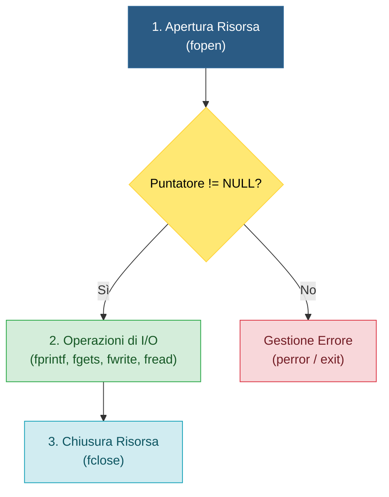
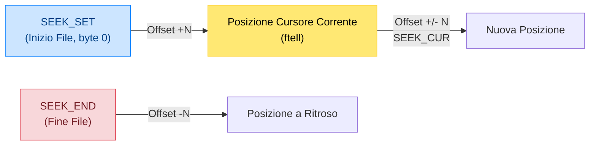

> [!SUMMARY] ⚡ In Sintesi (A Colpo d'Occhio)
> - **Puntatore allo Stream**: in C i file si gestiscono tramite un puntatore alla struttura ==`FILE*`== inclusa in `<stdio.h>`.
> - **Apertura**: ==`FILE *f = fopen("percorso", "modalita");`==. Se fallisce, restituisce sempre ==`NULL`==.
> - **Chiusura Obbligatoria**: ==`fclose(f);`== svuota il buffer (*flush*) su disco e rilascia il file descriptor nel sistema operativo (restituisce `0` se ok, `EOF` in errore).
> - **File di Testo**:
>   - Scrittura: ==`fprintf(f, ...)`== (formattata), ==`fputs(str, f)`== (stringa), ==`fputc(ch, f)`== (carattere).
>   - Lettura: ==`fgets(buf, dim, f)`== (legge l'intera riga spazi inclusi in sicurezza), ==`fscanf(f, ...)`==, ==`fgetc(f)`==.
> - **File Binari**:
>   - ==`fwrite(&dato, sizeof(Tipo), conteggio, f)`== scrive blocchi esatti di memoria RAM su file.
>   - ==`fread(&dato, sizeof(Tipo), conteggio, f)`== legge blocchi binari riversandoli direttamente in variabili o `struct`.
> - **Accesso Diretto/Casuale**:
>   - ==`fseek(f, offset, punto_riferimento)`== con costanti `SEEK_SET`, `SEEK_CUR`, `SEEK_END`.
>   - ==`ftell(f)`== restituisce l'indice del byte corrente (utile per calcolare la dimensione del file).
>   - ==`rewind(f)`== riporta il cursore a inizio file (`fseek(f, 0, SEEK_SET)`).

---

## 1. Il Modello di File in Linguaggio C (`FILE*`)

Un **file** è un'unità logica memorizzata su una memoria di massa secondaria (SSD o Hard Disk) che garantisce la **persistenza** dei dati anche dopo la chiusura del programma o lo spegnimento della macchina.

Quando un processo apre un file, il Kernel del sistema operativo alloca una tabella interna e la libreria standard C (`<stdio.h>`) restituisce un puntatore opaco a una struttura di tipo **`FILE`**:



> [!NOTE] 💾 Buffer di I/O in RAM
> Per motivi di prestazioni, la funzione di scrittura non scrive immediatamente ogni singolo carattere sul disco fisico: i dati vengono prima accumulati in un **buffer in memoria RAM**. I dati vengono riversati fisicamente su disco (*flushed*) solo quando il buffer si riempie, quando si forza con `fflush(f)`, o all'atto della chiusura con `fclose(f)`.

---

## 2. Apertura del File con `fopen()`

La funzione principale per agganciare un file al programma è `fopen`:
$$\mathbf{FILE*} \text{ fopen}(\mathbf{const\ char*} \text{ nome\_file}, \mathbf{const\ char*} \text{ modalita});$$

- `nome_file`: stringa contenente il percorso relativo (es. `"dati.txt"`) o assoluto (es. `"C:/dati/registro.txt"`).
- `modalita`: stringa che stabilisce l'intenzione di accesso e la tipologia di stream.

### Tabella Completa delle Modalità di Apertura

| Modalità | Operazione | Cursore Iniziale | Comportamento se il file ESISTE | Comportamento se NON esiste |
| :--- | :--- | :--- | :--- | :--- |
| **`"r"`** | Lettura testo | Inizio (byte 0) | Pronto alla lettura | **Ritorna `NULL` (Errore)** |
| **`"w"`** | Scrittura testo | Inizio | **Tronca il file a 0 byte (cancella tutto!)** | Crea un nuovo file vuoto |
| **`"a"`** | Append (Aggiunta) | Fine del file | Preserva i vecchi dati e accoda in fondo | Crea un nuovo file vuoto |
| **`"r+"`** | Lettura + Scrittura | Inizio | Pronto sia a leggere che a sovrascrivere | **Ritorna `NULL` (Errore)** |
| **`"w+"`** | Scrittura + Lettura | Inizio | **Tronca il file a 0 byte** | Crea un nuovo file vuoto |
| **`"a+"`** | Append + Lettura | Fine per scrittura | Preserva i dati; lettura ovunque con `fseek` | Crea un nuovo file vuoto |
| **Suffisso `"b"`** | File Binario | Dipende da sopra | Es. `"rb"`, `"wb"`, `"ab"`, `"rb+"`: disattiva conversioni newline | Come sopra |

---

### Dettaglio Visivo delle Tre Modalità Base

#### A. Apertura in Lettura (`"r"`)
Il puntatore parte dalla posizione iniziale (byte 0) e procede sequenzialmente verso la costante speciale `EOF` (*End Of File*):

![[Pasted image 20260504233648.png]]

#### B. Apertura in Scrittura Troncante (`"w"`)
Il file viene svuotato all'istante: il marcatore di EOF viene posizionato al byte 0 e qualsiasi dato preesistente viene perso irrimediabilmente:

![[Pasted image 20260504233634.png]]

#### C. Apertura in Aggiunta (`"a"`)
Il puntatore viene posizionato subito dopo l'ultimo byte significativo. I dati preesistenti rimangono intatti e le nuove scritture vengono appese in fondo:

![[Pasted image 20260504233706.png]]

---

## 3. Gestione degli Errori e Chiusura con `fclose()`

In C **non esistono le eccezioni**: il programmatore ha la responsabilità tassativa di verificare se il puntatore è `NULL` prima di effettuare qualsiasi operazione:

```c
#include <stdio.h>
#include <stdlib.h>

FILE *f = fopen("archivio.txt", "r");
if (f == NULL) {
    perror("Errore critico durante fopen");
    // perror stampa il motivo di sistema (es: 'No such file or directory')
    return 1;
}

// ... operazioni sul file ...

// Chiusura fondamentale
if (fclose(f) == EOF) {
    perror("Errore durante la chiusura del file");
}
```

La funzione `fclose(FILE *f)`:
1. Svuota il buffer in RAM riversando gli ultimi byte su memoria fisica.
2. Invia la chiusura al sistema operativo liberando il descrittore del file.
3. Ritorna `0` in caso di successo, oppure `EOF` (tipicamente `-1`) in caso di errore.

![[Pasted image 20260504234630.png]]

---

## 4. Lavoro su File di Testo (`.txt`)

### A. Scrittura Formattata: `fprintf()` e `fputs()`
Funziona esattamente come la comune `printf()`, ma prende come primo parametro il puntatore `FILE*`:

```c
FILE *f = fopen("scontrino.txt", "w");
if (f != NULL) {
    char articolo[] = "Penna USB";
    int quantita = 2;
    float prezzo = 8.50f;

    // Scrive testo formattato
    fprintf(f, "%s;%d;%.2f\n", articolo, quantita, prezzo);
    
    // Scrive una stringa pura senza formattazione
    fputs("Fine registrazione scontrino.\n", f);

    fclose(f);
}
```

### B. Lettura Sicura di Intere Righe: `fgets()`
Molti programmatori inesperti usano `fscanf(f, "%s", buffer)`: questo è un errore grave perché `%s` si arresta al primo spazio bianco!  
La funzione corretta per leggere testo riga per riga è **`fgets`**:

```c
char buffer[256];
FILE *f = fopen("scontrino.txt", "r");

if (f != NULL) {
    // fgets(array, dimensione_massima, puntatore_file)
    // Ritorna NULL quando finiscono le righe (o si verifica un errore)
    while (fgets(buffer, sizeof(buffer), f) != NULL) {
        printf("Letta riga: %s", buffer);
    }
    fclose(f);
}
```

### C. Lettura Formattata: `fscanf()`
Se il file contiene dati ben strutturati separati da delimitatori noti:
```c
char nome[50];
int qta;
float pr;

FILE *f = fopen("dati.txt", "r");
// fscanf restituisce il NUMERO di campi estratti con successo
while (fscanf(f, "%49[^;];%d;%f\n", nome, &qta, &pr) == 3) {
    printf("Prodotto: %s | Qta: %d | Prezzo: %.2f\n", nome, qta, pr);
}
fclose(f);
```

### D. Lettura e Scrittura a Singolo Carattere: `fgetc()` e `fputc()`
- `int fgetc(FILE *f)`: preleva un byte/carattere e lo restituisce come `int` (per poter rappresentare anche la costante `-1` di `EOF`).
- `int fputc(int c, FILE *f)`: scrive un singolo carattere su file.

```c
// Copia carattere per carattere di un file di testo
FILE *src = fopen("origine.txt", "r");
FILE *dst = fopen("copia.txt", "w");
int c;

while ((c = fgetc(src)) != EOF) {
    fputc(c, dst);
}

fclose(src);
fclose(dst);
```

---

## 5. Lavoro su File Binari (`.bin`, `.dat`)

Nei file binari non viene scritto testo leggibile in codice ASCII, ma l'**immagine esatta dei byte memorizzati nella RAM**.  
I vantaggi sono una dimensione del file notevolmente ridotta e una velocità I/O fulminea, ideale per salvare array e `struct`.

### A. Scrittura di Record con `fwrite()`
$$\mathbf{size\_t} \text{ fwrite}(\mathbf{const\ void*} \text{ ptr}, \mathbf{size\_t} \text{ size}, \mathbf{size\_t} \text{ count}, \mathbf{FILE*} \text{ stream});$$

- `ptr`: indirizzo di memoria della variabile o array da scrivere (`&variabile`).
- `size`: dimensione in byte del singolo elemento, calcolata con l'operatore **`sizeof()`**.
- `count`: quanti elementi consecutivi scrivere.
- `stream`: puntatore al file aperto con flag binario (es. `"wb"` o `"ab"`).

```c
typedef struct {
    int id;
    char username[32];
    double punteggio;
} Giocatore;

Giocatore g1 = {101, "PlayerOne", 9450.75};

FILE *f = fopen("classifica.bin", "wb");
if (f != NULL) {
    // Scrive 1 blocco della dimensione di struct Giocatore
    size_t scritti = fwrite(&g1, sizeof(Giocatore), 1, f);
    if (scritti != 1) {
        printf("Errore durante la scrittura su file binario!\n");
    }
    fclose(f);
}
```

### B. Lettura di Record con `fread()`
$$\mathbf{size\_t} \text{ fread}(\mathbf{void*} \text{ ptr}, \mathbf{size\_t} \text{ size}, \mathbf{size\_t} \text{ count}, \mathbf{FILE*} \text{ stream});$$

```c
Giocatore salvato;

FILE *f = fopen("classifica.bin", "rb");
if (f != NULL) {
    // Riversa direttamente i byte dal disco nella variabile 'salvato' in RAM
    if (fread(&salvato, sizeof(Giocatore), 1, f) == 1) {
        printf("Caricato Giocatore: ID=%d, Nome=%s, Score=%.2f\n",
               salvato.id, salvato.username, salvato.punteggio);
    }
    fclose(f);
}
```

---

## 6. Accesso Diretto (Casuale) e Navigazione del Cursore

Un file non deve essere per forza letto sequenzialmente dall'inizio alla fine: possiamo spostare il cursore interno in qualsiasi posizione con precisione millimetrica.



### A. La Funzione `fseek()`
$$\mathbf{int} \text{ fseek}(\mathbf{FILE*} \text{ stream}, \mathbf{long} \text{ offset}, \mathbf{int} \text{ whence});$$

Costanti di riferimento (`whence`):
1. **`SEEK_SET`**: l'offset si calcola partendo dall'**inizio del file** (l'offset deve essere $\ge 0$).
2. **`SEEK_CUR`**: l'offset si calcola partendo dalla **posizione attuale del cursore** (può essere positivo per andare avanti o negativo per tornare indietro).
3. **`SEEK_END`**: l'offset si calcola partendo dalla **fine del file** (offset negativo per arretrare prima della fine).

### B. La Funzione `ftell()`
Restituisce il numero del byte su cui si trova attualmente il cursore del file rispetto all'inizio:
$$\mathbf{long} \text{ ftell}(\mathbf{FILE*} \text{ stream});$$

> [!TIP] 💡 Calcolare la Dimensione di un File in Byte
> La tecnica standard in C per conoscere il peso esatto di un file è posizionarsi alla fine e leggere la posizione con `ftell`:
> ```c
> FILE *f = fopen("documento.pdf", "rb");
> fseek(f, 0, SEEK_END);      // Sposta il cursore all'ultimo byte
> long dimensione = ftell(f); // Legge la distanza dall'inizio = byte totali!
> rewind(f);                  // Riporta comodamente il cursore all'inizio (byte 0)
> printf("Peso del file: %ld byte\n", dimensione);
> fclose(f);
> ```

---

## 7. Domande d'Esame e Concetti Chiave

> [!QUESTION] ❓ Domande di Verifica
> 1. *Cosa succede se si apre un file esistente con modalità `"w"`?*  
>    **Risposta**: Il file viene immediatamente troncato a 0 byte, cancellando permanentemente tutti i dati preesistenti. Per accodare senza cancellare si deve usare `"a"`.
> 2. *Perché `fgets()` è preferibile a `gets()` e `fscanf("%s")`?*  
>    **Risposta**: `gets()` non controlla la dimensione del buffer e causa pericolosi Buffer Overflow (è stata deprecata e rimossa dallo standard C11). `fscanf("%s")` si arresta al primo spazio o tabulazione. `fgets()` accetta la dimensione massima consentendo letture sicure e complete di intere frasi.
> 3. *Qual è la differenza fondamentale tra scrivere con `fprintf()` e con `fwrite()`?*  
>    **Risposta**: `fprintf()` converte i dati in stringhe ASCII leggibili (es. l'intero `12345` occupa 5 caratteri/byte). `fwrite()` riversa direttamente i byte grezzi della RAM sul file (es. `int` occupa 4 byte indipendentemente dal valore).

---

## 8. Programmi Esecutivi Completi in C

> [!EXAMPLE]- 🧪 Programma 1: Gestione Anagrafica Studenti su File di Testo
> ```c
> #include <stdio.h>
> #include <stdlib.h>
> #include <string.h>
> 
> #define NOME_FILE "studenti.txt"
> 
> void aggiungi_studente(const char *nome, float media) {
>     FILE *f = fopen(NOME_FILE, "a");
>     if (f == NULL) {
>         perror("Impossibile aprire il file per la scrittura");
>         return;
>     }
>     fprintf(f, "%s;%.2f\n", nome, media);
>     fclose(f);
>     printf("Studente '%s' registrato con successo.\n", nome);
> }
> 
> void visualizza_studenti(void) {
>     FILE *f = fopen(NOME_FILE, "r");
>     if (f == NULL) {
>         printf("Nessun registro trovato (archivio vuoto).\n");
>         return;
>     }
> 
>     char riga[128];
>     char nome[64];
>     float media;
>     int conteggio = 0;
> 
>     printf("\n--- ELENCO STUDENTI NEL REGISTRO ---\n");
>     while (fgets(riga, sizeof(riga), f) != NULL) {
>         // Estrazione con sscanf dai delimitatori a punto e virgola
>         if (sscanf(riga, "%63[^;];%f", nome, &media) == 2) {
>             conteggio++;
>             printf("%2d) %-20s | Media: %5.2f\n", conteggio, nome, media);
>         }
>     }
>     printf("------------------------------------\n");
>     fclose(f);
> }
> 
> int main(void) {
>     aggiungi_studente("Alessandro Casetti", 8.80f);
>     aggiungi_studente("Beatrice Conti", 9.25f);
>     aggiungi_studente("Carlo Rossi", 7.10f);
>     
>     visualizza_studenti();
>     return 0;
> }
> ```

> [!EXAMPLE]- 🧪 Programma 2: Database Binario ad Accesso Diretto (Random Access con `fseek`)
> ```c
> #include <stdio.h>
> #include <stdlib.h>
> #include <string.h>
> 
> #define FILE_BIN "utenti.dat"
> 
> typedef struct {
>     int id;
>     char nome[30];
>     int livello;
> } Utente;
> 
> // Modifica il livello dell'utente specificato per posizione (accesso diretto senza riscrivere tutto il file)
> void aggiorna_livello_utente(int posizione_record, int nuovo_livello) {
>     // Modalità "rb+": lettura e scrittura binaria senza azzerare il file
>     FILE *f = fopen(FILE_BIN, "rb+");
>     if (f == NULL) {
>         perror("File binario inesistente");
>         return;
>     }
> 
>     // Salto diretto al record desiderato
>     long offset = (long)(posizione_record * sizeof(Utente));
>     fseek(f, offset, SEEK_SET);
> 
>     Utente u;
>     if (fread(&u, sizeof(Utente), 1, f) == 1) {
>         printf("Modifica utente [ID=%d, Nome=%s]: livello %d -> %d\n",
>                u.id, u.nome, u.livello, nuovo_livello);
>         u.livello = nuovo_livello;
> 
>         // Riportiamo il cursore indietro di 1 record per sovrascriverlo
>         fseek(f, offset, SEEK_SET);
>         fwrite(&u, sizeof(Utente), 1, f);
>     } else {
>         printf("Posizione record non valida!\n");
>     }
> 
>     fclose(f);
> }
> 
> int main(void) {
>     Utente squadra[3] = {
>         {1, "Alice", 10},
>         {2, "Bob", 15},
>         {3, "Charlie", 20}
>     };
> 
>     // 1. Scrittura iniziale array binario
>     FILE *f = fopen(FILE_BIN, "wb");
>     fwrite(squadra, sizeof(Utente), 3, f);
>     fclose(f);
> 
>     // 2. Modifica diretta del secondo record (indice 1: Bob)
>     aggiorna_livello_utente(1, 99);
> 
>     // 3. Verifica rilettura
>     f = fopen(FILE_BIN, "rb");
>     Utente temp;
>     printf("\n--- CONTENUTO FILE BINARIO DOPO MODIFICA ---\n");
>     while (fread(&temp, sizeof(Utente), 1, f) == 1) {
>         printf("ID: %d | Nome: %-10s | Livello: %d\n", temp.id, temp.nome, temp.livello);
>     }
>     fclose(f);
> 
>     return 0;
> }
> ```
