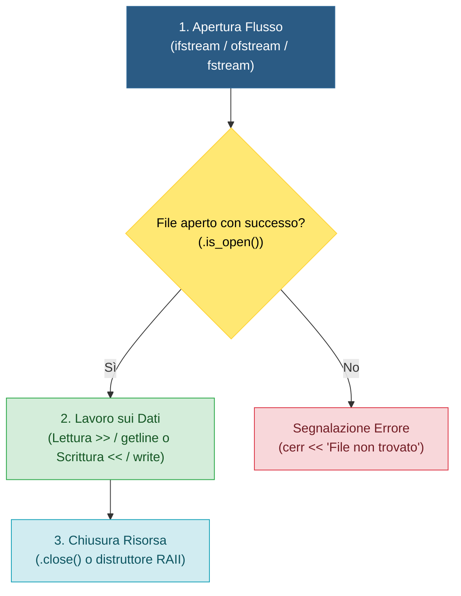
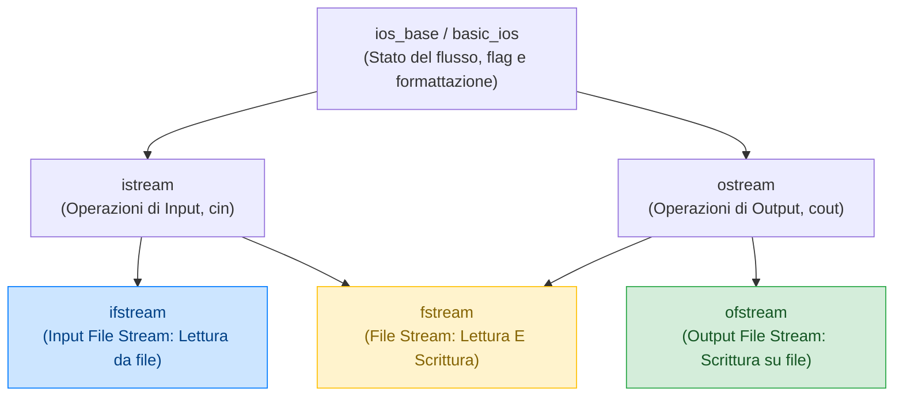
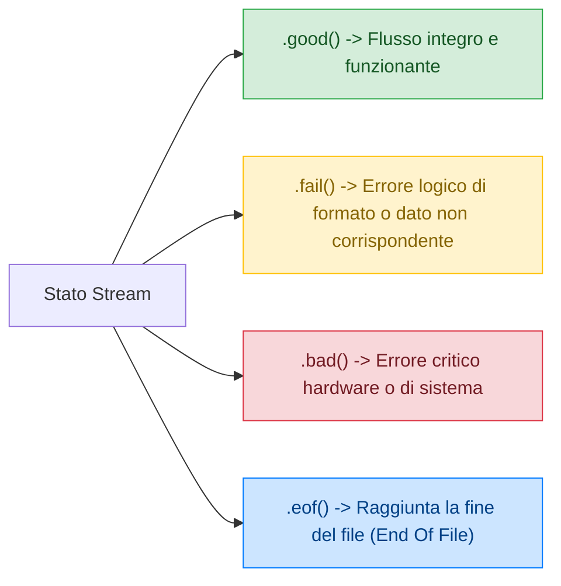
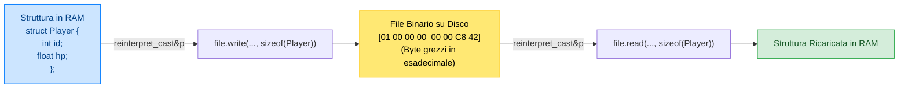

## 1. Il Concetto di File e la Memoria di Massa
Un **file** è un'unità logica di memorizzazione allocata su memorie secondarie persistenti (SSD, hard disk, pendrive). A differenza delle variabili allocate nella memoria centrale RAM (che è volatile e si azzera allo spegnimento del computer), i file permettono la **conservazione duratura** dei dati.

Quando il nostro programma apre un file:
1. Il sistema operativo carica i blocchi dal supporto di massa a un **buffer in RAM**.
2. Il programma lavora sui dati in RAM.
3. Per rendere definitive le modifiche, i dati devono essere sincronizzati nuovamente su disco (*flush*), operazione che avviene automaticamente alla chiusura.



I file si distinguono principalmente in due categorie:
- **File di Testo (`.txt`, `.csv`, `.json`)**: sequenze di caratteri ASCII/UTF-8 organizzate in righe logiche delimitate da caratteri di a-capo (`\n`).
- **File Binari (`.bin`, `.dat`, `.exe`)**: sequenze grezze di byte che rispecchiano la rappresentazione nativa dei dati in memoria RAM.

![[Pasted image 20260518102217.png|385]]![[Pasted image 20260518102242.jpg|385]]

---

## 2. L'Architettura Stream in C++ (`<fstream>`)

Nel C++ la gestione dei file è orientata agli oggetti e sfrutta il concetto di **Stream** (flusso continuo di dati).  
La libreria standard mette a disposizione tre classi principali incluse nell'header `<fstream>`:



1. **`ifstream`** (*Input File Stream*): apre file in sola **lettura**.
2. **`ofstream`** (*Output File Stream*): crea o apre file in **scrittura**.
3. **`fstream`**: flusso bidirezionale in grado di eseguire sia **lettura che scrittura** sullo stesso file.

> [!TIP] 💡 Il Paradigma RAII e la Chiusura Automatica
> In C++ non è strettamente obbligatorio chiamare `file.close()` se l'oggetto stream è dichiarato localmente in una funzione o blocco. Grazie al paradigma **RAII** (*Resource Acquisition Is Initialization*), quando la variabile stream esce dal suo ambito di validità (`}`), il distruttore viene invocato automaticamente chiudendo il file e svuotando il buffer, anche in presenza di `return` anticipati o eccezioni!

---

## 3. Modalità di Apertura ed i Flag `ios::*`

Quando apriamo un file, possiamo specificare una o più modalità combinandole tramite l'operatore bitwise OR **`|`**:

$$\mathbf{fstream} \text{ file}(\text{"archivio.dat"}, \mathbf{ios::in} \mid \mathbf{ios::out} \mid \mathbf{ios::binary});$$

| Flag | Nome Completo | Descrizione e Comportamento |
| :--- | :--- | :--- |
| **`ios::in`** | Input | Apre il file per la **lettura** (impostato di default per `ifstream`). |
| **`ios::out`** | Output | Apre il file per la **scrittura** (impostato di default per `ofstream`). **Azzera il file** se esiste già! |
| **`ios::app`** | Append | **Aggiunta in coda**: posiziona il cursore alla fine. I vecchi dati non vengono toccati. |
| **`ios::trunc`** | Truncate | **Troncamento**: cancella completamente il contenuto preesistente all'apertura. |
| **`ios::binary`** | Binary | **Modalità binaria pura**: disattiva ogni traduzione di caratteri speciali di a-capo. |
| **`ios::ate`** | At The End | Apre il file e sposta immediatamente il cursore alla fine, ma consente di riposizionarsi altrove. |

### Perché `ios::binary` è Cruciale?
Nei sistemi operativi Windows, un a-capo nei file di testo è codificato con due byte: Carriage Return (`\r`, ASCII 13) e Line Feed (`\n`, ASCII 10). In modalità testo standard, il C++ converte automaticamente la sequenza `\r\n` in un singolo `\n` durante la lettura, e viceversa in scrittura.  
Nei **file binari** questa traduzione corrompe irreversibilmente immagini, numeri float o struct! Con **`ios::binary`**, il flusso tratta i dati come byte esatti senza alcuna alterazione.

```cpp
// Esempio: Creare un file di testo in modalità append (senza sovrascrivere)
ofstream fileLog("eventi.log", ios::out | ios::app);

// Esempio: Aprire un file binario sia in lettura che in scrittura
fstream fileDati("archivio.dat", ios::in | ios::out | ios::binary);
```

---

## 4. Controllo dello Stato del Flusso e Gestione Errori

Ogni oggetto stream mantiene una maschera interna di bit che descrive lo stato del canale di comunicazione:



- **`file.is_open()`**: verifica se il file è stato effettivamente aperto dal sistema operativo.
- **`file.fail()`**: vero se si è verificato un errore logico di estrazione (es. si cercava di leggere un numero ma nel file c'era una parola).
- **`file.clear()`**: **ripristina i flag di stato** azzerando gli errori, operazione indispensabile per riutilizzare lo stream dopo aver toccato l'EOF.

> [!DANGER] 🚫 Errore da Principiante: `while (!file.eof())`
> **NON usare mai `while (!file.eof())` come condizione di lettura!**
> ```cpp
> // CODICE SBAGLIATO CHE DUPLICA L'ULTIMA RIGA:
> while (!file.eof()) {
>     file >> dato;
>     cout << dato << endl; // Verrà stampato due volte l'ultimo valore!
> }
> ```
> Il flag `eofbit` diventa `true` **solo DOPO** che un'operazione di lettura ha già fallito tentando di leggere oltre la fine!  
> **Pattern Corretto Idiomatico:**
> ```cpp
> while (file >> dato) {
>     cout << dato << endl; // Eseguito SOLO se la lettura ha avuto pieno successo!
> }
> ```

---

## 5. Operazioni su File di Testo (`.txt`, `.csv`)

### A. Scrittura Formattata con `ofstream` e `<<`
Scrivere su file usa la medesima sintassi di `cout`:

```cpp
#include <iostream>
#include <fstream>
#include <iomanip>

int main() {
    std::ofstream fout("catalogo.txt");
    if (!fout.is_open()) {
        std::cerr << "Errore creazione file!" << std::endl;
        return 1;
    }

    fout << std::fixed << std::setprecision(2);
    fout << "Mouse_Wireless" << " " << 25.99 << std::endl;
    fout << "Tastiera_RGB" << " " << 59.50 << std::endl;
    fout << "Monitor_4K" << " " << 320.00 << std::endl;

    fout.close();
    return 0;
}
```

### B. Lettura Parola per Parola con `>>`
L'operatore `>>` salta automaticamente spazi bianchi, tabulazioni e caratteri di a-capo:
```cpp
std::ifstream fin("catalogo.txt");
std::string prodotto;
double prezzo;

while (fin >> prodotto >> prezzo) {
    std::cout << "Articolo: " << prodotto << " | Prezzo: €" << prezzo << std::endl;
}
fin.close();
```

### C. Lettura di Intere Righe con `std::getline()`
Quando le stringhe contengono spazi (nomi, descrizioni, frasi intere), si usa **`std::getline(flusso, stringa, [delimitatore])`**:

```cpp
#include <iostream>
#include <fstream>
#include <string>

int main() {
    std::ifstream file("rubrica.txt");
    std::string riga;

    // Legge fino al carattere '\n'
    while (std::getline(file, riga)) {
        std::cout << "Riga letta: " << riga << std::endl;
    }
    return 0;
}
```

#### Parsing di File CSV con Delimitatore Personalizzato
`getline` accetta un terzo parametro facoltativo: il **delimitatore** (di default `'\n'`). Possiamo usarlo per separare campi CSV delimitati da virgole o punti e virgola:

```cpp
std::ifstream fileCSV("studenti.csv");
std::string matricola, nome, media;

// Legge campi separati da virgola
while (std::getline(fileCSV, matricola, ',') &&
       std::getline(fileCSV, nome, ',') &&
       std::getline(fileCSV, media)) { // L'ultimo campo termina con \n!
    std::cout << "Matr: " << matricola << " | Nome: " << nome << " | Media: " << media << std::endl;
}
```

> [!WARNING] ⚠️ La Trappola del Buffer: `>>` seguito da `getline()`
> Se alterni una lettura con `file >> numero` e una successiva con `std::getline(file, stringa)`, `getline()` leggerà immediatamente una **stringa vuota**! Questo accade perché `>>` estrae il numero ma lascia il carattere `\n` in sospeso nel buffer.  
> **Soluzione**: inserisci sempre `file.ignore()` prima del `getline()`!

---

## 6. Operazioni su File Binari (`ios::binary`)

Nei file binari non si convertono i numeri in caratteri: si memorizza l'esatta rappresentazione a byte della memoria centrale RAM.

I metodi fondamentali sono:
- **`flusso.write(const char* buffer, streamsize num_byte)`**
- **`flusso.read(char* buffer, streamsize num_byte)`**

Entrambi i metodi richiedono che il puntatore alla variabile venga convertito in un puntatore a caratteri grezzi (`char*`) tramite l'operatore di cast del C++ moderno: **`reinterpret_cast`**.



### A. Scrittura Binaria di una `struct`
```cpp
#include <iostream>
#include <fstream>

struct Giocatore {
    int id;
    char username[24]; // Dimensione FISSA per allocazione contigua
    int livello;
    float punteggio;
};

int main() {
    Giocatore g1 = {1001, "CyberKnight", 15, 8450.5f};

    std::ofstream fout("salvataggio.dat", std::ios::out | std::ios::binary);
    if (!fout.is_open()) return 1;

    // Scrive l'intero blocco di byte della struct in un unico colpo
    fout.write(reinterpret_cast<const char*>(&g1), sizeof(Giocatore));
    fout.close();

    std::cout << "Salvataggio completato (" << sizeof(Giocatore) << " byte scritti)." << std::endl;
    return 0;
}
```

### B. Lettura Binaria con Verifica dei Byte Effettivi
Il metodo `file.gcount()` restituisce il numero esatto di byte effettivamente estratti dall'ultima chiamata `.read()`:

```cpp
Giocatore caricato;
std::ifstream fin("salvataggio.dat", std::ios::in | std::ios::binary);

if (fin.is_open()) {
    fin.read(reinterpret_cast<char*>(&caricato), sizeof(Giocatore));
    
    if (fin.gcount() == sizeof(Giocatore)) {
        std::cout << "Giocatore: " << caricato.username 
                  << " | Livello: " << caricato.livello 
                  << " | Punti: " << caricato.punteggio << std::endl;
    }
    fin.close();
}
```

> [!DANGER] 🚫 Trappola Mortale: MAI usare `std::string` o Puntatori grezzi dentro struct per file binari!
> Una classe dinamica come `std::string` memorizza i caratteri del testo nello **Heap** e possiede al suo interno solo un puntatore all'indirizzo RAM. Se scrivi una `std::string` con `file.write(&str, sizeof(str))`, salverai sul disco l'**indirizzo di memoria virtuale**, non il testo!  
> Quando riaprirai il file in una successiva esecuzione, quell'indirizzo conterrà dati casuali o non validi, provocando un disastroso crash per **Segmentation Fault**.  
> **Regola d'oro per file binari**: usa array di caratteri a dimensione fissa (`char nome[32]`) o strutture composte solo da tipi primitivi (dette *Trivially Copyable*).

---

## 7. Accesso Diretto (Random Access): `seekg`, `seekp`, `tellg`, `tellp`

Nei file binari e nei database non serve rileggere tutto da capo per consultare o modificare un record: possiamo saltare istantaneamente all'offset di byte desiderato.

I due flussi hanno puntatori indipendenti:
- **`g` (get)**: cursore del flusso di **lettura** (`seekg` e `tellg`).
- **`p` (put)**: cursore del flusso di **scrittura** (`seekp` e `tellp`).

### Sintassi di Posizionamento:
$$\mathbf{file.seekg}(\text{offset}, \text{punto\_riferimento});$$
$$\mathbf{file.seekp}(\text{offset}, \text{punto\_riferimento});$$

I punti di riferimento sono definiti nell'oggetto `std::ios`:
1. **`std::ios::beg`**: Inizio del file (offset positivo verso destra).
2. **`std::ios::cur`**: Posizione attuale del cursore.
3. **`std::ios::end`**: Fine del file (offset tipicamente negativo a ritroso).

### Trucco: Calcolare la Dimensione di Qualsiasi File in C++
```cpp
std::ifstream file("video.mp4", std::ios::binary | std::ios::ate);
if (file.is_open()) {
    // Poiché abbiamo usato ios::ate, il cursore si trova già alla fine!
    std::streamsize grandezza = file.tellg();
    std::cout << "Peso del file: " << grandezza << " byte (" 
              << grandezza / (1024.0 * 1024.0) << " MB)" << std::endl;
    file.close();
}
```

### Modifica di un Record Specifico in Mezzo al File
```cpp
std::fstream fs("database.dat", std::ios::in | std::ios::out | std::ios::binary);

int indice_record = 3; // Vogliamo modificare il quarto record (indice 3)
long offset = indice_record * sizeof(Giocatore);

// 1. Spostiamo il puntatore di lettura sul record e lo leggiamo
fs.seekg(offset, std::ios::beg);
Giocatore g;
fs.read(reinterpret_cast<char*>(&g), sizeof(Giocatore));

// 2. Modifichiamo il dato in memoria
g.livello += 1;

// 3. Spostiamo il puntatore di SCRITTURA sullo stesso offset per sovrascriverlo
fs.seekp(offset, std::ios::beg);
fs.write(reinterpret_cast<const char*>(&g), sizeof(Giocatore));

fs.close();
```

---

## 8. Domande d'Esame e Concetti Chiave

> [!QUESTION] ❓ Domande di Verifica
> 1. *Cosa accade se ometti il flag `ios::binary` quando salvi una struct su file in Windows?*  
>    **Risposta**: Qualsiasi byte all'interno dei dati binari della struct avente valore $10$ (Line Feed `\n`) verrà trasformato automaticamente nella coppia di byte $13, 10$ (`\r\n`), alterando la dimensione dei dati e corrompendo la struttura al caricamento successivo.
> 2. *Qual è la differenza pratica tra `file.seekg(10, ios::beg)` e `file.seekg(10, ios::cur)`?*  
>    **Risposta**: `ios::beg` posiziona il cursore esattamente al decimo byte a partire dall'inizio del file; `ios::cur` sposta il cursore di 10 byte in avanti a partire dalla posizione in cui si trova in quel momento.
> 3. *Perché `getline(cin, s)` fallisce se preceduta da un'operazione `cin >> x`? Come si risolve?*  
>    **Risposta**: L'operatore `>>` consuma il valore numerico ma lascia il carattere `\n` generato dal tasto Invio all'interno del buffer di input. La successiva `getline()` incontra subito quel `\n` e termina immediatamente restituendo una stringa vuota. Si risolve invocando `cin.ignore()` per svuotare il carattere residuo.

---

## 9. Programmi Esecutivi Completi in C++

> [!EXAMPLE]- 🧪 Programma 1: Gestione Anagrafica Studenti con File CSV e `getline()`
> ```cpp
> #include <iostream>
> #include <fstream>
> #include <string>
> #include <vector>
> #include <sstream>
> 
> struct Studente {
>     std::string cognome;
>     std::string nome;
>     float media;
> };
> 
> const std::string NOME_FILE = "studenti.csv";
> 
> void inserisci_studente(const Studente& s) {
>     std::ofstream fout(NOME_FILE, std::ios::out | std::ios::app);
>     if (fout.is_open()) {
>         fout << s.cognome << "," << s.nome << "," << s.media << "\n";
>         fout.close();
>         std::cout << "✅ Salvato: " << s.cognome << " " << s.nome << std::endl;
>     }
> }
> 
> void stampa_registro() {
>     std::ifstream fin(NOME_FILE);
>     if (!fin.is_open()) {
>         std::cout << "⚠️ Registro vuoto o non trovato." << std::endl;
>         return;
>     }
> 
>     std::string riga;
>     std::cout << "\n--- REGISTRO SCOLASTICO CSV ---" << std::endl;
>     std::cout << "Cognome             Nome                Media" << std::endl;
>     std::cout << "-----------------------------------------------" << std::endl;
> 
>     while (std::getline(fin, riga)) {
>         if (riga.empty()) continue;
>         
>         std::stringstream ss(riga);
>         std::string cognome, nome, str_media;
> 
>         if (std::getline(ss, cognome, ',') &&
>             std::getline(ss, nome, ',') &&
>             std::getline(ss, str_media)) {
>             
>             float media = std::stof(str_media);
>             std::cout << cognome << "\t\t" << nome << "\t\t" << media << std::endl;
>         }
>     }
>     fin.close();
> }
> 
> int main() {
>     inserisci_studente({"Casetti", "Alessandro", 8.9f});
>     inserisci_studente({"Verdi", "Giuseppe", 7.5f});
>     inserisci_studente({"Bianchi", "Laura", 9.4f});
> 
>     stampa_registro();
>     return 0;
> }
> ```

> [!EXAMPLE]- 🧪 Programma 2: Database Binario di Record di Gioco con Accesso Diretto (Seek/Tell)
> ```cpp
> #include <iostream>
> #include <fstream>
> #include <cstring>
> 
> struct RecordAccount {
>     int id;
>     char nickname[24];
>     int monete;
>     bool attivo;
> };
> 
> const char* DB_FILE = "accounts.bin";
> 
> void inizializza_db() {
>     std::ofstream fout(DB_FILE, std::ios::out | std::ios::binary | std::ios::trunc);
>     RecordAccount accts[3] = {
>         {1, "GamerPro99", 500, true},
>         {2, "ShadowBlade", 1200, true},
>         {3, "PixelHero", 350, false}
>     };
> 
>     fout.write(reinterpret_cast<const char*>(accts), sizeof(accts));
>     fout.close();
>     std::cout << "Database binario creato con 3 account iniziali." << std::endl;
> }
> 
> void aggiungi_monete(int indice_account, int bonus) {
>     // Apertura bidirezionale binaria
>     std::fstream fs(DB_FILE, std::ios::in | std::ios::out | std::ios::binary);
>     if (!fs.is_open()) {
>         std::cerr << "Errore apertura database!" << std::endl;
>         return;
>     }
> 
>     long pos = indice_account * sizeof(RecordAccount);
>     
>     // 1. Posizionamento in lettura
>     fs.seekg(pos, std::ios::beg);
>     RecordAccount acc;
>     fs.read(reinterpret_cast<char*>(&acc), sizeof(RecordAccount));
> 
>     if (fs.gcount() == sizeof(RecordAccount)) {
>         std::cout << "Monete attuali per " << acc.nickname << ": " << acc.monete << std::endl;
>         acc.monete += bonus;
> 
>         // 2. Posizionamento nello stesso offset in scrittura
>         fs.seekp(pos, std::ios::beg);
>         fs.write(reinterpret_cast<const char*>(&acc), sizeof(RecordAccount));
>         std::cout << "✅ Accreditate " << bonus << " monete. Nuovo saldo: " << acc.monete << std::endl;
>     }
>     fs.close();
> }
> 
> void mostra_tutti() {
>     std::ifstream fin(DB_FILE, std::ios::in | std::ios::binary);
>     RecordAccount temp;
>     std::cout << "\n--- STATO FINALE DATABASE BINARIO ---" << std::endl;
>     while (fin.read(reinterpret_cast<char*>(&temp), sizeof(RecordAccount))) {
>         std::cout << "ID: " << temp.id 
>                   << " | Nick: " << temp.nickname 
>                   << " | Monete: " << temp.monete 
>                   << " | Attivo: " << (temp.attivo ? "SÌ" : "NO") << std::endl;
>     }
>     fin.close();
> }
> 
> int main() {
>     inizializza_db();
>     // Aggiungiamo 300 monete al secondo account (indice 1: ShadowBlade)
>     aggiungi_monete(1, 300);
>     mostra_tutti();
>     return 0;
> }
> ```
