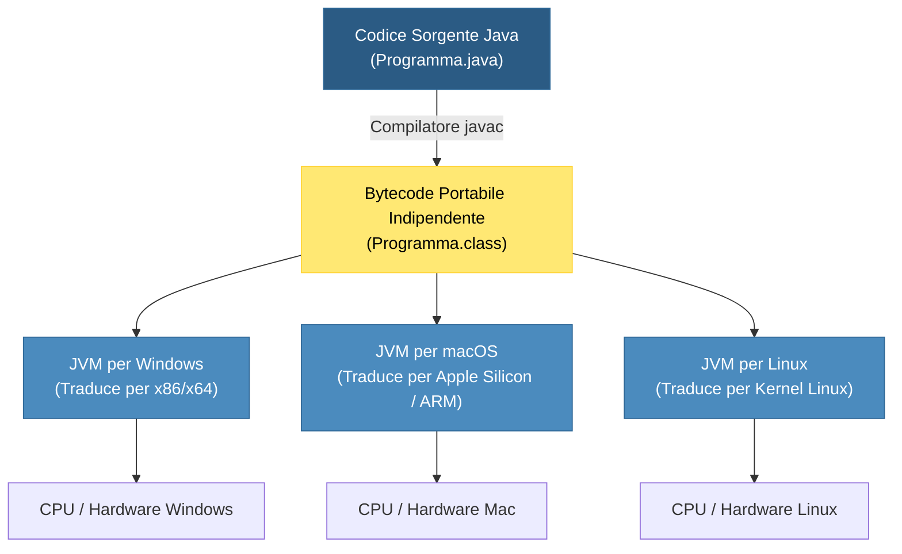
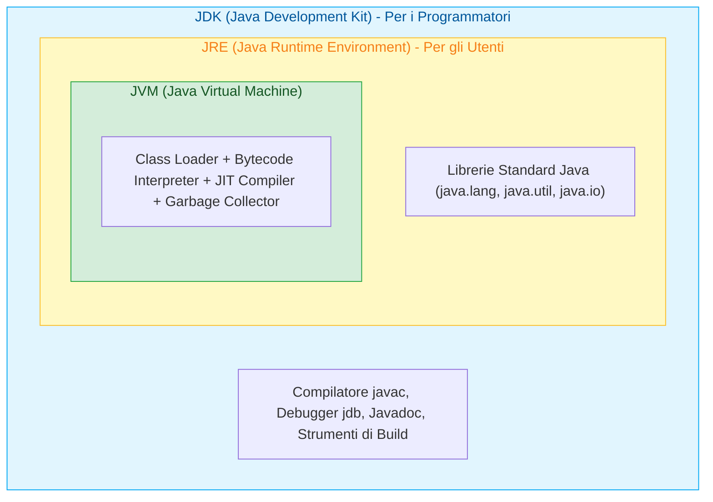

## 1. Origine e Filosofia di Java

Java nasce nei primi anni '90 nei laboratori di **Sun Microsystems** (successivamente acquisita da Oracle) per opera di un team guidato da **James Gosling**. 

Inizialmente battezzato con il nome di *Oak* (quercia), il linguaggio venne poi rinominato **Java** nel 1995 durante una sessione di brainstorming davanti a una tazza di caffè indonesiano (da cui derivano il celebre logo della tazza fumante e il termine *"Java Bean"*).

![[Pasted image 20261020094228.png|342]]

A differenza del C++ (progettato per dare il massimo controllo sull'hardware a discapito della portabilità), Java nasceva con l'obiettivo rivoluzionario di superare la frammentazione dei sistemi operativi:
$$\text{==\"Write Once, Run Anywhere\"== (Scrivi una volta, esegui ovunque)}$$

Oggi Java è ampiamente open-source attraverso il progetto **==OpenJDK==**, e non richiede l'acquisto di licenze proprietarie per lo sviluppo standard.

---

## 2. Il Modello di Esecuzione Ibrido: Compilatore e Bytecode

Spesso ci si chiede: *Java è un linguaggio compilato o interpretato?*  
La risposta è: **è un ==sistema ibrido a due stadi==**.



1. **Fase di Compilazione Statica (`javac`)**:  
   Il file sorgente con estensione `.java` viene analizzato dal compilatore `javac`. Il risultato non è un eseguibile binario nativo (come accade in C++ con i file `.exe`), bensì un file binario intermedio e indipendente dall'architettura hardware chiamato **==Bytecode==** (con estensione `.class`).
2. **Fase di Esecuzione Virtuale (JVM)**:  
   Il bytecode viene preso in carico dalla **==Java Virtual Machine (JVM)==** installata sul computer dell'utente finale, che lo interpreta ed esegue.

---

## 3. L'Ecosistema Java: JDK, JRE e JVM a Confronto

Spesso gli studenti confondono queste tre sigle fondamentali. Possiamo immaginarle come tre **scatole cinesi concentriche**:



| Componente  | Nome Esteso                | Cosa Contiene?                                                                                                                 | A Chi Serve?                                                                    |
| :---------- | :------------------------- | :----------------------------------------------------------------------------------------------------------------------------- | :------------------------------------------------------------------------------ |
| **==JVM==** | *Java Virtual Machine*     | Motore software che interpreta il bytecode, compila le parti critiche a runtime (JIT) e gestisce la RAM col Garbage Collector. | È il componente che **esegue** effettivamente le istruzioni.                    |
| **==JRE==** | *Java Runtime Environment* | La **JVM** + tutte le **librerie standard di runtime** precompilate (Class Library).                                           | Serve all'utente finale per poter ==eseguire i programmi Java== sul proprio PC. |
| **==JDK==** | *Java Development Kit*     | Il **JRE** + tutti gli **strumenti per lo sviluppatore**: compilatore `javac`, archiviatore `jar`, debugger `jdb`, `javadoc`.  | Serve al programmatore per ==scrivere e compilare== nuovo codice Java.          |

![[Pasted image 20261020093904.png]]

---

## 4. Tabella Comparativa: Java vs C++ vs Python

| Caratteristica       | C++                                                   | Java                                                   | Python                                       |
| :------------------- | :---------------------------------------------------- | :----------------------------------------------------- | :------------------------------------------- |
| **Paradigma**        | Multi-paradigma a basso/alto livello                  | ==OOP puro== (tutto risiede in una classe)             | Multi-paradigma ad altissimo livello         |
| **Compilazione**     | Compilato nativo diretto ad oggetti macchina (`.exe`) | ==Ibrido==: Bytecode `.class` su ==JVM== con JIT       | Bytecode eseguito su interprete PVM          |
| **Portabilità**      | Bassa (va ricompilato per ogni OS)                    | ==Massima (WORA)==: stesso `.class` su ogni OS         | Alta (richiede interprete Python installato) |
| **Tipizzazione**     | Statica e forte                                       | ==Statica e forte== (controlli ferrei a compile-time)  | Dinamica e forte                             |
| **Gestione Memoria** | Manuale (`new`/`delete`, puntatori espliciti)         | ==Automatica con Garbage Collector==                   | Automatica con Reference Counting e GC       |
| **Puntatori**        | Puntatori espliciti con aritmetica (`*`, `&`)         | ==Riferimenti gestiti== (nessuna aritmetica puntatori) | Riferimenti trasparenti a oggetti            |

## 5. Il Primo Programma: "Hello World" in Java

In Java ==qualsiasi riga di codice deve obbligatoriamente risiedere all'interno di una classe==. Il nome del file deve corrispondere esattamente al nome della classe pubblica principale!

> [!EXAMPLE]- 🧪 Programma Completo: `HelloWorld.java`
> ```java
> // Il file DEVE chiamarsi esattamente "HelloWorld.java"
> public class HelloWorld {
>     
>     // Punto di ingresso dell'applicazione (Main entry point)
>     public static void main(String[] args) {
>         System.out.println("==========================================");
>         System.out.println("   Benvenuto nel mondo della programmazione Java!");
>         System.out.println("==========================================");
>         
>         // Stampa dettagli dell'ambiente di esecuzione JVM
>         String versioneJava = System.getProperty("java.version");
>         String sistemaOperativo = System.getProperty("os.name");
>         
>         System.out.println("Versione Java in uso : " + versioneJava);
>         System.out.println("Sistema Operativo    : " + sistemaOperativo);
>         System.out.println("Compilazione Bytecode: Riuscita con successo!");
>     }
> }
> ```
> **Istruzioni da Terminale**:
> 1. Compilazione: `javac HelloWorld.java` (genera il file `HelloWorld.class`).
> 2. Esecuzione: `java HelloWorld` (avvia la JVM che esegue il bytecode).
