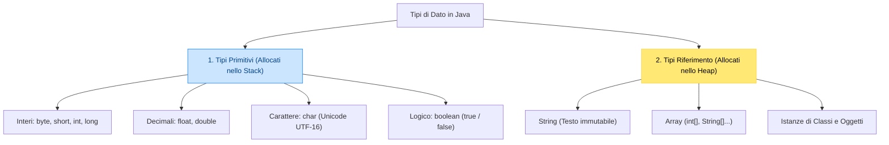

## 1. Anatomia del Metodo `main`

In Java ogni programma eseguibile parte da una firma rigorosa e standardizzata:

```java
public class Calcolatrice {
    // Firma universale del metodo principale
    public static void main(String[] args) {
        // Istruzioni eseguite dalla JVM
    }
}
```

- ==**`public`**==: il metodo è accessibile dall'esterno da parte della JVM.
- ==**`static`**==: il metodo appartiene alla classe e può essere invocato dalla JVM senza dover prima istanziare un oggetto.
- ==**`void`**==: non restituisce alcun valore al sistema operativo.
- ==**`main`**==: il nome convenzionale del punto di avvio.
- ==**`String[] args`**==: array di stringhe contenente gli eventuali argomenti passati da riga di comando.

---

## 2. Gli 8 Tipi di Dato Primitivi

Mentre in C e C++ la dimensione di un `int` o `long` può variare a seconda del compilatore e del processore (32 o 64 bit), **in Java le dimensioni sono ==scolpite nello standard del linguaggio==** per garantire la portabilità assoluta.



| Tipo              | Dimensione      | Note & Regole di Sintassi                                              |
| :---------------- | :-------------- | :--------------------------------------------------------------------- |
| ==**`byte`**==    | 8 bit (1 byte)  | Utile per buffer grezzi di byte e socket di rete.                      |
| ==**`short`**==   | 16 bit (2 byte) |                                                                        |
| ==**`int`**==     | 32 bit (4 byte) | Tipo predefinito per numeri interi.                                    |
| ==**`long`**==    | 64 bit (8 byte) | ==Richiede obbligatoriamente il suffisso `L`==.                        |
| ==**`float`**==   | 32 bit (4 byte) | ==Richiede obbligatoriamente il suffisso `f`==.                        |
| ==**`double`**==  | 64 bit (8 byte) | Tipo predefinito standard per numeri decimali.                         |
| ==**`char`**==    | 16 bit (2 byte) | Apici singoli `'...'`. ==Supporta caratteri internazionali ed emoji==! |
| ==**`boolean`**== | 1 bit logico    | ==NON è un numero intero== (nessun cast da/verso 0 e 1 come in C++!).  |

---

## 3. Tipi Riferimento e Classi Wrapper

In Java i tipi primitivi non sono oggetti (per massimizzare la velocità nei calcoli elementari nello Stack). Tuttavia, le strutture dati dinamiche della libreria standard (come `ArrayList`) richiedono necessariamente oggetti.

A tale scopo, ogni tipo primitivo possiede una corrispondente ==**Classe Wrapper**== (*Involucro*):
- `int` $\rightarrow$ ==`Integer`==
- `double` $\rightarrow$ ==`Double`==
- `char` $\rightarrow$ ==`Character`==
- `boolean` $\rightarrow$ ==`Boolean`==

### Meccanismo di Autoboxing e Unboxing
Java esegue la conversione automatica e trasparente tra tipo primitivo e classe wrapper:
```java
// Autoboxing: da primitivo int a oggetto Integer nello Heap
Integer objNumero = 42;

// Unboxing: da oggetto Integer a primitivo int nello Stack
int primitivo = objNumero;
```

---

## 4. La Classe `String` e la Trappola del Confronto

In Java le stringhe non sono semplici array di caratteri terminati da `\0` come in C, ma sono istanze della classe **`java.lang.String`**.

> [!IMPORTANT] 🔒 Immutabilità delle Stringhe
> **Le stringhe in Java sono totalmente immutabili**. Qualsiasi metodo (come `.toUpperCase()`) non modifica la stringa originale, ma ==genera e restituisce un nuovo oggetto nello Heap==:
> ```java
> String saluto = "Ciao";
> saluto.toUpperCase();
> System.out.println(saluto); // Stampa ancora "Ciao" (l'originale non è mutato!)
> 
> saluto = saluto.toUpperCase(); // Riassegnazione: ora punta al nuovo oggetto "CIAO"
> ```

> [!DANGER] 🚫 Errore Gravissimo: Confrontare Stringhe con `==`
> L'operatore **`==`** confronta se due variabili puntano allo **stesso indirizzo fisico di memoria nello Heap**, NON il contenuto testuale!  
> Per verificare se due stringhe contengono le stesse lettere, usa **SEMPRE ==`.equals()`==**:
> ```java
> String s1 = "Java";
> String s2 = new String("Java");
> 
> System.out.println(s1 == s2);      // FALSE! (Puntano a due oggetti distinti in RAM)
> System.out.println(s1.equals(s2));  // TRUE!  (Stesso identico testo carattere per carattere)
> ```

![[Pasted image 20261020100802.png]]

---

## 5. Conversioni di Tipo (Casting) e Parsing

### A. Casting Implicito ed Esplicito
- ==**Widening (Allargamento implicito)**==: assegnazione da tipo più piccolo a uno più capiente senza perdita di precisione (es. da `int` a `double`):
  ```java
  int x = 10;
  double d = x; // Automatico: d vale 10.0
  ```
- ==**Narrowing (Restringimento esplicito)**==: forzatura manuale con cast tra parentesi tonde, rischiando troncamento:
  ```java
  double pi = 3.99;
  int intero = (int) pi; // Tronca la parte decimale: intero vale 3!
  ```

### B. Parsing da Stringa a Numero
Quando si leggono dati da input o da file, arrivano sotto forma di testo. Per convertirli in valori numerici usiamo i metodi statici dei wrapper:
```java
String testoEtà = "18";
String testoPrezzo = "19.99";

int eta = Integer.parseInt(testoEtà);        // Converte in int primitivo
double prezzo = Double.parseDouble(testoPrezzo); // Converte in double primitivo
```

---

## 6. Input e Output da Console

### A. Output con `System.out`
- `System.out.println(dato)`: stampa il valore e aggiunge automaticamente un a-capo.
- `System.out.print(dato)`: stampa mantenendo il cursore sulla stessa riga.
- `System.out.printf("Formato %d %.2f\n", intero, decimale)`: stampa formattata.

### B. Input Interattivo con `java.util.Scanner`
Per leggere da tastiera usiamo la classe ==`Scanner`== collegata a `System.in`:

```java
import java.util.Scanner;

public class TestInput {
    public static void main(String[] args) {
        Scanner tastiera = new Scanner(System.in);

        System.out.print("Inserisci il tuo nome: ");
        String nome = tastiera.nextLine(); // Legge l'intera riga spazi inclusi

        System.out.print("Inserisci l'età: ");
        int eta = tastiera.nextInt(); // Legge un intero

        System.out.println("Benvenuto " + nome + ", hai " + eta + " anni.");
        tastiera.close();
    }
}
```

> [!WARNING] ⚠️ La Trappola del Buffer di `Scanner`
> Se chiami `tastiera.nextLine()` subito dopo `tastiera.nextInt()` o `tastiera.nextDouble()`, `nextLine()` leggerà immediatamente una **stringa vuota** saltando l'input dell'utente!  
> **Causa**: `nextInt()` legge il numero ma lascia il carattere Invio (`\n`) in sospeso nel buffer della tastiera.  
> **Soluzione obbligatoria**: inserisci sempre un ==`tastiera.nextLine();` a vuoto== per ripulire il buffer prima di leggere testo:
> ```java
> int matricola = tastiera.nextInt();
> tastiera.nextLine(); // ==CONSUMA IL BUFFER RESIDUO \n==
> String nome = tastiera.nextLine(); // Ora legge correttamente la stringa!
> ```

---
## 7. Programma Esecutivo Completo

> [!EXAMPLE]- 🧪 Programma Completo: Calcolatore di Media Ponderata Studente
> ```java
> import java.util.Scanner;
> 
> public class GestoreMedia {
>     public static void main(String[] args) {
>         Scanner input = new Scanner(System.in);
> 
>         System.out.println("=== CALCOLATORE MEDIA SCOLASTICA ===");
>         
>         System.out.print("Nome studente: ");
>         String nome = input.nextLine();
> 
>         System.out.print("Materia principale: ");
>         String materia = input.nextLine();
> 
>         System.out.print("Voto scritto (1-10): ");
>         double votoScritto = input.nextDouble();
> 
>         System.out.print("Voto orale (1-10): ");
>         double votoOrale = input.nextDouble();
> 
>         // Calcolo media ponderata: scritto 40%, orale 60%
>         double mediaPonderata = (votoScritto * 0.40) + (votoOrale * 0.60);
>         boolean promosso = mediaPonderata >= 6.0;
> 
>         System.out.println("\n------------------------------------");
>         System.out.printf("Studente        : %s%n", nome.toUpperCase());
>         System.out.printf("Disciplina      : %s%n", materia);
>         System.out.printf("Media Calcolata : %.2f%n", mediaPonderata);
>         System.out.printf("Esito Finale    : %s%n", (promosso ? "PROMOSSO" : "NON SUFFICIENTE"));
>         System.out.println("------------------------------------");
> 
>         input.close();
>     }
> }
> ```
