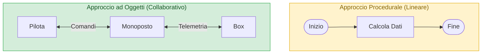
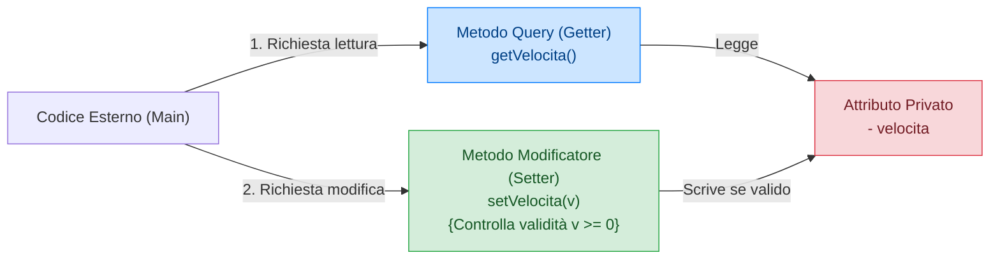

## 1. La Rivoluzione della OOP: Dai Flowchart alle Classi

Nella programmazione procedurale classica (come nel linguaggio C), l'attenzione era focalizzata sull'**algoritmo sequenziale**: passi logici, condizioni e cicli rappresentati graficamente tramite *flowchart*.

Nella **Programmazione Orientata agli Oggetti (OOP)**, la progettazione parte invece dalla risposta a due domande:
1. *Quali entità (oggetti) compongono il mio dominio applicativo?*
2. *Quali caratteristiche possiedono e come interagiscono tra loro?*



- **==Classe==**: è il **modello astratto**, il progetto architettonico o stampo (es. la scheda tecnica di una vettura di Formula 1).
- **==Oggetto (o Istanza)==**: è l'**esemplare reale, tangibile**, generato a partire dalla classe e residente nella memoria Heap (es. la singola monoposto con telaio #16 guidata da Leclerc).

---

## 2. Anatomia di una Classe in UML (Software NClass)

Nei progetti software professionali le classi si progettano visivamente con lo standard universale **==UML (Unified Modeling Language)==**, utilizzando strumenti visuali come **NClass**.

Nel diagramma UML, una classe è rappresentata graficamente come una scatola divisa in **==tre scomparti orizzontali==**:

![[Pasted image 20261020103245.png|277]]

1. **==Scomparto Superiore (Intestazione)==**:  
   Contiene il **Nome della Classe**, scritto obbligatoriamente con la prima lettera maiuscola in notazione **==PascalCase==** (es. `Monoposto`, `ContoCorrente`).
2. **==Scomparto Centrale (Attributi / Campi)==**:  
   Elenca le variabili di istanza che definiscono lo **stato** dell'oggetto.  
   *Sintassi UML*: `visibilità nomeAttributo : Tipo` (es. `- cavalli : int`).
3. **==Scomparto Inferiore (Metodi / Operazioni)==**:  
   Elenca le funzioni che definiscono il **comportamento** dell'oggetto.  
   *Sintassi UML*: `visibilità nomeMetodo(parametro : Tipo) : TipoRitorno` (es. `+ accelera(delta : int) : int`).

---

## 3. I 4 Modificatori di Accesso (Visibilità)

In Java e nei diagrammi UML, ogni attributo e metodo è preceduto da un simbolo che stabilisce chi ha il permesso di leggerlo o invocarlo:

| Simbolo UML | Modificatore Java   | Livello di Visibilità      | Spiegazione Dettagliata                                                                                                                                |
| :---------: | :------------------ | :------------------------- | :----------------------------------------------------------------------------------------------------------------------------------------------------- |
| **==`-`==** | **==`private`==**   | **Solo la Classe stessa**  | I membri privati sono invisibili a chiunque all'esterno della classe (pilastro dell'Incapsulamento).                                                   |
| **==`+`==** | **==`public`==**    | **Tutto il Mondo**         | Accessibili liberamente da qualsiasi altra classe di qualsiasi package dell'applicazione.                                                              |
| **==`#`==** | **==`protected`==** | **Package + Sottoclassi**  | Accessibili dalle classi nello stesso package e da tutte le classi figlie che ereditano, ovunque siano.                                                |
|             | ==*(Default)*==     | **Solo lo Stesso Package** | Detto **==Package-Private==**. Se non scrivi alcun modificatore, il membro è visibile solo alle classi situate nella stessa identica cartella/package. |


---

## 4. Incapsulamento: Metodi Query (Getter) e Modificatori (Setter)

L'**==Incapsulamento (*Information Hiding*)==** è la regola cardine della OOP:
$$\text{==Gli attributi devono essere SEMPRE privati (-) e mai accessibili direttamente dall'esterno!==}$$

Se un attributo fosse `public`, qualsiasi codice esterno potrebbe impostare dati privi di senso, corrompendo lo stato dell'oggetto (es. `auto.velocita = -300;` oppure `auto.cavalli = 0;`).

Per interagire in sicurezza con gli attributi privati, la classe fornisce metodi pubblici specializzati:



1. **==Metodi Query (o Getter / Ispettori)==**:  
   Hanno lo scopo di **interrogare e leggere** lo stato dell'oggetto restituendo il valore dell'attributo, senza modificarlo:
   ```java
   public int getVelocita() {
       return this.velocita;
   }
   ```
2. **==Metodi Modificatori (o Setter)==**:  
   Hanno lo scopo di **aggiornare** il valore dell'attributo, ==applicando tassativamente controlli di coerenza e validazione== prima della scrittura:
   ```java
   public void setVelocita(int nuovaVelocita) {
       if (nuovaVelocita >= 0 && nuovaVelocita <= 380) {
           this.velocita = nuovaVelocita;
       } else {
           System.out.println("⚠️ Valore velocità non consentito!");
       }
   }
   ```

---

## 5. Codice Java Completo e Testabile

> [!EXAMPLE]- 🧪 Programma Completo: `Monoposto.java` e `SimulatoreGara.java`
> ```java
> // Definizione della Classe Monoposto
> public class Monoposto {
>     // 1. Attributi privati (Information Hiding)
>     private int cavalli;
>     private float peso;
>     private String colore;
>     private int velocita;
> 
>     // 2. Costruttore
>     public Monoposto(int cavalli, float peso, String colore) {
>         this.cavalli = cavalli;
>         this.peso = peso;
>         this.colore = colore;
>         this.velocita = 0; // Parte da ferma
>     }
> 
>     // 3. Metodi operativi (Comportamenti)
>     public int accelera(int delta) {
>         if (delta > 0) {
>             this.velocita += delta;
>             System.out.println("🏎️ La monoposto accelera a " + this.velocita + " km/h!");
>         }
>         return this.velocita;
>     }
> 
>     public void frena() {
>         this.velocita = Math.max(0, this.velocita - 50);
>         System.out.println("🛑 Frenata! Nuova velocità: " + this.velocita + " km/h.");
>     }
> 
>     // 4. Metodi Query (Getter) e Modificatori (Setter)
>     public int getVelocita() {
>         return this.velocita;
>     }
> 
>     public void setVelocita(int velocita) {
>         if (velocita >= 0 && velocita <= 370) {
>             this.velocita = velocita;
>         } else {
>             System.out.println("❌ Errore: velocità fuori limite regolamentare!");
>         }
>     }
> 
>     public String getColore() {
>         return this.colore;
>     }
> }
> ```
> 
> ```java
> // Classe Main di esecuzione
> public class SimulatoreGara {
>     public static void main(String[] args) {
>         // Istanziazione dell'oggetto nello Heap
>         Monoposto f1 = new Monoposto(1000, 798.0f, "Rosso Corsa");
> 
>         System.out.println("Colore vettura: " + f1.getColore());
>         System.out.println("Velocità di partenza: " + f1.getVelocita() + " km/h");
> 
>         // Simulazione azioni
>         f1.accelera(120);
>         f1.accelera(160);
>         f1.frena();
> 
>         // Test validazione incapsulamento
>         f1.setVelocita(-40); // Rifiutato dal setter!
>     }
> }
> ```
