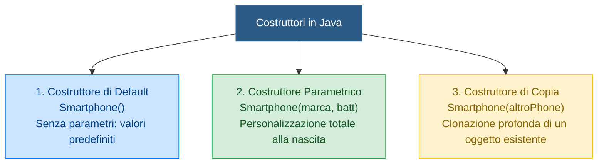
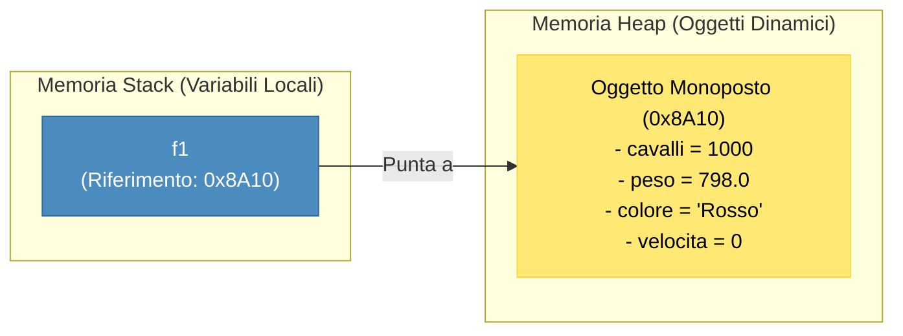

## 1. Cos'è un Costruttore

Il **==Costruttore==** è il componente deputato a far nascere un oggetto in uno stato coerente e garantito.

In Java, il costruttore ha due caratteristiche sintattiche inconfondibili:
1. Ha **==esattamente lo stesso nome della classe==** (rispettando maiuscole e minuscole).
2. **==Non specifica alcun tipo di ritorno==**, nemmeno la parola chiave `void`.

```java
public class Smartphone {
    private String marca;
    private int batteria;

    // Costruttore della classe Smartphone
    public Smartphone(String marca, int batteria) {
        this.marca = marca;
        this.batteria = batteria;
    }
}
```

---

## 2. Le Tre Tipologie di Costruttori



### 1. Costruttore di Default (senza parametri)
Inizializza gli attributi con valori neutri o predefiniti di fabbrica.

```java
public Monoposto() {
    this.cavalli = 800;
    this.peso = 798.0f;
    this.colore = "Nero Test";
    this.velocita = 0;
}
```

> [!WARNING] ⚠️ La Regola del Costruttore di Default Automatico
> Java ti regala un costruttore vuoto invisibile **solo finché non ne scrivi nessuno**.  
> **Non appena scrivi un qualsiasi costruttore parametrico, il costruttore vuoto gratuito scompare all'istante!**
> 
> ```java
> // ❌ CODICE CHE GENERA ERRORE (Il costruttore vuoto è scomparso)
> class Monoposto {
>     int cavalli;
>     // Abbiamo scritto SOLO il costruttore parametrico:
>     public Monoposto(int cavalli) { 
>         this.cavalli = cavalli; 
>     }
> }
> 
> // Nel Main:
> Monoposto m1 = new Monoposto(900); // ✅ OK (usa il costruttore parametrico)
> Monoposto m2 = new Monoposto();    // ❌ ERRORE DI COMPILAZIONE!
>                                    // "The constructor Monoposto() is undefined"
> ```
> 
> #### ✅ Come si fa a supportare ENTRAMBI?
> Per poter creare sia oggetti predefiniti (`new Monoposto()`) sia oggetti personalizzati (`new Monoposto(1000, "Rosso")`), devi semplicemente **scrivere ENTRAMBI i costruttori dentro la stessa classe**:
> 
> ```java
> class Monoposto {
>     int cavalli;
>     String colore;
> 
>     // 1. Costruttore di DEFAULT (scritto esplicitamente da noi!)
>     public Monoposto() {
>         this.cavalli = 800;
>         this.colore = "Nero Standard";
>     }
> 
>     // 2. Costruttore PARAMETRICO (per valori personalizzati)
>     public Monoposto(int cavalli, String colore) {
>         this.cavalli = cavalli;
>         this.colore = colore;
>     }
> }
> 
> // Nel Main ora funzionano ENTRAMBI in totale armonia:
> Monoposto base  = new Monoposto();               // ✅ Chiama il Costruttore 1 (senza parametri)
> Monoposto corsa = new Monoposto(1000, "Rosso");  // ✅ Chiama il Costruttore 2 (con parametri)
> ```

### 2. Costruttore Parametrico
Permette a chi istanzia l'oggetto di ==specificare i valori desiderati per i campi== al momento della nascita:

```java
public Monoposto(int cavalli, float peso, String colore) {
    this.cavalli = cavalli;
    this.peso = peso;
    this.colore = colore;
    this.velocita = 0;
}
```

### 3. Costruttore di Copia (*Copy Constructor*)
Se scriviamo `Monoposto b = a;`, **non stiamo duplicando la vettura**: abbiamo solo creato due puntatori nello Stack che guardano la stessa identica macchina nello Heap (==effetto aliasing==). Modificando `b`, cambierà anche `a`!

Per creare una **==vera copia indipendente==** usiamo il costruttore di copia:
```java
public Monoposto(Monoposto sorgente) {
    // Clona tutti i valori dell'oggetto sorgente nel nuovo oggetto
    this.cavalli = sorgente.cavalli;
    this.peso = sorgente.peso;
    this.colore = sorgente.colore;
    this.velocita = sorgente.velocita;
}
```

---

## 3. La Parola Chiave `this`

La parola chiave **==`this`==** è un riferimento implicito all'**istanza corrente** su cui è stato invocato il codice. Ha due utilizzi capitali:

### A. Disambiguazione di Nomi (Shadowing)
Quando il nome del parametro formale del costruttore è identico al nome dell'attributo della classe, l'attributo viene "nascosto" (*shadowed*). Per indicare al compilatore l'attributo usiamo ==`this.`==:
```java
public void setPeso(float peso) {
    this.peso = peso; // this.peso = attributo istanza; peso = argomento del metodo
}
```

### B. Chiamata a Cascata tra Costruttori (`this(...)`)
Per evitare di duplicare codice nei vari costruttori sovraccaricati, un costruttore può chiamare un altro costruttore della medesima classe:
```java
public class Monoposto {
    private int cavalli;
    private float peso;
    private String colore;

    // Costruttore parametrico completo
    public Monoposto(int cavalli, float peso, String colore) {
        this.cavalli = cavalli;
        this.peso = peso;
        this.colore = colore;
    }

    // Costruttore di default che riutilizza quello sopra (DEVE essere la prima riga!)
    public Monoposto() {
        this(850, 798.0f, "Bianco Standard"); // ==Invocazione del costruttore parametrico==
    }
}
```

---

## 4. Ciclo di Vita in Memoria RAM: Cosa fa la keyword `new`?

Quando scriviamo `Monoposto f1 = new Monoposto(1000, 798f, "Rosso");`, la JVM esegue 4 passaggi sequenziali:



1. **==Allocazione==**: riserva un blocco contiguo di byte nello Heap sufficiente a contenere tutti gli attributi della classe.
2. **==Inizializzazione di Default==**: azzera tutti i bit dei campi (numeri a $0$, booleani a `false`, riferimenti a `null`).
3. **==Esecuzione Costruttore==**: esegue le istruzioni del corpo del costruttore passato con i parametri specificati.
4. **==Assegnazione Riferimento==**: l'indirizzo esadecimale dell'oggetto allocato nello Heap viene memorizzato nella variabile `f1` nello Stack.

---

## 5. Placeholder per NClass e Istruzioni Pratiche

> [!TIP] 🖼️ **Placeholder Immagine: Costruttori e Overload su NClass**
> - **File da inserire nel vault**: `![[java_uml_costruttori_nclass.png|550]]`
> - **Cosa ricercare su Google / Web**:  
>   *"NClass multiple constructors overloading diagram"*, *"UML constructor notation class diagram"*.
> - **Come disegnarlo passo-passo su NClass**:
>   1. Nella classe creata su NClass, fai clic destro $\rightarrow$ **Add Constructor**.
>   2. Crea il primo costruttore (Default): nessun parametro, Modifier: `Public (+)`.
>   3. Fai nuovamente clic destro $\rightarrow$ **Add Constructor** per il secondo (Parametrico):
>      - Arguments: `int cavalli, float peso, string colore`.
>   4. Aggiungi il terzo costruttore (Di Copia):
>      - Arguments: `Monoposto sorgente`.
>   5. NClass mostrerà i tre costruttori raggruppati all'inizio della sezione metodi, evidenziando il meccanismo di **Overload dei costruttori**.

---

## 6. Domande d'Esame e Concetti Chiave

> [!QUESTION] ❓ Domande di Verifica
> 1. *Cosa accade se si antepone `void` alla firma di un costruttore (es. `public void Monoposto()`)?*  
>    **Risposta**: Il compilatore non lo considera più un costruttore, bensì un ==comune metodo della classe==. Di conseguenza, all'atto del `new Monoposto()` quel metodo non verrà invocato e Java cercherà un costruttore reale, sollevando un errore se assente.
> 2. *Perché l'istruzione `Monoposto b = a;` non crea una vera copia dell'oggetto?*  
>    **Risposta**: Perché le variabili di tipo classe in Java contengono solo riferimenti (indirizzi di memoria). Assegnare una variabile all'altra copia solo l'indirizzo, facendo sì che entrambe puntino allo ==stesso unico oggetto nello Heap==.
> 3. *Dove deve trovarsi la chiamata `this(...)` all'interno di un costruttore sovraccaricato?*  
>    **Risposta**: Deve trovarsi tassativamente come ==prima riga di codice== del corpo del costruttore; se collocata in posizione successiva, il compilatore rifiuta il codice.

---

## 7. Codice Java Completo e Testabile

> [!EXAMPLE]- 🧪 Programma Completo: Dimostrazione dei 3 Costruttori e Verifica Anti-Aliasing
> ```java
> public class TestCostruttori {
>     public static void main(String[] args) {
>         System.out.println("=== 1. TEST COSTRUTTORE PARAMETRICO ===");
>         Monoposto auto1 = new Monoposto(950, 795.0f, "Verde Aston");
>         auto1.accelera(150);
>         System.out.println("Auto 1: " + auto1.getColore() + " | Vel: " + auto1.getVelocita());
> 
>         System.out.println("\n=== 2. TEST COSTRUTTORE DI DEFAULT ===");
>         Monoposto autoDefault = new Monoposto();
>         System.out.println("Auto Default: " + autoDefault.getColore() + " | Vel: " + autoDefault.getVelocita());
> 
>         System.out.println("\n=== 3. TRAPPOLA DELL'ALIASING VS COSTRUTTORE DI COPIA ===");
>         // Aliasing errato (copia solo il riferimento)
>         Monoposto aliasAuto1 = auto1;
>         aliasAuto1.setVelocita(280);
>         System.out.println("Auto 1 originale dopo modifica di alias: " + auto1.getVelocita() + " km/h (ALTERATA!)");
> 
>         // Vera clonazione con Costruttore di Copia
>         Monoposto copiaReale = new Monoposto(auto1);
>         copiaReale.setVelocita(320);
>         System.out.println("Auto 1 originale dopo copia reale     : " + auto1.getVelocita() + " km/h (PROTETTA!)");
>         System.out.println("Copia reale indipendente              : " + copiaReale.getVelocita() + " km/h");
>     }
> }
> ```
