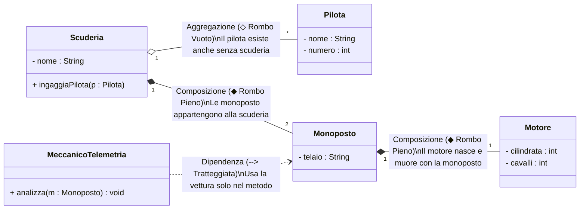

## 1. La Mappa delle Relazioni in UML

Nel linguaggio visivo UML, le relazioni tra classi definiscono l'accoppiamento e la gerarchia del sistema:



---

## 2. Analisi Dettagliata delle Relazioni

### 1. Dipendenza (*Dependency* - relazione ==\"uses-a\"==)
È la relazione più debole e temporanea. La classe A **utilizza temporaneamente** la classe B all'interno di un suo metodo, ma non la conserva come attributo permanente.
- **Tipologia d'uso**: B viene passata come ==parametro formale di un metodo==, oppure viene istanziata come variabile locale provvisoria.
- **Simbolo UML**: ==freccia tratteggiata aperta (`- - - ->`)==.

```java
// Il meccanico "dipende" da Monoposto solo durante la diagnosi
public class Meccanico {
    public void effettuaTagliando(Monoposto m) { // Ricevuta come parametro
        System.out.println("Revisione della monoposto completata.");
    }
}
```

![[Pasted image 20261020110236.png|700]]

---

### 2. Associazione (*Association* - relazione ==\"knows-a\"==)
È una relazione strutturale stabile. La classe A memorizza un riferimento permanente a un oggetto di classe B all'interno dei suoi attributi.
- **Molteplicità (Cardinalità)**: indica quanti oggetti partecipano al legame:
  - `1`: esattamente uno.
  - `0..1`: zero oppure uno (opzionale).
  - `*` o `0..*`: zero, uno o molti (gestiti tramite array o `ArrayList`).
  - `1..*`: da uno a molti.

```java
public class Pilota {
    private String nome;
    private Monoposto vetturaAssegnata; // Associazione: il pilota "conosce" la sua vettura
}
```

![[Pasted image 20261020110443.png|693]]

---

### 3. Aggregazione (*Aggregation* - relazione ==\"has-a\" debole==)
L'Aggregazione è una forma specializzata di associazione che esprime un rapporto **tutto-parti**: il contenitore possiede uno o più elementi, ma **il loro ciclo di vita è indipendente**.
- **Regola di Sopravvivenza**: se l'oggetto contenitore viene deallocato o distrutto, gli oggetti contenuti ==NON vengono distrutti==, ma continuano a esistere autonomamente nella memoria Heap.
- **Simbolo UML**: ==**rombo vuoto (bianco)** `◇`== posizionato dal lato del contenitore.

```java
public class Scuderia {
    private String nome;
    private Pilota primoPilota; // Aggregazione

    // Il pilota viene creato FUORI e passato alla scuderia
    public Scuderia(String nome, Pilota p) {
        this.nome = nome;
        this.primoPilota = p;
    }
    // Se la Scuderia fallisce e viene cancellata, 
    // l'oggetto Pilota continua a esistere e può passare ad un'altra squadra!
}
```

![[Pasted image 20261020110518.png|700]]

---

### 4. Composizione (*Composition* - relazione ==\"has-a\" forte==)
La Composizione è la forma più forte e vincolante di associazione tutto-parti.
- **Ciclo di Vita Coincidente**: l'oggetto componente nasce con il contenitore e **se il contenitore muore, ==il componente viene distrutto all'istante==**. Non ha senso che il componente esista da solo.
- **Simbolo UML**: ==**rombo pieno (nero)** `◆`== posizionato dal lato del contenitore.

```java
public class Monoposto {
    private String modello;
    private Motore motoreInterno; // Composizione: ciclo di vita legato

    public Monoposto(String modello, int cilindrata) {
        this.modello = modello;
        // L'oggetto Motore viene istanziato DIRETTAMENTE all'interno della Monoposto!
        this.motoreInterno = new Motore(cilindrata);
    }
    // Se la Monoposto viene deallocata, il Motore viene eliminato dal Garbage Collector
}
```

![[Pasted image 20261020110558.png|700]]

---

### 5. Generalizzazione (*Generalization* - relazione ==\"is-a\"==)
Rappresenta l'==**ereditarietà**== tra una superclasse generale e una sottoclasse specifica.
- La sottoclasse "è una" versione specializzata della classe base.
- **Simbolo UML**: linea continua con ==**freccia a triangolo vuoto** `—▷`== che punta verso la classe genitore.
- *Esempio*: la classe `Monoposto` è una generalizzazione di `VeicoloDaCorsa`.

![[Pasted image 20261020110640.png|700]]

---

## 3. Codice Java Completo e Testabile

> [!EXAMPLE]- 🧪 Programma Completo: Modello di Simulazione Formula 1 con tutte le Relazioni
> ```java
> // 1. Componente esclusivo per la Composizione
> class Motore {
>     private int cavalli;
>     public Motore(int cavalli) { this.cavalli = cavalli; }
>     public int getCavalli() { return cavalli; }
> }
> 
> // 2. Entità indipendente per l'Aggregazione
> class Pilota {
>     private String nome;
>     private int numero;
>     public Pilota(String nome, int numero) {
>         this.nome = nome;
>         this.numero = numero;
>     }
>     public String getNome() { return nome; }
> }
> 
> // 3. Classe Monoposto: COMPOSIZIONE con Motore
> class Monoposto {
>     private String modello;
>     private Motore motore; // Composizione: possesso forte
> 
>     public Monoposto(String modello, int cavalli) {
>         this.modello = modello;
>         this.motore = new Motore(cavalli); // Nasce con la monoposto
>     }
>     public String getInfo() {
>         return modello + " (Motore V6 Turbo " + motore.getCavalli() + " CV)";
>     }
> }
> 
> // 4. Classe Scuderia: AGGREGAZIONE con Pilota
> class Scuderia {
>     private String nome;
>     private Pilota pilotaUfficiale; // Aggregazione: possesso debole
> 
>     public Scuderia(String nome, Pilota p) {
>         this.nome = nome;
>         this.pilotaUfficiale = p; // Il pilota viene agganciato dall'esterno
>     }
>     public void mostraSchieramento() {
>         System.out.println("Scuderia " + nome + " schiera il pilota: " + pilotaUfficiale.getNome());
>     }
> }
> 
> // 5. Classe Ingegnere: DIPENDENZA con Monoposto
> class IngegnerePista {
>     // Dipendenza: riceve la monoposto solo come parametro provvisorio
>     public void controllaTelemetria(Monoposto m) {
>         System.out.println("📊 Telemetria analizzata per: " + m.getInfo());
>     }
> }
> 
> public class MainRelazioni {
>     public static void main(String[] args) {
>         // Creiamo il pilota autonomamente
>         Pilota charles = new Pilota("Charles Leclerc", 16);
> 
>         // Aggregazione: la scuderia aggrega il pilota
>         Scuderia ferrari = new Scuderia("Scuderia Ferrari", charles);
>         ferrari.mostraSchieramento();
> 
>         // Composizione: la vettura crea internamente il suo motore
>         Monoposto sf24 = new Monoposto("Ferrari SF-24", 1020);
> 
>         // Dipendenza: l'ingegnere esegue il check-up
>         IngegnerePista ing = new IngegnerePista();
>         ing.controllaTelemetria(sf24);
>     }
> }
> ```
