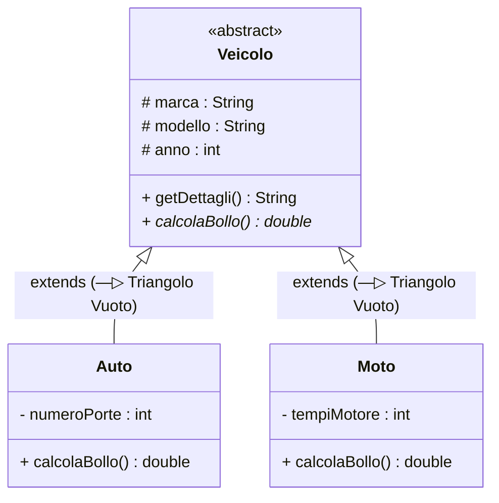

## 1. Il Meccanismo dell'Ereditarietà (`extends`)

L'**==Ereditarietà==** è il principio della OOP che modella la relazione gerarchica ==**"is-a"** ("è un")==.  
Consente a una nuova classe (**sottoclasse** o classe figlia) di acquisire attributi e metodi da una classe preesistente (**superclasse** o classe genitore), specializzandone il comportamento ed evitando duplicazioni di codice.



In Java:
```java
// Classe genitore (Superclasse)
public class Veicolo {
    protected String marca;
    protected String modello;
}

// Classe figlia (Sottoclasse) che eredita tramite extends
public class Auto extends Veicolo {
    private int numeroPorte; // Attributo specifico di Auto
}
```

> [!IMPORTANT] ⚠️ Divieto di Ereditarietà Multipla di Classi
> In C++ una classe può ereditare contemporaneamente da due o tre classi, creando complessi problemi di ambiguità (il celebre *Diamond Problem*).  
> **Java ==vieta l'ereditarietà multipla tra classi==**: ogni classe può avere una sola superclasse diretta (`extends` accetta un solo nome). Per ereditare comportamenti multipli, Java adotta le **Interfacce**.

---

## 2. Il Costruttore Figlio e la Chiamata a `super()`

Quando nasce un oggetto di una sottoclasse, la porzione ereditata della classe genitore deve essere inizializzata per prima. A questo scopo si usa **==`super(...)`==**:

```java
public class Veicolo {
    protected String marca;
    protected String modello;

    public Veicolo(String marca, String modello) {
        this.marca = marca;
        this.modello = modello;
    }
}

public class Auto extends Veicolo {
    private int porte;

    public Auto(String marca, String modello, int porte) {
        super(marca, modello); // ==Invoca il costruttore di Veicolo (TASSATIVAMENTE in prima riga!)==
        this.porte = porte;
    }
}
```

---

## 3. Il Modificatore di Accesso `protected`

Se un attributo della superclasse è dichiarato `private`, la sottoclasse non potrà accedervi direttamente (potrà farlo solo tramite getter pubblici).

Dichiarando l'attributo **==`protected`==**, permettiamo alle classi figlie di accedervi direttamente senza esporlo al mondo esterno:

```java
public class Veicolo {
    protected int velocitaMassima; // Accessibile da Veicolo e da tutte le sottoclassi come Auto e Moto
}
```

---

## 4. Classi e Metodi Astratti (`abstract`)

In una gerarchia di veicoli ha senso istanziare un'automobile o una motocicletta, ma che senso avrebbe istanziare un "Veicolo" generico? Nessuno, perché è un'idea astratta!

### A. Classe Astratta (`abstract class`)
È una classe contrassegnata dalla parola chiave **==`abstract`==**.
- Definisce caratteristiche e logiche comuni a tutta la gerarchia.
- **NON può essere istanziata direttamente**: l'istruzione ==`new Veicolo()` genererà un errore di compilazione==!
- Può contenere sia metodi normali con codice, sia metodi astratti.

### B. Metodo Astratto (`abstract method`)
È un metodo che possiede solo la **firma**, ma **==non ha alcun corpo==** (non ha le graffe `{}` e termina con `;`):
```java
public abstract double calcolaBollo(); // Obbliga i figli a implementarlo!
```
Ogni sottoclasse concreta che estende la classe astratta ha l'**==obbligo contrattuale di implementare il metodo astratto==** (facendone l'overriding), altrimenti non potrà essere compilata.

---

## 5. La Parola Chiave `final`

La keyword **==`final`==** rappresenta l'opposto di `abstract`:
1. **Variabile `final`**: diventa una ==costante non riassegnabile== (`final double PI = 3.14159;`).
2. **Metodo `final`**: ==impedisce alle sottoclassi di sovrascrivere== quel metodo (blocca l'overriding).
3. **Classe `final`**: classe terminale che ==non può essere estesa== da nessun'altra sottoclasse (ad esempio, la classe standard `String` è `final` per motivi di integrità e sicurezza).

---

## 6. Placeholder per NClass e Istruzioni Pratiche

> [!TIP] 🖼️ **Placeholder Immagine: Gerarchia e Notazione Astratta su NClass**
> - **File da inserire nel vault**: `![[java_uml_nclass_classi_astratte.png|550]]`
> - **Cosa ricercare su Google / Web**:  
>   *"NClass abstract class method italic representation"*, *"UML generalization inheritance hierarchy diagram NClass"*.
> - **Come disegnarlo passo-passo su NClass**:
>   1. Su **NClass**, crea una classe e nominala `Veicolo`.
>   2. Seleziona la classe e nella finestra laterale **Properties** imposta:  
>      ==`IsAbstract = True`==.  
>      *Nota visiva*: NClass scriverà immediatamente il titolo della classe in **==CORSIVO (*Italic*)==**!
>   3. Aggiungi il metodo `calcolaBollo`: nelle sue proprietà imposta ==`IsAbstract = True`==. Il nome del metodo apparirà in corsivo.
>   4. Crea due classi concrete normali: `Auto` e `Moto`.
>   5. Seleziona lo strumento **Generalization** (freccia con triangolo vuoto `—▷`) e trascina la freccia da `Auto` a `Veicolo` e da `Moto` a `Veicolo`.
>   6. Esporta l'immagine nel vault con il nome `java_uml_nclass_classi_astratte.png`.

---

## 7. Domande d'Esame e Concetti Chiave

> [!QUESTION] ❓ Domande di Verifica
> 1. *Cosa accade se una sottoclasse concreta non implementa uno dei metodi astratti ereditati dalla superclasse?*  
>    **Risposta**: Il compilatore rifiuta il codice generando un errore, a meno che la sottoclasse stessa non venga a sua volta dichiarata ==`abstract`==.
> 2. *Come viene rappresentata una classe astratta in un diagramma UML disegnato con NClass?*  
>    **Risposta**: Il nome della classe viene renderizzato graficamente con font in stile **==corsivo (*Italic*)==** e/o con il tag descrittivo `<<abstract>>`.
> 3. *È possibile che una classe astratta contenga un costruttore se non può essere istanziata direttamente?*  
>    **Risposta**: Sì, le classi astratte possono e devono avere costruttori per inizializzare i propri campi protetti, i quali verranno invocati dalle sottoclassi figlie tramite l'istruzione ==`super(...)`==.

---

## 8. Codice Java Completo e Testabile

> [!EXAMPLE]- 🧪 Programma Completo: Gerarchia Veicoli con Calcolo Tasse
> ```java
> // Superclasse Astratta
> abstract class Veicolo {
>     protected String targa;
>     protected int cavalliFiscali;
> 
>     public Veicolo(String targa, int cavalliFiscali) {
>         this.targa = targa;
>         this.cavalliFiscali = cavalliFiscali;
>     }
> 
>     // Metodo concreto ereditato da tutti
>     public void mostraDatiBase() {
>         System.out.println("Targa: " + targa + " | Potenza: " + cavalliFiscali + " CV");
>     }
> 
>     // METODO ASTRATTO (Ciascun tipo di veicolo calcola la tassa con regole proprie)
>     public abstract double calcolaBollo();
> }
> 
> // Sottoclasse Concreta Auto
> class Auto extends Veicolo {
>     private boolean elettrica;
> 
>     public Auto(String targa, int cavalliFiscali, boolean elettrica) {
>         super(targa, cavalliFiscali);
>         this.elettrica = elettrica;
>     }
> 
>     @Override
>     public double calcolaBollo() {
>         if (elettrica) {
>             return 0.0; // Esente da bollo
>         }
>         return cavalliFiscali * 2.58;
>     }
> }
> 
> // Sottoclasse Concreta Moto
> class Moto extends Veicolo {
>     public Moto(String targa, int cavalliFiscali) {
>         super(targa, cavalliFiscali);
>     }
> 
>     @Override
>     public double calcolaBollo() {
>         return 25.0 + (cavalliFiscali * 1.20);
>     }
> }
> 
> public class MainEreditarietà {
>     public static void main(String[] args) {
>         // Veicolo v = new Veicolo("AA000AA", 100); <-- ERRORE! Classe astratta non istanziabile
> 
>         Auto auto1 = new Auto("AB123CD", 110, false);
>         Auto autoTesla = new Auto("EV999ZZ", 300, true);
>         Moto moto1 = new Moto("MI45678", 75);
> 
>         auto1.mostraDatiBase();
>         System.out.printf("Bollo Auto Termica: €%.2f%n", auto1.calcolaBollo());
> 
>         autoTesla.mostraDatiBase();
>         System.out.printf("Bollo Auto Elettrica: €%.2f%n", autoTesla.calcolaBollo());
> 
>         moto1.mostraDatiBase();
>         System.out.printf("Bollo Moto: €%.2f%n", moto1.calcolaBollo());
>     }
> }
> ```
