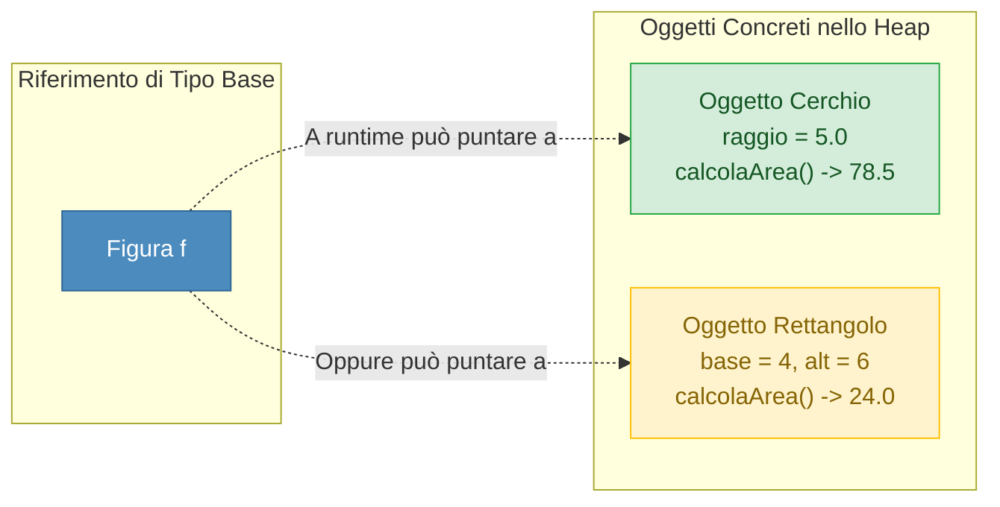
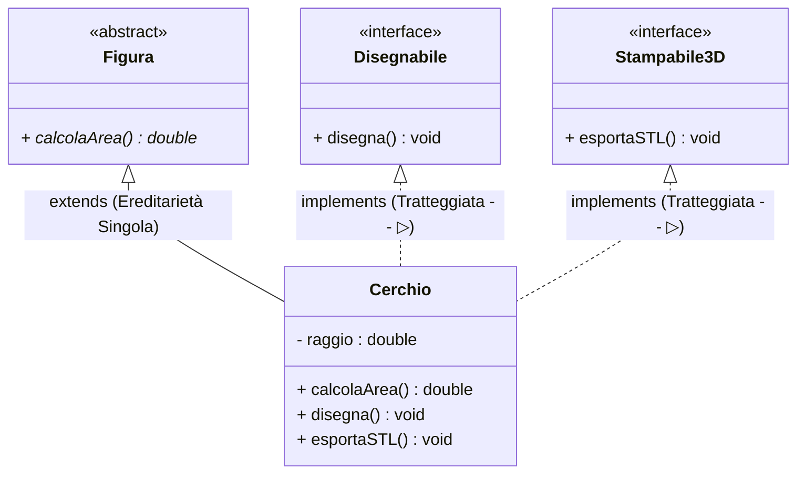

## 1. Cos'è il Polimorfismo

Il termine **==Polimorfismo==** (dal greco *poly* = molti, *morphé* = forma) è il ==terzo pilastro fondamentale== della programmazione ad oggetti, dopo Incapsulamento ed Ereditarietà.

Indica la ==capacità di un'entità software di assumere forme e comportamenti differenti== a seconda dell'oggetto a cui si riferisce a tempo di esecuzione.

Si divide in due macro-categorie:
1. **==Polimorfismo per i Dati==** (Riferimento Polimorfico e Collezioni Eterogenee).
2. **==Polimorfismo per i Metodi==** (Overloading a compile-time vs Overriding a runtime).

---

## 2. Polimorfismo per i Dati: Il Riferimento Polimorfico

Grazie all'ereditarietà, una ==variabile di riferimento di tipo della classe genitore può puntare a qualsiasi oggetto istanziato da una sua sottoclasse==:

```java
// Il tipo statico è Figura, ma l'oggetto dinamico nello Heap è un Cerchio!
Figura f1 = new Cerchio(5.0);
Figura f2 = new Rettangolo(4.0, 6.0);
```



### La Potenza delle Collezioni Eterogenee
Possiamo ==memorizzare elementi di classi diverse in un unico array o collezione== e farli interagire senza dover sapere a priori di che oggetto specifico si tratti:

```java
Figura[] forme = {
    new Cerchio(3.0),
    new Rettangolo(2.0, 5.0),
    new Cerchio(10.0)
};

// Polimorfismo in azione: ciascun oggetto calcolerà la propria area con la formula corretta!
for (Figura fig : forme) {
    System.out.println("Area calcolata: " + fig.calcolaArea());
}
```

### Operatore `instanceof` e Downcasting
Per verificare a runtime se un riferimento punta a una specifica sottoclasse ed effettuare un ==downcasting sicuro==:
```java
if (f1 instanceof Cerchio) {
    Cerchio c = (Cerchio) f1; // Downcasting esplicito sicuro
    System.out.println("Raggio del cerchio: " + c.getRaggio());
}
```

---

## 3. Polimorfismo per i Metodi: Overloading vs Overriding

| Caratteristica | Overloading (Sovraccarico) | Overriding (Sovrascrittura) |
| :--- | :--- | :--- |
| **Dove si applica?** | Nella **==stessa classe==** | Tra **==Superclasse e Sottoclasse==** |
| **Nome del metodo** | Identico | Identico |
| **Lista Parametri** | **==DIVERSA==** (per numero o tipo di dati) | **==IDENTICA==** per numero e tipi |
| **Tipo di Ritorno** | Può essere diverso | Deve essere identico (o covariante) |
| **Momento di Risoluzione**| **==Compile-Time==** (Static / Early Binding) | **==Runtime==** (Dynamic / Late Binding) |
| **Annotazione** | Nessuna | **==`@Override`==** |

### Late Binding (Dynamic Dispatch)
Quando invochi `fig.calcolaArea()`, il compilatore non sa quale formula verrà eseguita.  
A runtime, la JVM consulta la ==tabella virtuale dei metodi (**VMT - Virtual Method Table**)== dell'oggetto effettivo presente nello Heap e invoca la versione sovrascritta corretta.

---

## 4. Le Interfacce (`interface`)

Se una classe astratta modella *"cosa una classe È"*, un'**Interfaccia** modella ==*"cosa una classe SA FARE"*== (un'abilità o un ==contratto comportamentale puro==).

Caratteristiche fondamentali:
- Si dichiara con la parola chiave ==`interface`==.
- Tutti i metodi sono implicitamente ==`public abstract`== (firme pure senza corpo).
- Non possiede variabili di istanza, solo costanti ==`public static final`==.
- **==Ereditarietà Multipla Permessa==**: una classe può implementare ==un numero illimitato di interfacce== tramite la parola chiave ==`implements`==!



```java
public interface Disegnabile {
    void disegna(); // Metodo astratto
}

public interface Stampabile3D {
    void esportaSTL();
}

// Una sola superclasse estesa, ma MOLTEPLICI interfacce implementate!
public class Cerchio extends Figura implements Disegnabile, Stampabile3D {
    private double raggio;

    public Cerchio(double raggio) { this.raggio = raggio; }

    @Override
    public double calcolaArea() {
        return Math.PI * raggio * raggio;
    }

    @Override
    public void disegna() {
        System.out.println("Disegno un cerchio di raggio " + raggio);
    }

    @Override
    public void esportaSTL() {
        System.out.println("Esportazione mesh 3D del cilindro completata.");
    }
}
```

---

## 5. Tabella Comparativa: Classe Astratta vs Interfaccia

| Criterio | Classe Astratta (`abstract class`) | Interfaccia (`interface`) |
| :--- | :--- | :--- |
| **Relazione concettuale** | Relazione di appartenenza: ==**"is-a"** (È un)== | Relazione di abilità: ==**"can-do"** (Sa fare)== |
| **Ereditarietà** | **==Singola==**: solo 1 superclasse (`extends`) | **==Multipla==**: $N$ interfacce (`implements`) |
| **Attributi** | Può avere attributi di istanza (`private`, `protected`) | ==Solo costanti pubbliche statiche== (`public static final`) |
| **Costruttori** | **==Sì==**, per inizializzare i campi ereditati | **==No==**, non può avere alcun costruttore |
| **Scopo Primario** | Condivisione di stato e codice comune | Garanzia di un protocollo o contratto di comunicazione |

---

## 6. Placeholder per NClass e Istruzioni Pratiche

> [!TIP] 🖼️ **Placeholder Immagine: Interfacce e Realizzazione su NClass**
> - **File da inserire nel vault**: `![[java_uml_nclass_interfacce_polimorfismo.png|600]]`
> - **Cosa ricercare su Google / Web**:  
>   *"NClass UML interface realization dashed triangle arrow"*, *"Polymorphism UML class diagram interface implementation"*.
> - **Come disegnarlo passo-passo su NClass**:
>   1. Su **NClass**, seleziona lo strumento **==Interface==** nella barra superiore e posizionalo sul foglio.
>   2. Nominalo `Disegnabile` e aggiungi il metodo `disegna(): void`. NClass apporrà automaticamente lo stereotipo ==`<<interface>>`==.
>   3. Crea la classe concreta `Cerchio`.
>   4. Seleziona lo strumento **==Realization==** (noto anche come *Implementation*: ==freccia tratteggiata con triangolo vuoto `- - - ▷`==).
>   5. Trascina la freccia da `Cerchio` fino a `Disegnabile`.
>   6. Esporta il diagramma e inseriscilo nel vault come `java_uml_nclass_interfacce_polimorfismo.png`.

---

## 7. Domande d'Esame e Concetti Chiave

> [!QUESTION] ❓ Domande di Verifica
> 1. *Qual è la differenza fondamentale tra Overloading e Overriding in Java?*  
>    **Risposta**: L'==Overloading== si realizza nella ==stessa classe== e consiste in metodi con lo stesso nome ma ==parametri diversi== risolti a ==compile-time==. L'==Overriding== consiste nella riscrittura di un metodo della superclasse da parte della sottoclasse con la ==stessa identica firma==, risolta a ==runtime tramite Late Binding==.
> 2. *Perché è considerata ottima prassi inserire l'annotazione `@Override` prima di un metodo sovrascritto?*  
>    **Risposta**: Perché istruisce il ==compilatore a verificare che il metodo stia effettivamente sovrascrivendo== una funzione della superclasse. Se si commette un errore di battitura, il compilatore genera un ==errore immediato anziché creare silenziosamente un overload involontario==.
> 3. *Perché Java non permette l'ereditarietà multipla tra classi ma la permette per le interfacce?*  
>    **Risposta**: L'ereditarietà multipla di classi genera ambiguità nel caso due genitori abbiano attributi o implementazioni con lo stesso nome (==*Diamond Problem*==). Nelle interfacce non ci sono attributi di stato né conflitti di implementazione, quindi una classe può garantire ==più contratti comportamentali in assoluta sicurezza==.

---

## 8. Codice Java Completo e Testabile

> [!EXAMPLE]- 🧪 Programma Completo: Sistema Grafico Polimorfico con Interfacce
> ```java
> // 1. Interfaccia Comportamentale
> interface Disegnabile {
>     void disegna();
> }
> 
> // 2. Superclasse Astratta
> abstract class FiguraGeometria {
>     protected String colore;
>     public FiguraGeometria(String colore) { this.colore = colore; }
>     public abstract double calcolaArea();
> }
> 
> // 3. Sottoclasse Concreta Rettangolo
> class Rettangolo extends FiguraGeometria implements Disegnabile {
>     private double base;
>     private double altezza;
> 
>     public Rettangolo(String colore, double base, double altezza) {
>         super(colore);
>         this.base = base;
>         this.altezza = altezza;
>     }
> 
>     @Override
>     public double calcolaArea() { return base * altezza; }
> 
>     @Override
>     public void disegna() {
>         System.out.printf("🟦 Disegno Rettangolo %s [%.1fx%.1f]%n", colore, base, altezza);
>     }
> }
> 
> // 4. Sottoclasse Concreta Cerchio
> class Cerchio extends FiguraGeometria implements Disegnabile {
>     private double raggio;
> 
>     public Cerchio(String colore, double raggio) {
>         super(colore);
>         this.raggio = raggio;
>     }
> 
>     @Override
>     public double calcolaArea() { return Math.PI * raggio * raggio; }
> 
>     @Override
>     public void disegna() {
>         System.out.printf("🔴 Disegno Cerchio %s [Raggio=%.1f]%n", colore, raggio);
>     }
> }
> 
> public class MainPolimorfismo {
>     public static void main(String[] args) {
>         // Array Polimorfico di tipo Interfaccia Disegnabile
>         Disegnabile[] scena = {
>             new Rettangolo("Blu", 10.0, 5.0),
>             new Cerchio("Rosso", 4.0),
>             new Rettangolo("Giallo", 3.0, 3.0)
>         };
> 
>         System.out.println("=== RENDERING GRAFICO POLIMORFICO ===");
>         for (Disegnabile elemento : scena) {
>             // Chiamata polimorfica a runtime (Late Binding!)
>             elemento.disegna();
> 
>             // Se è anche una FiguraGeometria, ne calcoliamo l'area
>             if (elemento instanceof FiguraGeometria) {
>                 FiguraGeometria fg = (FiguraGeometria) elemento;
>                 System.out.printf("   -> Area calcolata: %.2f mq%n", fg.calcolaArea());
>             }
>         }
>     }
> }
> ```
