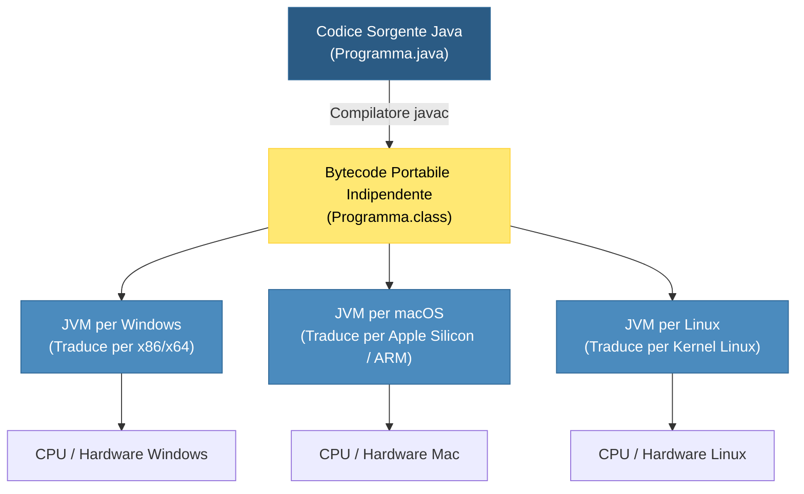
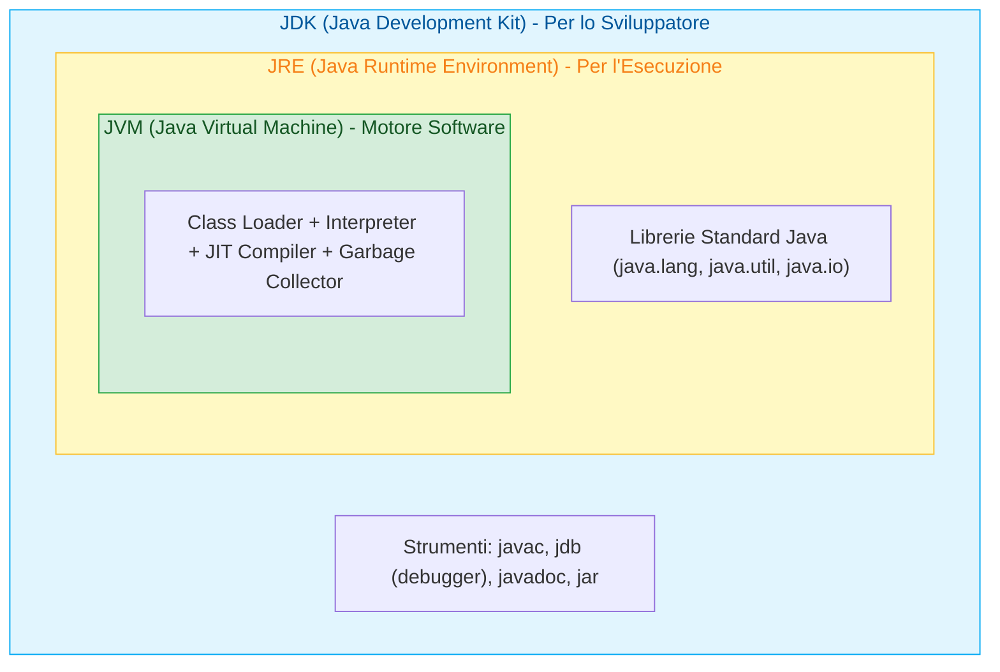
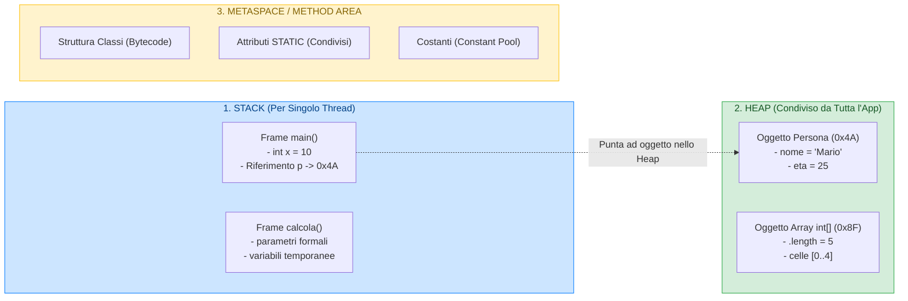
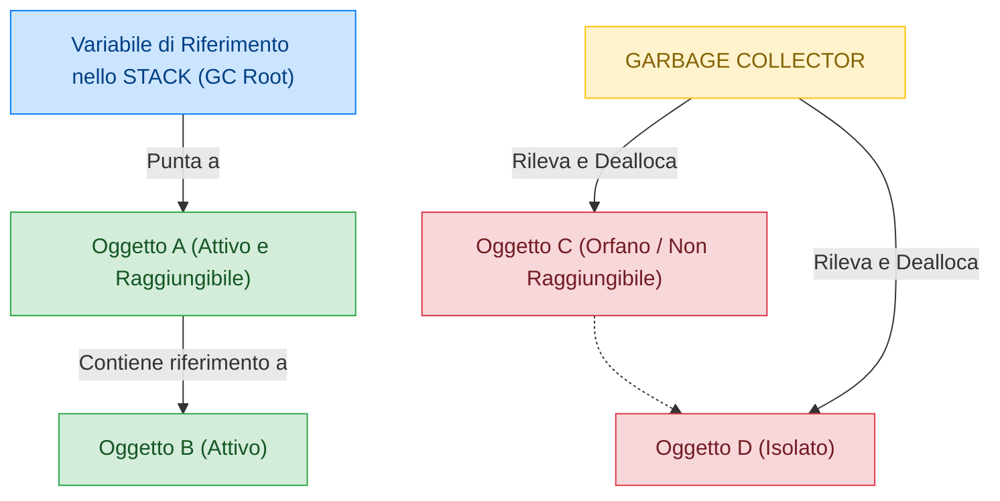

## 1. Origine e Filosofia di Java

Java nasce nei primi anni '90 nei laboratori di **Sun Microsystems** (successivamente acquisita da Oracle Corporation) per opera di un gruppo di ingegneri guidato da **James Gosling**.

Inizialmente battezzato con il nome di *Oak* (quercia), il linguaggio venne rinominato **Java** nel 1995 durante una sessione di lavoro davanti a una tazza di caffè proveniente dall'isola di Giava (da cui derivano il celebre logo della tazza fumante e il termine *"Java Bean"*).

![[Pasted image 20261020094228.png|342]]

A differenza del C++ (progettato per dare il massimo controllo sull'hardware a discapito della portabilità), Java nasceva con l'obiettivo rivoluzionario di superare la frammentazione dei sistemi operativi e delle architetture CPU:

$$\text{\ Write Once, Run Anywhere\ (WORA)}\quad\longrightarrow\quad\text{Scrivi una volta, esegui ovunque}$$

Oggi Java è ampiamente open-source attraverso il progetto standard **==OpenJDK==**, che costituisce la base di tutte le distribuzioni moderne certificate.

---

## 2. Il Modello di Esecuzione Ibrido: Compilatore e Bytecode

Una delle domande più frequenti all'orale è: *Java è un linguaggio compilato o interpretato?*  
La risposta corretta è: **è un ==sistema ibrido a due stadi==**.

1. **Fase 1: Compilazione Statica (`javac`)**:  
   Il file sorgente leggibile dall'uomo (`.java`) viene processato dal compilatore statico `javac`. Il risultato non è un eseguibile binario legato a uno specifico processore (come i file `.exe` generati dal compilatore C++), bensì un file binario intermedio universale chiamato **==Bytecode==** (con estensione `.class`).
2. **Fase 2: Esecuzione Virtuale (JVM)**:  
   Il bytecode viene eseguito dalla **==Java Virtual Machine (JVM)==** installata sul sistema host, che lo interpreta ed esegue traducendolo nelle istruzioni native della CPU locale.

---

## 3. L'Ecosistema Java: JDK, JRE e JVM a Confronto

Spesso queste tre sigle vengono confuse. Possono essere visualizzate concettualmente come **tre scatole concentriche**:

![[Pasted image 20261020093904.png]]

| Componente | Nome Esteso | Cosa Contiene? | A Chi Serve? |
| :--- | :--- | :--- | :--- |
| **==JVM==** | *Java Virtual Machine* | Il motore software che carica i file `.class`, verifica il bytecode, alloca la memoria ed esegue le istruzioni. | È il cuore operativo presente su ogni dispositivo. |
| **==JRE==** | *Java Runtime Environment* | La **JVM** + tutte le **librerie standard precompilate** (Java Class Library: math, collezioni, I/O, networking). | Serve all'utente finale per poter ==eseguire programmi Java== già compilati. |
| **==JDK==** | *Java Development Kit* | Il **JRE** completo + tutti gli **strumenti per il programmatore**: compilatore `javac`, archiviatore `jar`, debugger `jdb`, generatore di documentazione `javadoc`. | Serve allo sviluppatore per ==scrivere, compilare e collaudare== nuovo codice Java. |

---

## 4. Il Modello di Memoria a Runtime della JVM (Memory Layout)

Quando un programma Java viene avviato, la JVM organizza la memoria RAM allocata dal sistema operativo in diverse aree specializzate:

1. **==Call Stack (Memoria Stack)==**:
   - Organizzata a pila (LIFO - Last In, First Out).
   - È velocissima ed effimera: ogni volta che viene invocato un metodo, viene creato un nuovo **Stack Frame** contenente i parametri formali e le variabili locali del metodo.
   - Quando il metodo termina (`return`), il frame viene distrutto all'istante e la memoria liberata.
   - Nello Stack risiedono direttamente i **valori dei tipi primitivi** (`int`, `double`, `boolean`) e i **puntatori di riferimento** (indirizzi esadecimali) agli oggetti.
2. **==Heap (Memoria Heap)==**:
   - Spazio dinamico globale condiviso da tutti i thread.
   - Qui nascono **tutti gli oggetti** istanziati tramite la parola chiave `new`, così come tutti gli **array**.
   - Gli elementi rimangono nello Heap finché risultano necessari, indipendentemente dalla funzione che li ha creati.
3. **==Metaspace (ex Method Area / PermGen)==**:
   - Area di memoria nativa introdotta da Java 8 che memorizza la struttura delle classi caricate dal ClassLoader, i metodi compilati, il pool delle costanti e tutte le **variabili contrassegnate con la parola chiave ==`static`==**.

---

## 5. Il Garbage Collector (GC) e il Ciclo di Vita della Memoria

Nel linguaggio C e C++, il programmatore deve deallocare manualmente la memoria dinamica usando `free()` o `delete`. Una svista provoca disastrosi **Memory Leaks** (RAM occupata ma non più usata) o puntatori penzolanti (**Dangling Pointers**).

In Java, la gestione della memoria è **completamente automatica**:

1. **Algoritmo di Raggiungibilità (*Root Tracing*)**:
   - Il GC parte da radici sicure nello Stack chiamate **GC Roots** (variabili locali attive, parametri correnti, riferimenti statici).
   - Segue a catena tutti i collegamenti agli oggetti nello Heap.
2. **Individuazione degli Oggetti Orfani**:
   - Qualsiasi oggetto nello Heap che non è più raggiungibile da alcuna catena di puntatori partente dalle GC Roots viene considerato "orfano" o "morto".
3. **Spazzamento e Compattazione (*Mark-Sweep-Compact*)**:
   - Il Garbage Collector agisce in background a bassa priorità: individua gli oggetti orfani, ne dealloca la memoria e compatta lo Heap per evitare frammentazione.

---

## 6. Il Compilatore JIT (Just-In-Time)

I linguaggi puramente interpretati sono storicamente lenti perché traducono ogni istruzione a runtime una alla volta. Per garantire prestazioni vicine al codice compilato nativo (C++), le JVM moderne integrano il compilatore ==**JIT (Just-In-Time)**==:

- **Fase iniziale**: la JVM avvia l'applicazione interpretando il bytecode istruzione per istruzione per garantire tempi di avvio rapidi.
- **Profilazione**: durante l'esecuzione, un modulo analizzatore rileva i blocchi di codice eseguiti con frequenza elevata (i cosiddetti **Hotspots**, ad esempio cicli ad alta intensità di calcolo o metodi richiamati milioni di volte).
- **Compilazione Nativa**: il compilatore JIT compila questi hotspots traducendoli al volo direttamente in **codice macchina CPU nativo**, conservandolo nella cache di memoria. Alle esecuzioni successive, quel blocco gira alla velocità del codice nativo puro!

---

## 7. Tabella Comparativa Definitiva: Java vs C++ vs Python

| Criterio | C++ | Java | Python |
| :--- | :--- | :--- | :--- |
| **Paradigma** | Multi-paradigma a basso/alto livello | ==OOP rigoroso== (ogni riga risiede in una classe) | Multi-paradigma ad altissimo livello |
| **Compilazione** | Diretta in binario macchina nativo (`.exe`) | ==Ibrida==: Bytecode (`.class`) su ==JVM== con JIT | Bytecode interpretato da PVM (CPython) |
| **Portabilità** | Bassa (va ricompilato su misura per ogni OS/CPU) | ==Massima (WORA)==: lo stesso file `.class` gira ovunque | Alta (richiede interprete Python installato) |
| **Tipizzazione** | Statica e forte | ==Statica e forte== (controlli ferrei a compile-time) | Dinamica e forte |
| **Gestione Memoria** | Manuale col rischio di leak (`new` / `delete`) | ==Automatica con Garbage Collector== | Automatica con Reference Counting e GC |
| **Puntatori** | Puntatori espliciti con aritmetica (`*`, `&`, `->`) | ==Riferimenti gestiti== (nessuna aritmetica puntatori) | Riferimenti trasparenti a oggetti |
