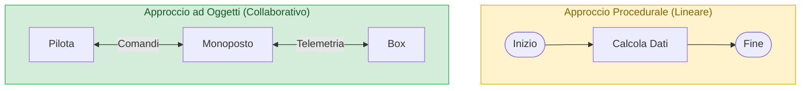
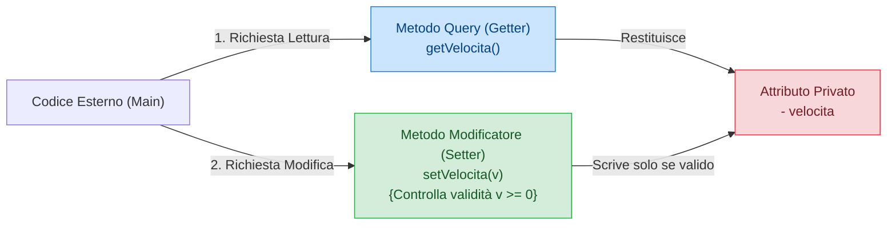

## 1. La Transizione Mentale: Da Procedurale a Orientato agli Oggetti

Nella programmazione procedurale (come nel linguaggio C), il software è modellato attorno agli **algoritmi sequenziali**: istruzioni riga per riga, selezioni condizionali e cicli rappresentati visivamente tramite *flowchart*. I dati (le variabili) sono entità passive manipolate dalle funzioni.

Nella **Programmazione Orientata agli Oggetti (OOP)**, la progettazione parte invece dalla risposta a due domande cardine:
1. *Quali entità reali (oggetti) popolano il problema da risolvere?*
2. *Quali caratteristiche (stato) possiedono e quali azioni (comportamento) sanno compiere per collaborare tra loro?*



- ==**Classe**==: è il **modello concettuale astratto**, il disegno architettonico o stampo (es. la scheda di omologazione FIA di una vettura di Formula 1).
- ==**Oggetto (o Istanza)**==: è l'**esemplare reale, fisico e tangibile**, creato a partire dalla classe e allocato nello Heap (es. la singola monoposto con telaio #16 guidata da Leclerc).

---

## 2. Anatomia di una Classe in UML (Software NClass)

Nel software engineering standardizzato, le classi si progettano graficamente usando il linguaggio universale **==UML (Unified Modeling Language)==** tramite strumenti dedicati come **NClass**.

Nel diagramma delle classi, ogni classe viene rappresentata come un rettangolo suddiviso orizzontalmente in **==tre comparti distinti==**:

![[Pasted image 20261020103245.png|277]]

1. **==Scomparto Superiore (Intestazione)==**:  
   Contiene il **Nome della Classe**, scritto obbligatoriamente con la prima lettera maiuscola in notazione ==**PascalCase**== (es. `Monoposto`, `ContoCorrente`, `StudenteUniversitario`).
2. **==Scomparto Centrale (Attributi / Campi di Istanza)==**:  
   Elenca le variabili che definiscono lo **stato interno** dell'oggetto.  
   *Sintassi UML*: `visibilità nomeAttributo : Tipo` (es. `- cavalli : int`, `- colore : String`).
3. **==Scomparto Inferiore (Metodi / Operazioni)==**:  
   Elenca le funzioni che definiscono il **comportamento** dell'oggetto e i servizi che mette a disposizione.  
   *Sintassi UML*: `visibilità nomeMetodo(parametro : Tipo) : TipoRitorno` (es. `+ accelera(delta : int) : int`, `+ getVelocita() : int`).

---

## 3. I 4 Modificatori di Accesso (Visibilità)

In Java e nei diagrammi UML, ogni attributo e ogni metodo è preceduto da un indicatore di visibilità che stabilisce chi ha il permesso di leggerlo o invocarlo:

| Simbolo UML | Modificatore Java | Livello di Visibilità | Spiegazione Teorica per l'Orale |
| :---: | :--- | :--- | :--- |
| ==**`-`**== | ==**`private`**== | **Solo la Classe stessa** | I membri privati sono invisibili a chiunque si trovi all'esterno del file della classe. È il fondamento dell'Incapsulamento. |
| ==**`+`**== | ==**`public`**== | **Tutto il Mondo** | Accessibili liberamente da qualsiasi altra classe di qualsiasi package dell'applicazione. |
| ==**`#`**== | ==**`protected`**== | **Package + Sottoclassi** | Accessibili dalle classi collocate nello stesso package e da tutte le classi figlie che estendono la classe (`extends`), ovunque si trovino. |
| ==**`~`**== | ==*(Default)*== | **Solo lo Stesso Package** | Detto ==**Package-Private**==. Se non scrivi nessun modificatore, il membro è visibile solo alle classi situate nella stessa cartella/package. |

### Matrice di Visibilità Completa
Spesso i docenti chiedono a sorpresa se un membro senza modificatore sia visibile da una sottoclasse in un altro package:

| Modificatore | Stessa Classe | Stesso Package | Sottoclasse (Altro Package) | Altro Package Generico |
| :--- | :---: | :---: | :---: | :---: |
| `public` | ✅ | ✅ | ✅ | ✅ |
| `protected` | ✅ | ✅ | ✅ | ❌ |
| *(default / package-private)* | ✅ | ✅ | ❌ | ❌ |
| `private` | ✅ | ❌ | ❌ | ❌ |

---

## 4. Il Principio dell'Incapsulamento (*Information Hiding*)

L'==**Incapsulamento**== è il primo e più importante pilastro della programmazione ad oggetti:

==🔴Gli attributi di un oggetto devono essere SEMPRE privati (-) e MAI accessibili direttamente dall'esterno!==

### Perché rendere gli attributi pubblici è gravissimo?
Se l'attributo `velocita` o `cavalli` fosse `public`, qualsiasi classe esterna (come il `main`) potrebbe scrivere:
```java
auto.velocita = -500; // Valore fisicamente assurdo!
auto.cavalli = 0;
```
L'oggetto finirebbe in uno **stato illegale e corrotto**, violando le regole del dominio.

### La Soluzione: Metodi Getter e Setter
Per consentire al mondo esterno di interagire con gli attributi protetti, la classe espone metodi pubblici di controllo:



1. ==**Metodi Query (o Getter / Ispettori)**==:  
   Consentono di **leggere** il valore dell'attributo senza alterarlo:
   ```java
   public int getVelocita() {
       return this.velocita;
   }
   ```
2. ==**Metodi Modificatori (o Setter)**==:  
   Consentono di **modificare** il valore dell'attributo, ma ==solo dopo averne validato l'integrità logica== tramite opportune condizioni:
   ```java
   public void setVelocita(int nuovaVelocita) {
       if (nuovaVelocita >= 0 && nuovaVelocita <= 380) {
           this.velocita = nuovaVelocita; // Assegnazione sicura
       } else {
           System.out.println("⚠️ Valore non valido: operazione respinta!");
       }
   }
   ```

---

## 5. Esempio Guida: Modellazione della Classe `Monoposto`

Ecco come la specifica UML si traduce nella classe Java rigorosamente incapsulata:

```java
public class Monoposto {
    // 1. STATO: Attributi privati (Information Hiding)
    private int cavalli;
    private float peso;
    private String colore;
    private int velocita;

    // 2. COSTRUTTORE (Inizializza lo stato coerente iniziale)
    public Monoposto(int cavalli, float peso, String colore) {
        this.cavalli = cavalli;
        this.peso = peso;
        this.colore = colore;
        this.velocita = 0; // Nasce da ferma
    }

    // 3. COMPORTAMENTO: Metodi operativi di business logic
    public int accelera(int delta) {
        if (delta > 0) {
            this.velocita += delta;
        }
        return this.velocita;
    }

    public void frena() {
        this.velocita = Math.max(0, this.velocita - 50);
    }

    // 4. METODI GETTER E SETTER
    public int getVelocita() { return this.velocita; }
    public String getColore() { return this.colore; }
    
    public void setVelocita(int v) {
        if (v >= 0 && v <= 380) {
            this.velocita = v;
        }
    }
}
```