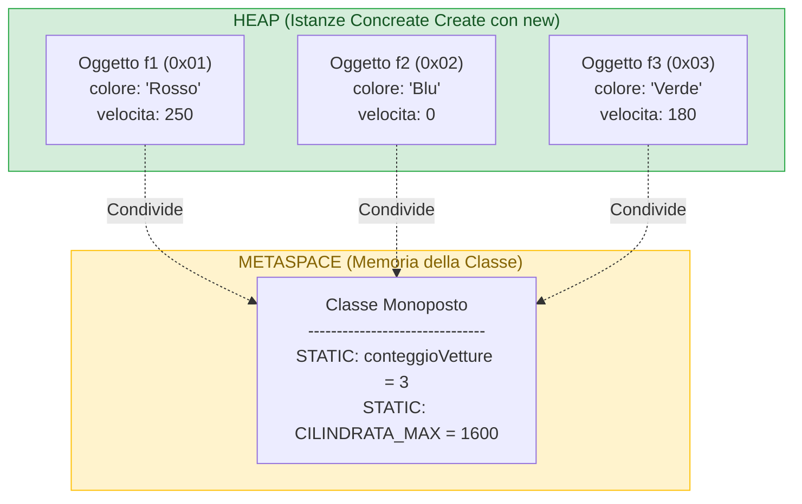

## 1. Cos'è la Parola Chiave `static`?

Normalmente, ogni volta che creiamo un oggetto tramite `new`, Java assegna a quell'oggetto una copia personale e indipendente di tutti gli attributi definiti nella classe. Questi attributi prendono il nome di **Membri di Istanza**.

Aggiungendo la parola chiave ==**`static`**==, diciamo al compilatore che quel membro **non appartiene ai singoli oggetti, ma appartiene all'intera Classe nel suo complesso**.



---

## 2. Attributi Statici (Variabili di Classe)

Un attributo dichiarato `static` **non risiede all'interno degli oggetti nello Heap**, bensì nell'area di memoria nativa della classe (**Metaspace**):
- Viene allocato ed inizializzato **una sola volta**, al momento del primo caricamento della classe da parte della JVM.
- Tutte le istanze condividono la medesima variabile: se l'oggetto `f1` la incrementa, l'oggetto `f2` leggerà il valore aggiornato.

### Esempio Pratico: Il Contatore di Istanze
Il caso d'uso più classico di una variabile statica è tenere traccia di quante istanze di una classe sono nate:

```java
public class Monoposto {
    // 1. Attributo statico (Variabile di Classe) - UNA SOLA COPIA GLOBALE
    private static int conteggioTotale = 0;

    // 2. Attributo di istanza - COPIA PRIVATA PER OGNI OGGETTO
    private String colore;

    public Monoposto(String colore) {
        this.colore = colore;
        Monoposto.conteggioTotale++; // Incrementa il contatore condiviso ad ogni new!
    }

    public static int getConteggioTotale() {
        return Monoposto.conteggioTotale;
    }
}
```

Nel `main`:
```java
System.out.println("Auto prima della gara: " + Monoposto.getConteggioTotale()); // Stampa 0

Monoposto m1 = new Monoposto("Rosso");
Monoposto m2 = new Monoposto("Nero");

System.out.println("Auto create: " + Monoposto.getConteggioTotale()); // Stampa 2!
```

---

## 3. Metodi Statici (Metodi di Classe)

Un metodo contrassegnato con `static` **può essere eseguito direttamente invocando il nome della classe**, senza dover creare alcun oggetto con `new`:

$$\text{Sintassi: }\quad\text{==NomeClasse.nomeMetodo(argomenti);==}$$

### Classi di Utilità (*Utility Classes*)
Nella libreria standard di Java, molte classi non contengono dati di istanza ma raggruppano unicamente metodi statici pronti all'uso:
- **`Math`**: `Math.sqrt(25)`, `Math.pow(2, 8)`, `Math.abs(-10)`, `Math.max(a, b)`.
- **`Arrays`**: `Arrays.sort(voti)`, `Arrays.toString(dati)`.
- **Wrapper**: `Integer.parseInt("42")`, `Double.parseDouble("3.14")`.

Non avrebbe alcun senso scrivere `Math m = new Math(); m.sqrt(25);`: la funzione radice quadrata è un'operazione matematica pura che dipende solo dal parametro in ingresso!

---

## 4. Le Tre Regole Invalicabili di `static` (Domande Tipiche da Orale)

> [!DANGER] 🚫 Regola 1: Nei contesti statici NON esiste `this`!
> Il puntatore implicito **`this`** rappresenta l'indirizzo dell'oggetto corrente nello Heap. Poiché un metodo statico appartiene alla classe e può girare **senza che esista alcun oggetto**, `this` non ha alcun significato e il suo utilizzo genera un errore di compilazione.

> [!DANGER] 🚫 Regola 2: Un metodo statico NON può accedere direttamente a campi o metodi non-statici!
> Se provi a leggere un attributo di istanza normale dentro un metodo statico, il compilatore si blocca con il celebre errore:  
> `Cannot make a static reference to the non-static field ...`  
> **Spiegazione logica per l'orale**: se ci sono 100 monoposto nello Heap, ciascuna con la propria velocità, e il metodo statico prova a leggere `velocita`, *di quale delle 100 macchine dovrebbe leggere il valore?* Nessuna, perché il metodo statico non sa quale oggetto stai considerando!

> [!NOTE] ✅ Regola 3: I metodi di istanza possono accedere liberamente a tutto!
> Un normale metodo di istanza (senza `static`) può accedere sia ai campi dell'oggetto corrente tramite `this`, sia a qualsiasi variabile o metodo statico della classe.

### Dimostrazione Visiva nel Codice
```java
public class Veicolo {
    private static int limiteVelocita = 130; // Statico
    private int velocitaAttuale = 100;       // Di istanza

    // METODO STATICO
    public static void metodoStatico() {
        System.out.println(limiteVelocita);   // ✅ OK: static accede a static!
        // System.out.println(velocitaAttuale); // ❌ ERRORE DI COMPILAZIONE! Di chi è la velocità?
        // System.out.println(this);           // ❌ ERRORE DI COMPILAZIONE! this non esiste!
    }

    // METODO DI ISTANZA
    public void metodoDiIstanza() {
        System.out.println(this.velocitaAttuale); // ✅ OK: legge la propria velocità
        System.out.println(Veicolo.limiteVelocita); // ✅ OK: legge anche il dato statico condiviso
    }
}
```

---

## 5. Anatomia Dettagliata di `public static void main(String[] args)`

Ora che conosciamo il significato di `static`, possiamo finalmente comprendere fino in fondo la firma del metodo principale, punto fisso delle domande di teoria:

```java
public static void main(String[] args)
```

1. **`public`**: il metodo deve essere accessibile dalla JVM dall'esterno dell'applicazione, superando qualsiasi restrizione di package.
2. **`static`**: **perché è obbligatorio?**  
   All'avvio del programma, nello Heap **non esiste ancora nessun oggetto**! Se il metodo `main` fosse di istanza, la JVM si troverebbe nel paradosso dell'uovo e della gallina: dovrebbe istanziare un oggetto per chiamare il `main`, ma per istanziare l'oggetto servirebbe eseguire il codice che risiede proprio nel `main`. Dichiarandolo `static`, la JVM può invocarlo direttamente tramite `NomeClasse.main(...)`.
3. **`void`**: a differenza del C/C++ (in cui il `main` restituisce un codice di errore intero al sistema operativo con `return 0`), in Java il `main` non restituisce alcun valore. Se serve terminare con un codice di errore, si usa `System.exit(codice)`.
4. **`main`**: nome convenzionale riconosciuto dal motore di bootstrap della JVM come punto di ingresso (*entry point*).
5. **`String[] args`**: array di stringhe che raccoglie eventuali argomenti passati da riga di comando all'atto del lancio (es. `java Programma file.txt 8080`).

---

## 6. Costanti di Classe: Il Trinomio `public static final`

Quando una proprietà deve essere accessibile a tutti, condivisa e immutabile (non modificabile dopo l'inizializzazione), si combinano le tre parole chiave:

```java
public class CostantiFisiche {
    public static final double PI_GRECO = 3.141592653589793;
    public static final double ACCELERAZIONE_GRAVITA = 9.81;
    public static final int CAPIENZA_MAX_STADIO = 50000;
}
```

- **`public`**: leggibile liberamente da chiunque.
- **`static`**: esiste in un'unica copia di classe (nessun consumo inutile di memoria per ogni istanza).
- **`final`**: è una **costante**: se qualcuno prova a riassegnare `CostantiFisiche.PI_GRECO = 3.0;`, il compilatore blocca l'esecuzione.
- *Convenzione di stile*: i nomi delle costanti `static final` si scrivono rigorosamente in lettere ==**TUTTE MAIUSCOLE**== separate da underscore (**SCREAMING_SNAKE_CASE**).

---

## 7. Blocco di Inizializzazione Statico (`static { ... }`)

Se un attributo statico richiede un'inizializzazione complessa (ad esempio caricare dati da un file di configurazione o calcolare una tabella di lookup trigonometrica), si utilizza il **blocco statico**:

```java
public class DatabaseConfig {
    public static final String INDIRIZZO_SERVER;
    public static final int PORTA;

    // Viene eseguito UNA SOLA VOLTA quando la JVM carica la classe in memoria
    static {
        INDIRIZZO_SERVER = "192.168.1.100";
        PORTA = 3306;
        System.out.println("Configurazione Database caricata con successo.");
    }
}
```

---

## 8. Tabella Comparativa: Membri di Istanza vs Membri Statici

| Caratteristica | Membro di Istanza (Normale) | Membro Statico (`static`) |
| :--- | :--- | :--- |
| **A chi appartiene?** | Al singolo **Oggetto** istanziato | Alla **Classe** in generale |
| **Dove risiede in RAM?** | Nello ==**Heap**== (dentro l'oggetto) | Nel ==**Metaspace**== (area classi) |
| **Quante copie esistono?** | Tante quanti sono gli oggetti creati (`new`) | **Una sola copia** per tutta la JVM |
| **Come si accede?** | Tramite la variabile di riferimento: `auto.accelera()` | Tramite il nome della classe: `Math.sqrt()` |
| **Possiede `this`?** | **Sì**, `this` punta all'istanza corrente | **NO**, `this` è inesistente e vietato |
| **Può accedere a campi di istanza?**| **Sì**, liberamente | **NO**, divieto assoluto senza creare un oggetto |

---

## 9. Domande Tipiche d'Esame / Interrogazione

> [!QUESTION] ❓ Domande di Verifica Orale
> 1. *Cosa succede in memoria RAM quando un attributo viene dichiarato `static`?*  
>    **Risposta**: La variabile non viene duplicata all'interno di ciascun oggetto nello Heap, ma viene allocata in un'unica copia globale condivisa nell'area di memoria della classe (il **Metaspace**).
> 2. *Perché all'interno di un metodo statico non è possibile utilizzare la parola chiave `this`?*  
>    **Risposta**: Perché la keyword `this` rappresenta il puntatore all'oggetto corrente su cui è stato invocato il metodo. Poiché i metodi statici appartengono alla classe e possono essere eseguiti anche se nessun oggetto è mai stato istanziato, `this` non avrebbe alcun oggetto a cui fare riferimento.
> 3. *Cosa significa l'errore "Cannot make a static reference to the non-static field" e come si risolve?*  
>    **Risposta**: Si verifica quando un metodo statico tenta di leggere o modificare direttamente un attributo di istanza normale. Si risolve rendendo statico anche l'attributo (se il dato deve essere effettivamente condiviso), oppure istanziando un oggetto specifico all'interno del metodo per accedere al suo campo.
> 4. *Perché il metodo `main` in Java deve obbligatoriamente essere dichiarato `static`?*  
>    **Risposta**: Perché la JVM deve essere in grado di invocare il punto d'ingresso del programma all'avvio prima che sia stato creato qualsiasi oggetto in memoria Heap.
