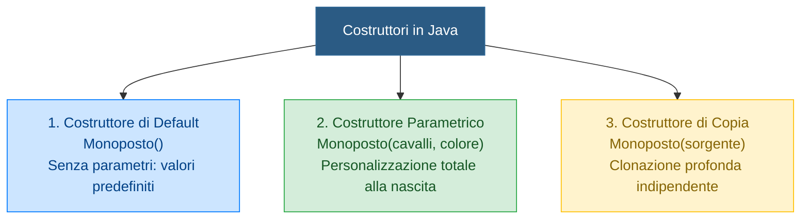

## 1. Cos'è un Costruttore

Il ==**Costruttore**== è il componente fondamentale deputato a far nascere un oggetto in uno stato iniziale coerente, valido e garantito.

In Java, un costruttore ha due regole sintattiche inconfondibili:
1. Ha ==**esattamente lo stesso nome della classe**== (rispettando maiuscole e minuscole).
2. ==**Non specifica alcun tipo di ritorno**==, nemmeno la parola chiave `void`.

```java
public class Smartphone {
    private String marca;
    private int batteria;

    // Costruttore della classe Smartphone
    public Smartphone(String marca, int batteria) {
        this.marca = marca;
        this.batteria = batteria;
    }
}
```

> [!WARNING] ⚠️ La Trappola del `void`
> Se anteponi `void` alla firma (es. `public void Smartphone()`), il compilatore non ti segnalerà un errore di sintassi, ma **non lo considererà più un costruttore**! Lo tratterà come un banale metodo ordinario, e quando tenterai di fare `new Smartphone()` il programma fallirà in compilazione perché non troverà un vero costruttore.

---

## 2. Le Tre Tipologie di Costruttori



### 1. Costruttore di Default (Senza Parametri)
Inizializza gli attributi con valori neutri o predefiniti di fabbrica:
```java
public Monoposto() {
    this.cavalli = 800;
    this.peso = 798.0f;
    this.colore = "Nero Standard";
    this.velocita = 0;
}
```

---

### 2. Costruttore Parametrico
Permette a chi crea l'oggetto di specificare direttamente i valori desiderati per i campi:
```java
public Monoposto(int cavalli, float peso, String colore) {
    this.cavalli = cavalli;
    this.peso = peso;
    this.colore = colore;
    this.velocita = 0;
}
```

---

### 3. Costruttore di Copia (*Copy Constructor*) e la Trappola dell'Aliasing

Cosa succede se scriviamo:
```java
Monoposto b = a;
```
**Non stiamo affatto duplicando l'automobile!**  
Abbiamo semplicemente creato due variabili nello Stack (`a` e `b`) che contengono lo **stesso identico indirizzo di memoria**, puntando alla stessa macchina nello Heap (**Effetto Aliasing**). Se modifichiamo `b.setVelocita(300)`, cambierà istantaneamente anche la velocità di `a`!

Per creare una **vera copia autonoma e indipendente**, usiamo il **Costruttore di Copia**:
```java
public Monoposto(Monoposto sorgente) {
    // Copia valore per valore dallo stato dell'oggetto sorgente al nuovo oggetto
    this.cavalli = sorgente.cavalli;
    this.peso = sorgente.peso;
    this.colore = sorgente.colore;
    this.velocita = sorgente.velocita;
}
```
Uso:
```java
Monoposto m1 = new Monoposto(1000, 798f, "Rosso");
Monoposto m2 = new Monoposto(m1); // m2 è un'auto gemella totalmente separata in RAM!
```

---

## 3. La Regola del Costruttore di Default Automatico (Perché Scompare?)

Java ti regala un costruttore vuoto invisibile **solo finché non ne scrivi nessuno**.  
**Non appena scrivi un qualsiasi costruttore parametrico, il costruttore vuoto gratuito scompare all'istante!**

```java
// ❌ CODICE CHE GENERA ERRORE (Il costruttore vuoto è scomparso)
class Monoposto {
    int cavalli;
    // Abbiamo scritto SOLO il costruttore parametrico:
    public Monoposto(int cavalli) { 
        this.cavalli = cavalli; 
    }
}

// Nel Main:
Monoposto m1 = new Monoposto(900); // ✅ OK (usa il costruttore parametrico)
Monoposto m2 = new Monoposto();    // ❌ ERRORE DI COMPILAZIONE!
                                   // "The constructor Monoposto() is undefined"
```

### ✅ Come supportare ENTRAMBI (Overloading dei Costruttori)?
Basta scriverli **tutti e due esplicitamente** nella stessa classe:

```java
class Monoposto {
    int cavalli;
    String colore;

    // 1. Costruttore di DEFAULT (scritto esplicitamente da noi!)
    public Monoposto() {
        this.cavalli = 800;
        this.colore = "Nero Standard";
    }

    // 2. Costruttore PARAMETRICO (per valori personalizzati)
    public Monoposto(int cavalli, String colore) {
        this.cavalli = cavalli;
        this.colore = colore;
    }
}

// Nel Main ora funzionano ENTRAMBI in totale armonia:
Monoposto base  = new Monoposto();               // ✅ Chiama il Costruttore 1 (senza parametri)
Monoposto corsa = new Monoposto(1000, "Rosso");  // ✅ Chiama il Costruttore 2 (con parametri)
```

---

## 4. La Parola Chiave `this`

La parola chiave ==**`this`**== è un riferimento speciale che punta all'**oggetto corrente** su cui è in esecuzione il metodo o costruttore. Ha due ruoli fondamentali:

### A. Disambiguazione dei Nomi (*Variable Shadowing*)
Quando il parametro formale del costruttore ha lo stesso nome dell'attributo di classe, l'attributo viene "nascosto". Per indicare che ci riferiamo all'attributo usiamo ==`this.`==:
```java
public void setPeso(float peso) {
    this.peso = peso; // this.peso = attributo dell'oggetto; peso = parametro passato
}
```

### B. Chiamata a Cascata tra Costruttori (`this(...)`)
Per evitare di riscrivere lo stesso codice di inizializzazione nei vari costruttori, un costruttore può richiamarne un altro:
```java
public class Monoposto {
    private int cavalli;
    private float peso;
    private String colore;

    // Costruttore parametrico completo
    public Monoposto(int cavalli, float peso, String colore) {
        this.cavalli = cavalli;
        this.peso = peso;
        this.colore = colore;
    }

    // Costruttore di default che richiama quello sopra
    public Monoposto() {
        this(850, 798.0f, "Bianco Standard"); // ==DEVE ESSERE TASSATIVAMENTE LA PRIMA RIGA==!
    }
}
```