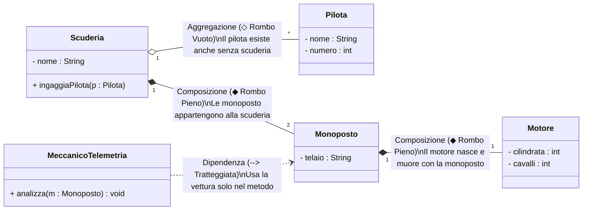

## 1. La Mappa delle Relazioni in UML

In un sistema orientato agli oggetti, le classi non vivono isolate ma collaborano attraverso cinque tipologie standardizzate di legami:



---

## 2. Analisi Dettagliata delle 5 Relazioni

### 1. Dipendenza (*Dependency* - relazione =="uses-a"==)
È la relazione più debole e temporanea: una classe A **ha bisogno provvisoriamente** di una classe B per compiere una specifica operazione, ma non ne memorizza il riferimento a lungo termine.
- **Come si traduce in codice**: l'oggetto B viene passato come ==parametro formale di un metodo==, oppure viene istanziato come variabile locale provvisoria dentro il metodo.
- **Simbolo UML**: ==freccia tratteggiata aperta (`- - - ->`)== da chi dipende verso chi è usato.

```java
public class Meccanico {
    // Dipendenza pura: la Monoposto esiste solo per la durata del tagliando
    public void effettuaTagliando(Monoposto m) { 
        System.out.println("Revisione della monoposto completata.");
    }
}
```

![[Pasted image 20261020110236.png|700]]

---

### 2. Associazione (*Association* - relazione =="knows-a"==)
È una relazione strutturale permanente: la classe A possiede un riferimento continuo alla classe B conservandolo tra i propri campi di istanza.
- **Cardinalità (Molteplicità)**:
  - `1`: associazione a un singolo oggetto obbligatorio.
  - `0..1`: opzionale (può valere `null`).
  - `*` o `0..*`: collezione multipla (gestita tramite array `[]` o `ArrayList`).
- **Simbolo UML**: freccia continua (`—————>`).

```java
public class Pilota {
    private String nome;
    private Monoposto vetturaAssegnata; // Associazione permanente
}
```

![[Pasted image 20261020110443.png|693]]

---

### 3. Aggregazione (*Aggregation* - relazione =="has-a" debole==)
L'Aggregazione modella un rapporto contenitore-contenuto (tutto-parti), ma **con ciclo di vita totalmente indipendente**:
- **Regola di Sopravvivenza per l'Orale**: le parti nascono **fuori** dal contenitore e vengono passate al costruttore. Se il contenitore viene distrutto o deallocato, **le parti continuano ad esistere indisturbate nello Heap**.
- **Simbolo UML**: ==**rombo vuoto (bianco)** `◇`== posizionato dal lato del contenitore.

```java
public class Scuderia {
    private String nome;
    private Pilota pilotaUfficiale; // Aggregazione

    // Il pilota viene creato FUORI e iniettato nella scuderia
    public Scuderia(String nome, Pilota p) {
        this.nome = nome;
        this.pilotaUfficiale = p;
    }
    // Se la Scuderia chiude, l'oggetto Pilota non muore: 
    // può essere ingaggiato da un'altra squadra!
}
```

![[Pasted image 20261020110518.png|700]]

---

### 4. Composizione (*Composition* - relazione =="has-a" forte==)
La Composizione è la forma più vincolante ed esclusiva di relazione tutto-parti:
- **Ciclo di Vita Coincidente**: le parti **nascono con il contenitore** e, **se il contenitore muore, le parti muoiono con lui all'istante**. La parte non ha ragione logica di esistere al di fuori del suo contenitore.
- **Come si traduce in codice**: il componente viene istanziato con `new` direttamente **all'interno** del costruttore del contenitore.
- **Simbolo UML**: ==**rombo pieno (nero)** `◆`== posizionato dal lato del contenitore.

```java
public class Monoposto {
    private String modello;
    private Motore motoreInterno; // Composizione

    public Monoposto(String modello, int cilindrata) {
        this.modello = modello;
        // Il Motore viene creato DENTRO la Monoposto: vive e muore con essa!
        this.motoreInterno = new Motore(cilindrata);
    }
}
```

![[Pasted image 20261020110558.png|700]]

---

### 5. Generalizzazione (*Generalization* - relazione =="is-a"==)
Modella l'==**Ereditarietà**==: la sottoclasse "è una" specializzazione della superclasse.
- **Traduzione in Java**: parola chiave ==`extends`==.
- **Simbolo UML**: linea continua con ==**freccia a triangolo vuoto** `—▷`== che punta sempre verso la classe genitore.

![[Pasted image 20261020110640.png|700]]

---

## 3. Tabella Riassuntiva per NClass e l'Esame Orale

| Relazione | Nome Italiano | Simbolo Grafico NClass | Vincolo di Vita | Traduzione in Codice Java |
| :--- | :--- | :---: | :--- | :--- |
| **Dependency** | Dipendenza | ==`- - - - >`== | Temporaneo | Parametro di un metodo o variabile locale. |
| **Association** | Associazione | ==`—————>`== | Permanente | Attributo di istanza (`private B obj;`). |
| **Aggregation** | Aggregazione | ==`◇—————` *(Rombo Vuoto)*== | **Indipendente** | Passato al costruttore dall'esterno (`this.p = p;`). |
| **Composition** | Composizione | ==`◆—————` *(Rombo Pieno)*== | **Coincidente** | Creato con `new` dentro al costruttore (`this.m = new Motore();`). |
| **Generalization** | Ereditarietà | ==`—————▷` *(Triangolo Vuoto)*==| Gerarchico | Parola chiave ==`extends`==. |
