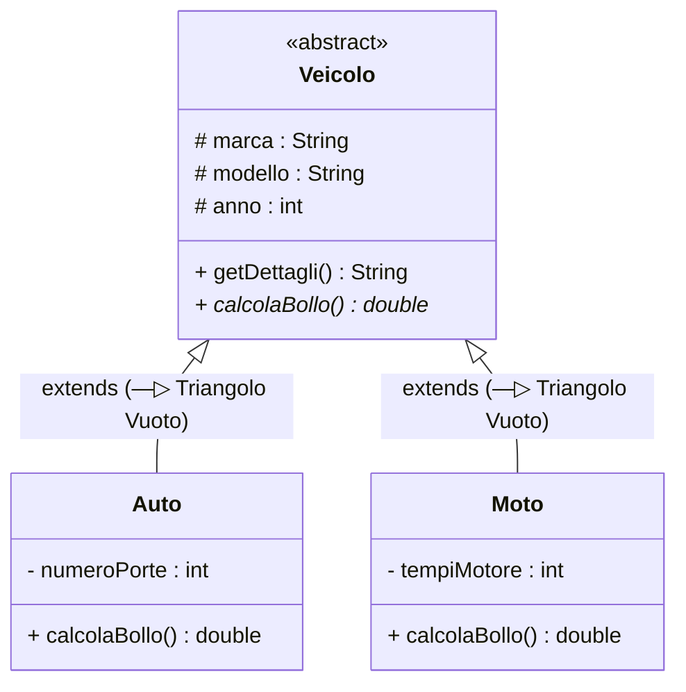
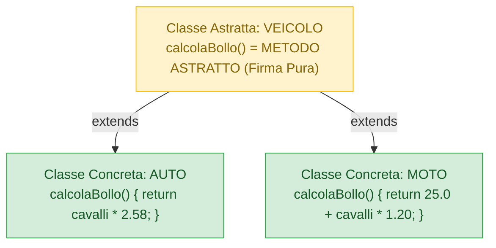

??? forse non fatto come argomento ???

## 1. Il Meccanismo dell'Ereditarietà (`extends`)

L'==**Ereditarietà**== è il principio della OOP che modella la relazione gerarchica di specializzazione =="is-a" ("è un")==.  
Permette a una nuova classe (**sottoclasse** o classe figlia) di ereditare automaticamente tutti gli attributi e i metodi di una classe esistente (**superclasse** o classe genitore), consentendo di:
1. Riutilizzare codice collaudato senza duplicazioni.
2. Estendere ed arricchire il modello con nuovi attributi e comportamenti specifici.



In codice Java:
```java
// Superclasse
public class Veicolo {
    protected String marca;
    protected String modello;
}

// Sottoclasse che estende la superclasse
public class Auto extends Veicolo {
    private int numeroPorte; // Attributo esclusivo della classe Auto
}
```

---

## 2. Il Divieto di Ereditarietà Multipla e il "Diamond Problem"

Una classica domanda da interrogazione è: *Perché in C++ esiste l'ereditarietà multipla mentre Java la proibisce rigorosamente tra classi?*

In C++, una classe può estendere simultaneamente due o più genitori:
$$\text{class Anfibio : public Automobile, public Barca}$$

Se sia `Automobile` sia `Barca` possiedono un metodo `accelera()` o un campo `motore`, la classe figlia eredita due implementazioni identiche in conflitto tra loro. Questo rompicapo strutturale prende il nome di **Problema del Diamante (*Diamond Problem*)**.

Java risolve il dilemma alla radice:
- **Ereditarietà di Implementazione (Classi)**: rigorosamente **singola** (`extends` accetta un solo nome).
- **Ereditarietà di Tipo/Comportamento**: permessa in modo multiplo, ma unicamente attraverso le **Interfacce**.

---

## 3. Il Costruttore Figlio e l'Istruzione `super(...)`

Quando istanziamo un oggetto di una sottoclasse con `new Auto(...)`, l'oggetto nello Heap è composto da due parti: la porzione ereditata della superclasse e i campi nuovi del figlio.

La porzione del genitore **deve essere inizializzata per prima**:
```java
public class Veicolo {
    protected String marca;
    protected String modello;

    public Veicolo(String marca, String modello) {
        this.marca = marca;
        this.modello = modello;
    }
}

public class Auto extends Veicolo {
    private int numeroPorte;

    public Auto(String marca, String modello, int porte) {
        super(marca, modello); // ==INVOCAZIONE COSTRUTTORE GENITORE: TASSATIVAMENTE IN PRIMA RIGA!==
        this.numeroPorte = porte;
    }
}
```

> [!DANGER] 🚫 Regola Fondamentale di `super(...)`
> Se il costruttore della superclasse richiede parametri, la chiamata `super(...)` deve trovarsi **sulla primissima riga di codice** del costruttore del figlio. Se omessa, Java proverà a chiamare di nascosto `super()` senza argomenti; se tale costruttore vuoto non esiste nella superclasse, il programma non compilerà!

---

## 4. Il Modificatore di Accesso `protected`

Se gli attributi della superclasse fossero `private`, nemmeno le sottoclassi figlie potrebbero accedervi direttamente. Dichiarandoli **`protected` (`#`)**:
- Rimangono inaccessibili al codice esterno generico (preservando l'incapsulamento).
- Risultano direttamente visibili e manipolabili da tutte le sottoclassi che ereditano.

---

## 5. Classi Astratte (`abstract class`) e Metodi Astratti (`abstract`)

In una gerarchia di veicoli possiamo incontrare automobili, motociclette, autocarri. Ma ha senso creare un "Veicolo" generico? No, perché il concetto di "Veicolo" è un'astrazione mentale, non un mezzo reale da guidare!



### A. Classe Astratta (`abstract class`)
- Si dichiara anteponendo la keyword **`abstract`**.
- **NON può essere istanziata**: l'istruzione ==`Veicolo v = new Veicolo();` genera un errore immediato di compilazione==!
- Può contenere attributi, costruttori e metodi ordinari con codice.

### B. Metodo Astratto (`abstract method`)
- È un metodo che possiede solo la firma ma **non ha alcun corpo** (niente graffe `{}`, termina con un punto e virgola `;`):
  ```java
  public abstract double calcolaBollo(); // Metodo astratto: niente corpo!
  ```
- Rappresenta un **obbligo contrattuale**: ogni classe figlia concreta che estende la superclasse ha il dovere inderogabile di fare l'**Overriding** di quel metodo, fornendo la propria formula specifica.

---

## 6. Notazione NClass per Classi e Metodi Astratti

> [!TIP] 🖼️ **Come Disegnare Classi Astratte su NClass**
> 1. Su **NClass**, crea una classe normale e nominala `Veicolo`.
> 2. Seleziona la classe e nella finestra laterale **Properties** imposta:  
>    ==`IsAbstract = True`==.  
>    *Cosa succede graficamente*: NClass visualizzerà il titolo della classe in stile ==**CORSIVO (*Italic*)**==!
> 3. Aggiungi il metodo `calcolaBollo`: nelle sue proprietà imposta ==`IsAbstract = True`==. Anche la firma del metodo apparirà in corsivo.
> 4. Crea le sottoclassi concrete `Auto` e `Moto` e collegale a `Veicolo` con lo strumento **Generalization** (freccia con triangolo vuoto `—▷`).

---

## 7. La Parola Chiave `final` (L'Opposto di `abstract`)

Mentre `abstract` impone di essere esteso o implementato, la parola chiave ==**`final`**== pone un blocco invalicabile:
1. **Variabile `final`**: diventa una ==costante immutabile== non riassegnabile.
2. **Metodo `final`**: ==impedisce alle sottoclassi di sovrascrivere quel metodo== (ne congela l'algoritmo).
3. **Classe `final`**: classe terminale che ==non può essere estesa da nessuno==. Un celebre esempio nella libreria standard di Java è la classe `java.lang.String`: è `final` per impedire a chiunque di alterarne il comportamento compromettendo la sicurezza del sistema operativo.

---

## 8. Domande Tipiche d'Esame / Interrogazione

> [!QUESTION] ❓ Domande di Verifica Orale
> 1. *Cosa accade se una classe figlia concreta dimentica di sovrascrivere uno dei metodi astratti della superclasse?*  
>    **Risposta**: Il compilatore rifiuta il programma con un errore di compilazione, a meno che la classe figlia stessa non venga a sua volta dichiarata `abstract`.
> 2. *Se una classe astratta non può essere istanziata con `new`, può possedere un costruttore?*  
>    **Risposta**: Sì, e molto spesso lo possiede! Il costruttore di una classe astratta serve per inizializzare i campi protetti della classe base e viene invocato dalle sottoclassi concrete tramite l'istruzione `super(...)`.
> 3. *Come si indicano visivamente le classi e i metodi astratti in un diagramma delle classi UML (NClass)?*  
>    **Risposta**: Vengono renderizzati graficamente con il carattere in stile ==**corsivo (*Italic*)**== e opzionalmente con il tag testuale `<<abstract>>`.
> 4. *Qual è la differenza fondamentale tra la parola chiave `abstract` e la parola chiave `final`?*  
>    **Risposta**: Sono concettualmente opposte: `abstract` obbliga all'estensione e all'overriding nei figli, mentre `final` vieta categoricamente l'estensione (su classi) o la riscrittura (su metodi).
