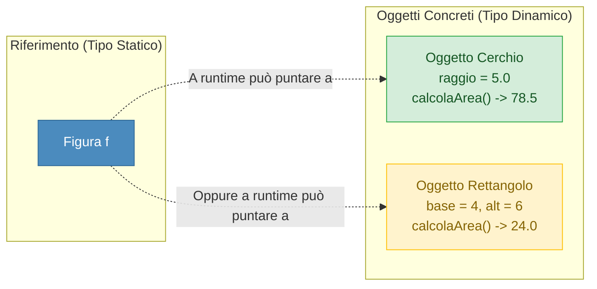

## 1. Cos'è il Polimorfismo

Il termine **Polimorfismo** (dal greco *poly* = molti, *morphé* = forma) è il terzo pilastro dell'architettura ad oggetti, dopo Incapsulamento ed Ereditarietà.

Indica la capacità di un'entità software di assumere forme e comportamenti differenti a seconda dell'oggetto a cui si riferisce a tempo di esecuzione.

Si articola in due macro-ambiti:
1. ==**Polimorfismo per i Dati**== (Riferimento Polimorfico e Collezioni Eterogenee).
2. ==**Polimorfismo per i Metodi**== (Overloading a compile-time vs Overriding dinamico con Late Binding).

---

## 2. Polimorfismo per i Dati: Il Riferimento Polimorfico

Grazie alla gerarchia di ereditarietà, una variabile di riferimento dichiarata del tipo della superclasse può contenere il puntatore a **qualsiasi oggetto istanziato da una sua sottoclasse**:

```java
// Il Tipo Statico (dichiarato) è Figura, ma l'oggetto reale nello Heap è un Cerchio!
Figura f1 = new Cerchio(5.0);
Figura f2 = new Rettangolo(4.0, 6.0);
```



### La Potenza delle Collezioni Eterogenee
Possiamo raccogliere forme geometriche di natura completamente diversa in un unico array e farle interagire senza sapere a priori quale oggetto si trovi in ciascuna cella:

```java
Figura[] forme = {
    new Cerchio(3.0),
    new Rettangolo(2.0, 5.0),
    new Cerchio(10.0)
};

// Ciascun oggetto calcolerà la propria area con la formula corretta!
for (Figura fig : forme) {
    System.out.println("Area calcolata: " + fig.calcolaArea());
}
```

### Operatore `instanceof` e Downcasting
Per verificare a runtime la vera natura dell'oggetto puntato ed accedere ai metodi esclusivi della sottoclasse:
```java
if (f1 instanceof Cerchio) {
    Cerchio c = (Cerchio) f1; // Downcasting esplicito sicuro
    System.out.println("Raggio del cerchio: " + c.getRaggio());
}
```

---

## 3. Polimorfismo per i Metodi: Overloading vs Overriding

Una delle distinzioni teoriche più richieste all'esame:

| Caratteristica | Overloading (Sovraccarico) | Overriding (Sovrascrittura) |
| :--- | :--- | :--- |
| **Dove si applica?** | Nella ==**stessa classe**== | Tra ==**Superclasse e Sottoclasse**== |
| **Nome del metodo** | Identico | Identico |
| **Lista Parametri** | ==**DIVERSA**== (per numero o tipi) | ==**IDENTICA**== per numero e tipi |
| **Tipo di Ritorno** | Può essere diverso | Deve essere identico (o covariante) |
| **Momento di Risoluzione**| ==**Compile-Time**== (Static / Early Binding) | ==**Runtime**== (Dynamic / Late Binding) |
| **Annotazione** | Nessuna | ==**`@Override`**== |
