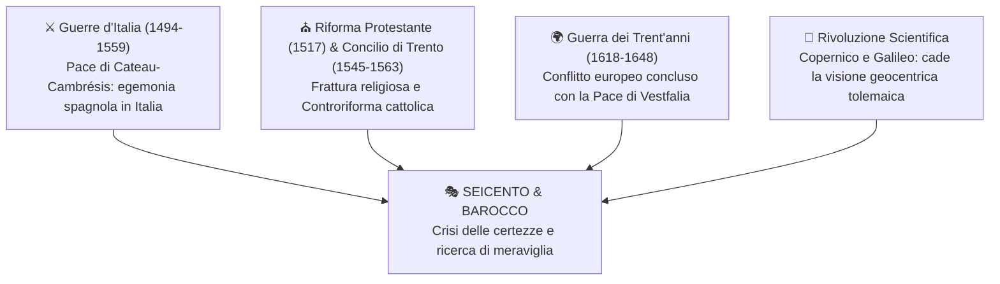
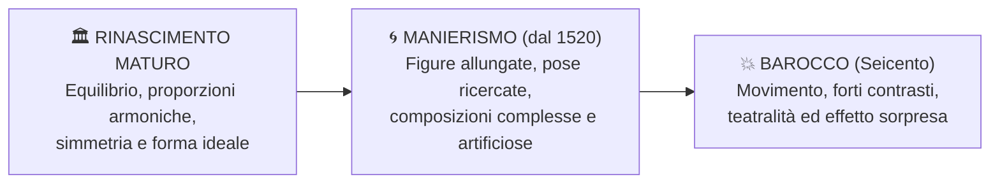

# 🎭 Il Seicento e il Barocco

> [!NOTE] Coordinate Essenziali
> - **Periodo:** XVII secolo (Seicento)
> - **Motto cardine:** *«È del poeta il fin la meraviglia»* (Giovan Battista Marino, *Murtoleide*)
> - **Obiettivo artistico e letterario:** Stupire, commuovere e coinvolgere lo spettatore rompendo l'equilibrio e l'armonia classici.

---

## 1. Il Contesto Storico e Culturale (Breve Inquadramento)

Il Barocco si sviluppa in un'Europa segnata da profonde lacerazioni politiche e religiose, ma anche da una straordinaria rivoluzione nel modo di concepire il cosmo:



### 🔗 Riferimenti Rapidi agli Eventi Storici
- **Dominio Spagnolo in Italia:** Conclusione delle [[01_Guerre d'Italia e il Dominio di Carlo V|Guerre d'Italia (1494-1559)]] e firma della Pace di Cateau-Cambrésis; l'Italia perde la propria indipendenza politica ed entra nell'orbita della [[05_La Spagna Imperiale di Filippo II e le Colonie del Nuovo Mondo|Spagna di Filippo II]].
- **Spaccatura Religiosa:** Rottura dell'unità cristiana con la [[02_Riforma Protestante e la Frattura Religiosa|Riforma Protestante di Martin Lutero (1517)]].
- **La Risposta della Chiesa:** Il [[03_Controriforma Cattolica e Concilio di Trento|Concilio di Trento e la Controriforma (1545-1563)]], con cui la Chiesa riorganizza la dottrina e utilizza l'arte come potente strumento di persuasione, propaganda e fede.
- **La Guerra dei Trent'anni (1618–1648):** Conflitto devastante su scala europea; si chiude con la **Pace di Vestfalia (1648)**, che inaugura un nuovo ordine diplomatico basato sulla convivenza tra Stati sovrani.
- **La Rivoluzione Scientifica (Copernico e Galileo Galilei):** Le scoperte astronomiche abbattono la certezza che la Terra sia immobile al centro del cosmo. L'uomo seicentesco perde i punti di riferimento tradizionali e avverte un forte senso di smarrimento di fronte all'immensità dell'universo.

```
╔══════════════════════════════════════════════════════════════════════════════════════════╗
║ 🖼️ PLACEHOLDER: LA PACE DI VESTFALIA E LA FINE DELLA GUERRA DEI TRENT'ANNI              ║
╠══════════════════════════════════════════════════════════════════════════════════════════╣
║ ![[la_ratifica_del_trattato_di_munster.png|700]]                                         ║
║ Cerca: "Gerard ter Borch La ratifica del trattato di Münster 1648 dipinto"               ║
║ Descrizione: Il celebre dipinto storico olandese che documenta il giuramento di pace     ║
║ di Münster del 1648, simbolo dei nuovi equilibri europei del Seicento.                   ║
╚══════════════════════════════════════════════════════════════════════════════════════════╝
```

---

## 2. Il Termine «Barocco»: Origine e Significato

Il Barocco è una **categoria storico-artistica** che designa le manifestazioni artistiche e letterarie dominanti del Seicento (non coincide con l'intera cultura del secolo, che comprende anche la rigorosa nascita del metodo scientifico moderno).

| Aspetto                   | Spiegazione                                                                                                                                                                                                                                                                                           |
| :------------------------ | :---------------------------------------------------------------------------------------------------------------------------------------------------------------------------------------------------------------------------------------------------------------------------------------------------- |
| **Origine del nome**      | Due etimologie probabili:<br>1. Dal portoghese **_barroco_**: perla irregolare e bizzarra.<br>2. Dal latino scolastico **_baroco_**: ragionamento di tipo di sillogismo medievale poco chiaro e complicato.<br>In entrambi i casi l'elemento in comune è l'eccesso, ricercando l'elemento abbondante. |
| **Giudizio originario**   | **Negativo (dal Settecento):** Gli illuministi e i neoclassici usarono la parola "barocco" con intento dispregiativo, per condannare uno stile ritenuto stravagante, eccessivo e privo di buon gusto.                                                                                                 |
| **Rivalutazione odierna** | Oggi il Barocco è riconosciuto come una straordinaria stagione artistica caratterizzata da virtuosismo tecnico, ricerca di stupore, teatralità e profonda indagine emotiva.                                                                                                                           |

```
╔══════════════════════════════════════════════════════════════════════════════════════════╗
║ 🖼️ PLACEHOLDER: IL DAVID DI BERNINI (DINAMISMO BAROCCO)                                  ║
╠══════════════════════════════════════════════════════════════════════════════════════════╣
║ ![[david_bernini_1623.png|450]]                                                          ║
║ Cerca: "Gian Lorenzo Bernini David 1623 Galleria Borghese Roma"                          ║
║ Descrizione: La scultura che coglie David nell'attimo esatto di massima torsione e       ║
║ tensione muscolare mentre carica la fionda: emblema del movimento barocco.               ║
╚══════════════════════════════════════════════════════════════════════════════════════════╝
```

---

## 3. Dal Rinascimento al Barocco: Il Confronto

L'estetica barocca si comprende pienamente confrontandola con le fasi artistiche precedenti:



- **Rinascimento maturo:** Ricerca di armonia, stabilità, ordine razionale e proporzione ideale (ispirata ai canoni dell'antichità classica).
- **Manierismo (dal 1520 circa):** Crisi del modello classico. Gli artisti dipingono "alla maniera" dei  grandi maestri ma ne forzano le regole con proporzioni alterate, figure sinuose e allungate, spazi asimmetrici.
- **Barocco (Seicento):** Rottura definitiva della compostezza. L'arte non deve più rassicurare con l'armonia, ma scuotere lo spettatore con **movimento dinamico**, **contrasti violenti di luce/ombra**, **illusionismo prospettico** e **drammaticità teatrale**.

```
╔══════════════════════════════════════════════════════════════════════════════════════════╗
║ 🖼️ PLACEHOLDER: IL MANIERISMO (MADONNA DAL COLLO LUNGO)                                 ║
╠══════════════════════════════════════════════════════════════════════════════════════════╣
║ ![[parmigianino_madonna_collo_lungo.png|450]]                                            ║
║ Cerca: "Parmigianino Madonna col collo lungo 1534 Uffizi"                                ║
║ Descrizione: Esempio cardine del Manierismo cinquecentesco: collo e dita allungate,      ║
║ proporzioni volutamente alterate e composizione fortemente asimmetrica.                  ║
╚══════════════════════════════════════════════════════════════════════════════════════════╝
```

Come possiamo vedere dalla madonna da collo lungo, che rappresenta lo stile del manierismo, essa ha appunto un collo lungo e sproporionato, anche il bambino è una posizione innaturale, stesso per la madonna; poi poswsiamo anhce vedere lo sfodno è molto caotico e poco chiaro anche là.

// foto 2 della stessa pagina 

La seconda foto rappresenta invece una scena piena, totalente esasperata.

---

## 4. I Luoghi della Cultura e la Committenza nel Seicento

Nel Seicento il ruolo dell'intellettuale e dell'artista è strettamente legato ai centri di potere e ai canali di committenza:

### 🏛️ 1. Chiesa Cattolica e Corti Principesche
- **Finalità:** Dopo il Concilio di Trento, la Chiesa cattolica e le grandi casate nobiliari (in particolare a Roma) impiegano le arti come strumento di **persuasione dei fedeli** e **manifestazione di prestigio e potenza**.
- **Opere:** Chiese sontuose, monumenti urbani scenografici, soffitti affrescati con fughe prospettiche verso l'infinito (*trompe-l'œil*).

//vocazione di san matteo
Caravagio
Va a dirci che in ogni situazione quotidiana la vocazione può essere anche giornaliera; luci e ombre poi evidenziano l'arrivo della componente divina; riconducibile alla controriforma.

//ronda di notte
Rembrant
Figure rappresentate tutte ammassate con molta dinamicità, precedentemente sconosciuta.

### 🛒 2. Il Mercato Borghese Privato (Nei Paesi Bassi)
- **Nuovo modello sociale:** Nelle Province Unite (Olanda), a maggioranza protestante e con un'economia mercantile avanzata, la committenza non proviene dalla Chiesa o dai monarchi assoluti, ma dalla **ricca borghesia mercantile e cittadina**.
- **Nuovo collezionismo:** Nasce un mercato artistico moderno. Le opere sono destinate alle abitazioni private: trionfano soggetti fino ad allora considerati "minori", come scene di vita domestica quotidiana (*scene di genere*), nature morte, paesaggi e ritratti individuali e collettivi.

//la lattaia
Scena normale in cui l'attenzione viene portata sulla lattaia e sulla scena quotidiana.

### 📚 3. Le Accademie e l'Editoria
- **Accademie vs Università:** Mentre le università dell'epoca restano legate all'insegnamento tradizionale e conservatore, le **Accademie** diventano i veri centri propulsori del confronto scientifico, letterario e linguistico.
- **Maggiore libertà di espressione:** Sostenute anche da privati e intellettuali laici, permettono una circolazione delle idee più vivace e autonoma rispetto alle rigide censure istituzionali ed ecclesiastiche.
- **L'Accademia della Crusca (Firenze):** Nel **1612** (diffuso nel **1613**) pubblica il **primo Vocabolario degli Accademici della Crusca**, opera monumentale che assume a modello la lingua toscana trecentesca (Dante, Petrarca, Boccaccio) e segna una tappa fondamentale nella storia della lingua italiana.

---

## 5. Osservare un Capolavoro: Bernini e la Cappella Cornaro

L'apice della poetica barocca è rappresentato dalla fusione scenografica di scultura, architettura e pittura (*il "bel composto"*) realizzata da **Gian Lorenzo Bernini** nella **Cappella Cornaro** (Chiesa di Santa Maria della Vittoria, Roma, 1647–1652).

```
╔══════════════════════════════════════════════════════════════════════════════════════════╗
║ 🖼️ PLACEHOLDER: LA CAPPELLA CORNARO NELL'INSIEME (VISIONE D'INSIEME)                     ║
╠══════════════════════════════════════════════════════════════════════════════════════════╣
║ ![[cappella_cornaro_insieme.png|700]]                                                    ║
║ Cerca: "Bernini Cappella Cornaro Santa Maria della Vittoria Roma insieme altare"         ║
║ Descrizione: Visione completa della cappella: altare barocco centrale con marmi          ║
║ policromi e i palchetti laterali con i committenti della famiglia Cornaro.              ║
╚══════════════════════════════════════════════════════════════════════════════════════════╝
```

### 👼 A. Il Gruppo Centrale: L'Estasi di Santa Teresa d'Avila
- **Il soggetto sacro (la Transverberazione):** Raffigura la santa carmelitana trafitta al cuore da un dardo dorato retto da un angelo sorridente, metafora dell'ardente amore divino.
- **L'espressione e il corpo:** Il volto di santa Teresa esprime un abbandono estatico travolgente (labbra socchiuse, occhi rovesciati, mano e piede rilassati nel vuoto), in cui sofferenza fisica e beatitudine spirituale si fondono.
- **La teatralità della materia:** Il marmo perde la sua pesantezza: la veste della santa è scolpita in un panneggio tumultuoso e increspato, posata su una nuvola informe sospesa a mezz'aria.
- **La luce scenografica:** Sopra la composizione si aprono fasci di raggi in bronzo dorato, illuminati da una **fonte di luce naturale nascosta** (una finestrella con vetro giallo collocata in alto), creando un effetto teatrale di pura meraviglia.

```
╔══════════════════════════════════════════════════════════════════════════════════════════╗
║ 🖼️ PLACEHOLDER: ESTASI DI SANTA TERESA (DETTAGLIO VOLTO E ANGELO)                        ║
╠══════════════════════════════════════════════════════════════════════════════════════════╣
║ ![[estasi_santa_teresa_dettaglio.png|600]]                                               ║
║ Cerca: "Bernini Estasi di santa Teresa dettaglio viso angelo freccia"                    ║
║ Descrizione: Il primo piano dell'angelo con il dardo d'oro e il viso di santa Teresa     ║
║ rapita nell'estasi mistica con gli occhi socchiusi.                                      ║
╚══════════════════════════════════════════════════════════════════════════════════════════╝
```

### 👥 B. I Committenti nei Palchetti Teatrali (I 4 Membri della Famiglia Cornaro)
- **Chi sono:** I committenti dell'opera, il cardinale veneziano **Federico Cornaro** e i membri illustri della sua famiglia (tra cui patriarchi e dogi).

```
╔══════════════════════════════════════════════════════════════════════════════════════════╗
║ 🖼️ PLACEHOLDER: I COMMITTENTI CORNARO NEI PALCHETTI TEATRALI                            ║
╠══════════════════════════════════════════════════════════════════════════════════════════╣
║ ![[committenti_famiglia_cornaro_palchetto.png|600]]                                      ║
║ Cerca: "Bernini Cappella Cornaro membri famiglia Cornaro rilievo palchetto teatro"       ║
║ Descrizione: Il rilievo marmoreo laterale con quattro membri della famiglia Cornaro      ║
║ che assistono e discutono dell'estasi affacciati dalla balaustra.                        ║
╚══════════════════════════════════════════════════════════════════════════════════════════╝
```

---

## 7. La Letteratura Barocca e il Linguaggio della Meraviglia

### 🎯 Il Principio della «Meraviglia»
Il massimo teorico e poeta del Barocco italiano è **Giovan Battista Marino**, celebre per la sua affermazione programmatica:

> *«È del poeta il fin la meraviglia*  
> *(parlo de l'eccellente, non del goffo):*  
> *chi non sa far stupir, vada a la striglia!»*  
> — Giovan Battista Marino, *Murtoleide*

La letteratura non mira più a istruire moralmente o a imitare i modelli classici in modo ordinato: il suo scopo prioritario è **suscitare stupore, meraviglia e piacere sensoriale** nel lettore; portando artificiosità, ovvero che è così strutturwta per dare meraviglia portando difficoltà a seguire tutto e bassa naturalezza.

### 📜 Temi e Forme
**Il Tempo e la Morte:** La fugacità inesorabile del tempo, l'ossessione per lo scorrere delle ore (orologi, clessidre, specchi, scheletri, rovine).

**Realtà e Finzione:** Il mondo intero visto come immenso palcoscenico teatrale; l'inganno dei sensi e l'instabilità delle certezze.

**L'Insolito e il Quotidiano non Idealizzato:** A differenza del Rinascimento (che celebrava solo la bellezza ideale), la lirica barocca canta aspetti inusuali: donne con difetti fisici (zoppe, calve, miopi), intente a compiti quotidiani (pettinarsi, cucire), mendicanti e oggetti bizzarri.

### 💡 Le Figure Retoriche dell'Ingegno
Per ottenere la meraviglia, il poeta impiega una lingua estremamente artificiosa e raffinata basata su tre strumenti:

**La Metafora Inattesa:**
Non è un semplice ornamento poetico, ma uno strumento per scoprire legami nascosti tra realtà completamente diverse.
	*Esempio tratto da Marino:* **«Onde dorate»** per descrivere i capelli biondi e mossi di una donna mentre viene pettinata; l'immagine accosta in modo sorprendente i capelli al moto fluttuante del mare, evocando luce, ricchezza e movimento.

**Il Concettismo (L'«Ingegno»):**
La capacità intellettuale di concepire accostamenti acuti, brillanti e inaspettati (*i concetti*) che costringono il lettore a un processo mentale di decifrazione e ammirazione.

**L'Artificiosità dello Stile:**
Frequente uso di **antitesi** (accostamento di contrari: luce/ombra, ghiaccio/fuoco), **iperboli** (esagerazioni vistose), giochi di parole, paronomasie e ritmo musicale incalzante.


//foto pagina 50 per esempio