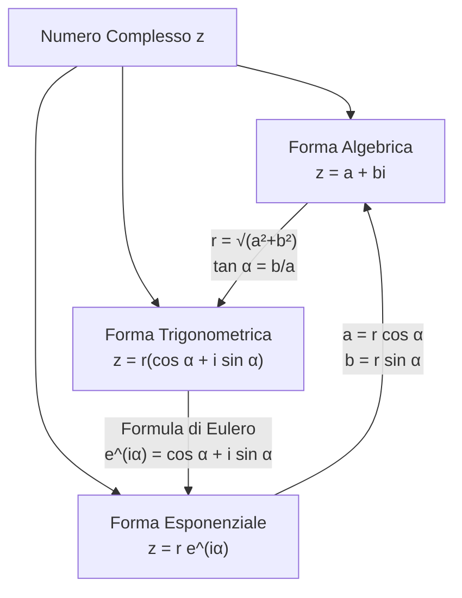

# 📂 Capitolo 13: Numeri Complessi ($\mathbb{C}$)

I **numeri complessi** ampliano il campo dei numeri reali $\mathbb{R}$, permettendo di dare significato all'estrazione di radici di indice pari da numeri negativi e fornendo un ponte algebrico e geometrico essenziale per l'analisi matematica, la trigonometria, l'elettrotecnica e la fisica quantistica.

---

## 🗺️ Il Percorso Lineare di Studio (Da File 01 a File 06)

Questo capitolo è strutturato in un percorso logico-sequenziale guidato, passo dopo passo, accompagnato da esempi dettagliati e diagrammi esplicativi ad alta definizione:

### **[[01_Insieme C e Numeri Immaginari|01. Insieme C e Numeri Immaginari]]**
* L'insufficienza dei reali di fronte a $x^2 = -1$.
* Definizione dell'unità immaginaria $i$ ($i^2 = -1$).
* I numeri immaginari puri $\mathbb{I}$ e le operazioni base.
* Il ciclo delle potenze di $i$ (periodo 4) e l'algoritmo del resto.

### **[[02_Forma Algebrica e Operazioni Fondamentali|02. Forma Algebrica e Operazioni Fondamentali]]**
* Scrittura binomiale $z = a + bi$, parte reale $\text{Re}(z)$ e parte immaginaria $\text{Im}(z)$.
* Uguaglianza, assenza di ordinamento in $\mathbb{C}$, modulo $|z| = \sqrt{a^2+b^2}$.
* Complesso coniugato $\bar{z} = a - bi$ e opposto $-z = -a - bi$.
* Aritmetica algebrica completa: somma, sottrazione, prodotto, reciproco, divisione razionalizzata e potenze di binomio.
* Genesi storica: la formula di Cardano e il caso irriducibile di Rafael Bombelli ($x^3 = 15x + 4$).

### **[[03_Rappresentazione Geometrica e Coordinate Polari|03. Rappresentazione Geometrica e Coordinate Polari]]**
* Il Piano di Argand-Gauss: asse reale e asse immaginario.
* Corrispondenza biunivoca: numero $\leftrightarrow$ punto (affissa) $\leftrightarrow$ vettore $\vec{OP}$.
* Geometria di modulo, coniugato (simmetria orizzontale) e opposto (simmetria centrale).
* Coordinate polari $[r; \alpha]$ (modulo $r$ e argomento principale $\alpha$).
* Algoritmo di conversione bidirezionale cartesiane $\longleftrightarrow$ polari con analisi dei 4 quadranti.

### **[[04_Forma Trigonometrica e Teorema di De Moivre|04. Forma Trigonometrica e Teorema di De Moivre]]**
* Definizione: $z = r(\cos\alpha + i\sin\alpha)$.
* Teorema del Prodotto: moltiplicazione dei moduli e somma degli argomenti (rototraslazione geometrica).
* Teorema del Quoziente: divisione dei moduli e differenza degli argomenti.
* Teorema / Formula di Abraham De Moivre per l'elevamento a potenze elevate: $z^n = r^n(\cos n\alpha + i\sin n\alpha)$.

### **[[05_Radici n-esime ed Equazioni nel Campo Complesso|05. Radici n-esime ed Equazioni nel Campo Complesso]]**
* Le $n$ radici distinte nel campo complesso.
* Le radici $n$-esime dell'unità ($\sqrt[n]{1}$) e la genesi dei poligoni regolari inscritti nella circonferenza.
* Formula generale per le radici $n$-esime di un numero complesso qualunque.
* Risoluzione di equazioni di secondo grado con $\Delta < 0$ e soluzioni coniugate.
* Il Teorema Fondamentale dell'Algebra di Carl Friedrich Gauss.

### **[[06_Forma Esponenziale e Formule di Eulero|06. Forma Esponenziale e Formule di Eulero]]**
* La formula di Leonhard Euler: $e^{i\alpha} = \cos\alpha + i\sin\alpha$.
* La scrittura esponenziale $z = r e^{i\alpha}$ e il calcolo con le proprietà delle potenze.
* Espressione trigonometrica di $\sin\alpha$ e $\cos\alpha$ tramite esponenziali complessi.
* L'Identità di Eulero $e^{i\pi} + 1 = 0$, la formula più bella della matematica.
* Tavola comparativa sinottica tra le 3 forme (Algebrica, Trigonometrica, Esponenziale).

---

## 📊 Sintesi delle 3 Forme di Rappresentazione

