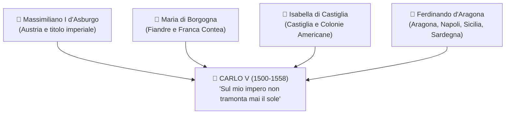

## 1. Il Contesto: Perché l'Italia Diventa un Terreno di Scontro?

- **Debolezza dell'Italia:** Ricca e colta, ma ==🔴 divisa in piccoli stati rivali== (Milano, Venezia, Firenze, Stato della Chiesa, Napoli) privi di eserciti moderni.
- **La fine dell'equilibrio:** Con la morte di Lorenzo il Magnifico (1492) crolla la Pace di Lodi.
- **==🟡 1494 - Discesa di Carlo VIII (Re di Francia):==**
  - Scende per conquistare il Regno di Napoli (rivendicazione angioina).
  - Dimostra che l'Italia è militarmente indifesa: inizia la contesa tra **Francia** e **Spagna** per il controllo della penisola.

---

## 2. L'Impero di Carlo V: I Territori dei 4 Nonni

Carlo d'Asburgo (figlio di Filippo il Bello e Giovanna la Pazza) concentra nelle sue mani un impero immenso ereditato direttamente dai **quattro nonni**:

### 🗺️ Tabella Rapida dei Territori Ereditati

| Da Chi Eredita?                                | Territori Precisi                                           | Perché Sono Importanti?                                                                                                          |
| :--------------------------------------------- | :---------------------------------------------------------- | :------------------------------------------------------------------------------------------------------------------------------- |
| **Massimiliano I d'Asburgo** *(nonno paterno)* | ==🔵 Austria, Tirolo, Stiria, Carinzia==                    | Baluardo tedesco contro l'avanzata dei Turchi Ottomani nei Balcani.                                                              |
| **Maria di Borgogna** *(nonna paterna)*        | ==🔵 Paesi Bassi (Fiandre, Olanda)== e ==🔵 Franca Contea== | Regione più ricca d'Europa per commercio e manifatture (sarà poi il teatro della rivolta calvinista descritta nella Lezione 05). |
| **Isabella di Castiglia** *(nonna materna)*    | ==🔵 Corona di Castiglia== e ==🔵 Colonie Americane==       | Fanteria d'élite (*Tercios*) e l'afflusso di ==🟠 oro e argento dalle miniere americane== analizzate nella Lezione 05.           |
| **Ferdinando d'Aragona** *(nonno materno)*     | ==🔵 Aragona, Regno di Napoli, Sicilia, Sardegna==          | Controllo navale del Mediterraneo e "granaio d'Europa" (grano del Sud).                                                          |

- **==🟡 1519 - Elezione a Imperatore del SRI:==** Il titolo imperiale è elettivo. Carlo V batte Francesco I comprando i voti dei **7 Principi Elettori** con 850.000 fiorini d'oro prestati dai banchieri **Fugger** e **Welser**.

![[Pasted image 20261028131413.png|700]]

---

## 3. Lo Scontro con Francesco I di Francia

- **Causa strategica:** La Francia di Francesco I si sente **accerchiata** dai territori asburgici.
- **L'obiettivo conteso:** Il **Ducato di Milano**. Per Carlo V è la cerniera vitale del **Camino Español** (permette di spostare via terra truppe e rifornimenti dai porti di Spagna e Napoli verso la Germania e le Fiandre).
- **🔗 Collegamento con Lutero:** L'impegno militare totale di Carlo V in questa guerra contro la Francia e contro l'avanzata dei Turchi a Vienna gli impedirà di intervenire con decisione in Germania, lasciando a Martin Lutero il tempo necessario per diffondere indisturbato la Riforma Protestante tra i principi tedeschi.

### I Fatti Salienti
1. **==🟡 1525 - Battaglia di Pavia:==** Carlo V sconfigge i francesi con gli archibugieri dei *Tercios*; **Francesco I viene fatto prigioniero** e deve cedere Milano.
2. **1526 - Lega di Cognac:** Il papa **Clemente VII Medici**, terrorizzato dall'eccessivo potere di Carlo V in Italia, compie un ribaltamento di alleanze unendosi alla Francia.
3. **==🟡 1527 - Il Sacco di Roma:==**
   - Per punire il tradimento del Papa, Carlo V invia in Italia 12.000 **Lanzichenecchi** (fanti mercenari tedeschi in gran parte convertiti al luteranesimo).
   - Rimasti senza paga, assediano e saccheggiano Roma per 9 mesi: chiese profanate, massacri e fuga del Papa a Castel Sant'Angelo.
   - **🔗 Conseguenza Diretta sullo Scisma d'Inghilterra:** Questo evento ha un impatto storico decisivo: Papa Clemente VII, ridotto a ostaggio politico di Carlo V, sarà costretto a respingere la richiesta di Enrico VIII di annullare le nozze con Caterina d'Aragona (che era la **zia carnale di Carlo V**!), innescando direttamente lo Scisma Anglicano del 1534.
4. **1529 - 1530: Pace di Cambrai e Incoronazione:** Clemente VII fa pace con Carlo V e lo incorona solennemente **Imperatore a Bologna (1530)**.

![[Pasted image 20261028131611.png|700]]

---

## 4. L'Abdicazione di Carlo V e la Divisione dell'Impero (1555-1556)

Consapevole che il sogno di un impero universale cattolico è fallito (dopo aver dovuto concedere ai principi tedeschi la libertà religiosa con la Pace di Augusta del 1555), Carlo V abdica e **divide l'impero in due rami dinastici**:

- Al figlio **==🔵 Filippo II==**: riceve la ==Spagna, le Colonie Americane, i Paesi Bassi e i domini italiani (Milano, Napoli, Sicilia, Sardegna)==. Da qui nasce la grande potenza della Spagna Imperiale di Filippo II.
- Al fratello **==🔵 Ferdinando I==**: riceve le ==Terre asburgiche d'Austria, Boemia, Ungheria== e il titolo elettivo di **Imperatore del Sacro Romano Impero**.

---

## 5. La Pace di Cateau-Cambrésis (1559): L'Italia Spagnola

Firmata tra **Filippo II di Spagna** ed **Enrico II di Francia**:
- **==🟢 Fine delle Guerre d'Italia:==** Sancisce l'inizio dell'**egemonia spagnola sull'Italia** per oltre 150 anni (fino al 1713).
- **Assetto politico dell'Italia:**
  - **Domini diretti spagnoli:** Milano, Regno di Napoli, Sicilia, Sardegna e lo **Stato dei Presìdi** (basi militari costiere in Toscana: Orbetello, Piombino, Porto Ercole) per controllare le rotte navali tirreniche.
  - **Stati satellite legati alla Spagna:** Repubblica di Genova (principale banchiere della Corona spagnola), Granducato di Toscana (Medici), Ducato di Savoia.
  - **Unico stato davvero indipendente:** la **Repubblica di Venezia**, che concentrerà tutte le sue forze navali nella difesa dell'Oriente contro i Turchi fino alla battaglia di Lepanto nel 1571.

![[Pasted image 20261028131812.png|700]]