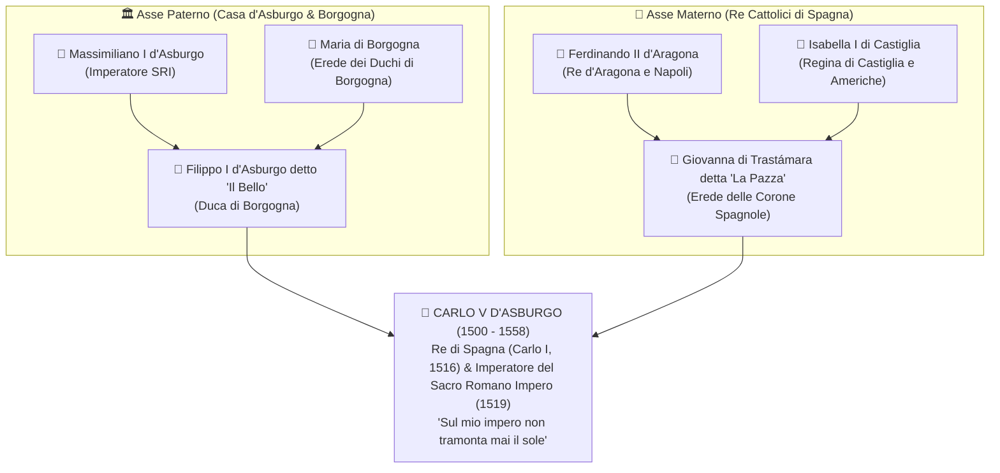
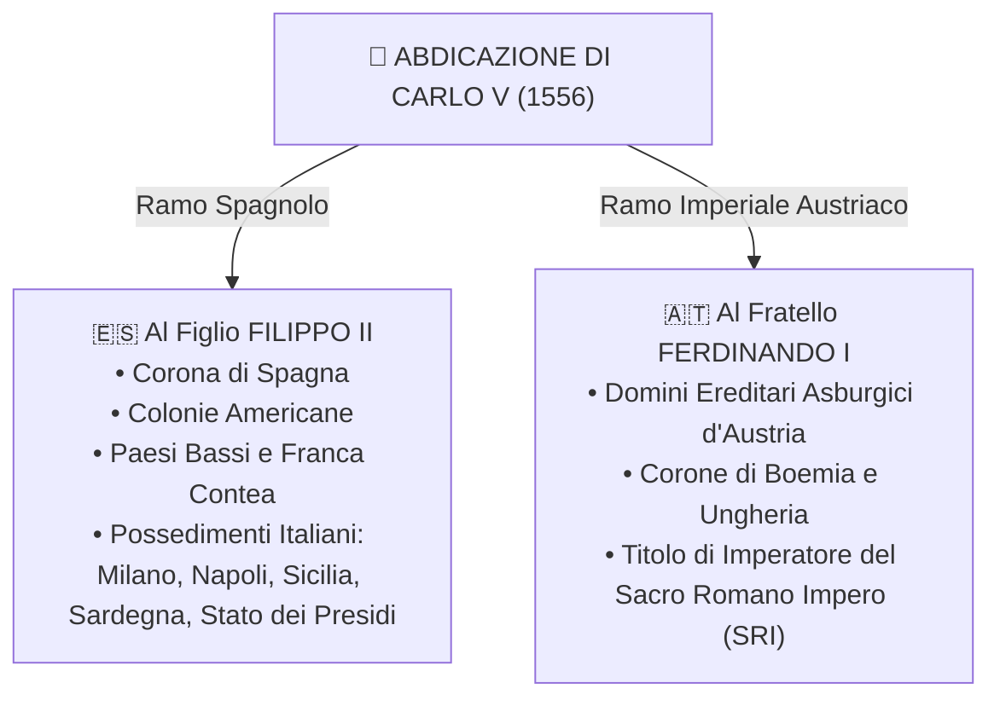

# ⚔️ Le Guerre d'Italia e l'Impero Universale di Carlo V

> [!NOTE] Riferimenti Manuale
> **Pagine di studio:** pag. 253 - 260 (*La crisi degli stati italiani e le prime guerre*); pag. 368 - 377 (*L'impero di Carlo V e lo scontro con la Francia*); pag. 378 - 379 (*Galleria iconografica e immagini a confronto: Carlo V vs Francesco I*).

---

## 1. Il Contesto: L'Italia come Terreno di Conquista (1494 - 1516)

Alla fine del Quattrocento, la penisola italiana era l'area più colta, urbanizzata e ricca d'Europa, ma soffriva di una ==🔴 drammatica frammentazione politica e debolezza militare==. La politica di equilibrio garantita dalla **Pace di Lodi (1454)** e da **Lorenzo il Magnifico** andò in frantumi alla morte di quest'ultimo nel 1492.

```
       IL CROLLO DELL'EQUILIBRIO ITALIANO (1494)
┌────────────────────────────────────────────────────────┐
│  • Ducato di Milano (Sforza / Ludovico il Moro)         │
│  • Repubblica di Venezia (potenza marinara autonoma)    │
│  • Repubblica di Firenze (Medici -> Savonarola)         │  ==> PREDA AMBITA DALLE GRANDI
│  • Stato della Chiesa (Roma, Alessandro VI Borgia)     │      MONARCHIE NAZIONALI
│  • Regno di Napoli (Aragonesi -> conteso)               │      (FRANCIA E SPAGNA)
└────────────────────────────────────────────────────────┘
```

### La Discesa di Carlo VIII (1494)
Nel **==🟡 1494==**, il re di Francia **Carlo VIII di Valois** scese in Italia con un potente esercito moderno dotato di artiglierie mobili in bronzo. Rivendicava il trono di Napoli come erede della casa d'Angiò. 
- La discesa fu una "passeggiata militare" che mise a nudo l'incapacità militare degli stati regionali.
- A Firenze, l'atteggiamento servile di Piero de' Medici provocò la cacciata della famiglia e la proclamazione della Repubblica teocratica e rigorista guidata dal frate domenicano **Girolamo Savonarola** (poi scomunicato e arso al rogo nel 1498).
- Gli stati italiani, terrorizzati dalla potenza francese, formarono una coalizione (Lega Antifrancese) che affrontò Carlo VIII nella **Battaglia di Fornovo (1495)**: il re francese riuscì a riparare in patria senza mantenere Napoli, ma dimostrò al mondo che l'Italia era una terra indifesa e facilmente conquistabile.

> [!DEFINIZIONE] Definizione Storiografica: "Guerre d'Italia"
> Conflitto lungo oltre sessant'anni (**1494 - 1559**) combattuto prevalentemente sul suolo italiano tra le due massime potenze europee — il **Regno di Francia** e la **Monarchia Spagnola / Impero Asburgico** — per il dominio strategico ed economico sulla penisola e la supremazia sul continente.

---

## 2. Il Colosso Asburgico: L'Incredibile Eredità di Carlo V

Nel **1500** nacque a Gand (in Belgio) **Carlo d'Asburgo**. Attraverso una serie combinata di matrimoni dinastici e morti premature dei parenti, Carlo si ritrovò a ereditare una concentrazione di corone e territori senza precedenti nella storia umana.

> [!TRUCCO] Come Ricordare l'Eredità di Carlo V: I 4 Nonni
> Carlo V è figlio di **Filippo il Bello** (Asburgo d'Austria/Borgogna) e **Giovanna la Pazza** (erede di Castiglia e Aragona). L'eredità deriva direttamente dai suoi **quattro nonni**:



### 🗺️ Mappa Dettagliata dei Territori di Carlo V

| Ramo di Eredità | Territori Ricevuti | Valore Strategico / Economico |
| :--- | :--- | :--- |
| **Nonno Paterno**<br>==Massimiliano I d'Asburgo== (1519) | • ==🔵 Austria, Tirolo, Stiria, Carinzia==<br>• Diritto di candidatura al titolo imperiale del Sacro Romano Impero | Cuore geopolitico tedesco, difesa della cristianità contro l'avanzata dell'Impero Ottomano nei Balcani. |
| **Nonna Paterna**<br>==Maria di Borgogna== (1506) | • ==🔵 Paesi Bassi (Fiandre, Olanda, Brabante)==<br>• ==🔵 Franca Contea, Lussemburgo, Artois== | Polo manifatturiero e mercantile più ricco e urbanizzato d'Europa del Nord (commercio tessile e porti atlantici). |
| **Nonna Materna**<br>==Isabella di Castiglia== (1516) | • ==🔵 Corona di Castiglia==<br>• ==🔵 Impero Coloniale Americano== (Nuova Spagna, Antille, futuro Perù) | Truppe d'élite (i celebri *Tercios* castigliani) e l'incessante afflusso di ==🟠 oro e argento dalle miniere americane==. |
| **Nonno Materno**<br>==Ferdinando d'Aragona== (1516) | • ==🔵 Corona d'Aragona (Catalogna, Valencia)==<br>• ==🔵 Regno di Napoli, Regno di Sicilia, Sardegna== | Controllo totale del Mediterraneo occidentale, basi navali strategiche e granaio d'Europa (grano siciliano e pugliese). |

> [!INTERROGAZIONE] Domanda Tipica da Interrogazione: Perché si diceva che "sul suo impero non tramontava mai il sole"?
> Perché i suoi domini si estendevano dalla Spagna e dall'Europa centrale fino ai possedimenti americani del Nuovo Mondo (Messico e America del Sud) e alle isole Filippine (in Asia): a qualsiasi ora del giorno e della notte, c'era sempre una parte dell'impero illuminata dalla luce solare.

---

```
╔══════════════════════════════════════════════════════════════════════════════════════════╗
║ 🖼️ PLACEHOLDER IMMAGINE: MAPPA DELL'IMPERO DI CARLO V NEL 1519-1556                    ║
╠══════════════════════════════════════════════════════════════════════════════════════════╣
║ ![[cartina_impero_carlo_v.png|750]]                                                      ║
║ COSA CERCARE SU GOOGLE / ATLAS: "Mappa impero di Carlo V territori ereditati colori"    ║
║ DESCRIZIONE: Carta tematica dell'Europa del XVI secolo che evidenzia con colori diversi   ║
║ i 4 blocchi territoriali: verde/giallo per la Spagna e le colonie, rosso/arancio per i   ║
║ Paesi Bassi e Franca Contea, blu per i domini asburgici austriaci e tratteggio SRI.      ║
╚══════════════════════════════════════════════════════════════════════════════════════════╝
```

---

## 3. L'Elezione Imperiale del 1519: L'Oro dei Banchieri Fugger

Nel **1519**, alla morte del nonno Massimiliano I, la corona imperiale del Sacro Romano Impero divenne vacante. 
- Il titolo non era ereditario, ma **elettivo**: spettava a un collegio di **7 Principi Elettori** tedeschi (3 ecclesiastici: arcivescovi di Magonza, Treviri e Colonia; 4 laici: duca di Sassonia, conte del Palatinato, margravio del Brandeburgo e re di Boemia).
- Il re di Francia **Francesco I di Valois** si candidò per evitare l'accerchiamento mortale della Francia.
- **La mossa vincente di Carlo:** Carlo V ottenne il prestito astronomico di circa **850.000 fiorini d'oro** dalle grandi famiglie di banchieri tedeschi (**Fugger** di Augusta e **Welser**) e banchieri genovesi. Con quest'oro ==🟡 corruppe sistematicamente i 7 elettori==, che il 28 giugno 1519 lo elessero all'unanimità Imperatore del Sacro Romano Impero col nome di **Carlo V**.

> [!TRAPPOLA] Attenzione alla Doppia Numerazione
> Carlo è contemporaneamente **Carlo I come Re di Spagna** (dal 1516) e **Carlo V come Imperatore del Sacro Romano Impero** (dal 1519).

---

## 4. Il Duello per l'Italia: Carlo V contro Francesco I

La Francia si trovava letteralmente ==🔴 stretta in una morsa d'acciaio==: a sud la Spagna, a nord i Paesi Bassi, a est la Franca Contea e l'Impero Germanico. 

Per Carlo V, il controllo dell'Italia settentrionale — in particolare il **Ducato di Milano** con il porto di Genova — era di vitale importanza geopolitica: costituiva il cosiddetto **"Camino Español"**, il corridoio strategico per trasferire via terra truppe e rifornimenti dalla Spagna e da Napoli verso la Germania e le Fiandre senza dover circumnavigare la Francia via mare.


### Le Fasi Cruciali del Conflitto

#### 1. La Battaglia di Pavia (1525) e il Trattato di Madrid
- Le forze imperiali asburgiche e quelle francesi si affrontarono sotto le mura di Pavia.
- La cavalleria pesante aristocratica francese fu decimata dalla nuova tattica della fanteria iberica armata di **archibugi** (gli iconici *Tercios*).
- ==🔴 Francesco I fu fatto prigioniero sul campo== e condotto a Madrid. Per ottenere la liberazione, firmò il **Trattato di Madrid (1526)**, cedendo Milano e la Borgogna e lasciando i propri due figli in ostaggio.
- Appena liberato, Francesco I dichiarò nullo il trattato perché estorto con la forza.

#### 2. La Lega di Cognac (1526) e il Terrore del Papa
Spaventato dall'onnipotenza di Carlo V in Italia, il papa **Clemente VII de' Medici** compì un clamoroso cambio di fronte e promosse la **Lega di Cognac**, alleandosi con Francesco I, Venezia, Firenze e Milano.

#### 3. Il Drammatico Sacco di Roma (1527)
- Indignato per il tradimento del Papa, Carlo V inviò in Italia un esercito di mercenari: 14.000 fanti imperiali spagnoli e oltre 10.000 **Lanzichenecchi** tedeschi, comandati da Carlo di Borbone.
- I Lanzichenecchi, per gran parte di fede **luterana** e animati da un feroce odio antipapista, rimasero a lungo senza paga.
- Nel maggio **==🟡 1527==**, le truppe ammutinate marciarono su Roma, penetrarono nelle mura vaticane e misero la città a ferro e fuoco per oltre nove mesi:
  - Palazzi e chiese profanate, opere d'arte distrutte, cardinali torturati per riscatto, monache violentate, oltre 20.000 vittime.
  - Papa Clemente VII si salvò rifugiandosi nella fortezza inespugnabile di **Castel Sant'Angelo**, mentre la Guardia Svizzera pontificia si sacrificò fino all'ultimo uomo sulle scale della Basilica di San Pietro.
  - L'eco in tutta Europa fu devastante: il mondo cattolico e luterano lesse il sacco come un inequivocabile **segno del giudizio divino** contro la corruzione e la simonia della curia papale.

```
╔══════════════════════════════════════════════════════════════════════════════════════════╗
║ 🖼️ PLACEHOLDER IMMAGINE: IL SACCO DI ROMA (1527)                                         ║
╠══════════════════════════════════════════════════════════════════════════════════════════╣
║ ![[sacco_di_roma_1527.png|750]]                                                          ║
║ COSA CERCARE SU GOOGLE / ARCHIVI: "Sacco di Roma 1527 Johannes Lingelbach dipinto"       ║
║ DESCRIZIONE: Dipinto d'epoca o incisione che raffigura l'assalto a Castel Sant'Angelo e  ║
║ le colonne di fumo che si alzano da Roma devastata dai Lanzichenecchi.                   ║
╚══════════════════════════════════════════════════════════════════════════════════════════╝
```

#### 4. La Pace delle Due Dame e l'Incoronazione di Bologna (1529 - 1530)
- Nel 1529 si giunse a una tregua: il Papa si riconciliò con Carlo V (**Trattato di Barcellona**); contemporaneamente, la zia di Carlo (Margherita d'Asburgo) e la madre di Francesco I (Luisa di Savoia) negoziarono la **Pace di Cambrai** (*Pace delle Due Dame*): la Francia rinunciava per sempre a Napoli e Milano, mentre Carlo V rinunciava alle sue pretese sulla Borgogna francese.
- Nel **==🟡 1530==**, a Bologna, papa Clemente VII pose sulla testa di Carlo V la corona ferrea di Re d'Italia e la corona imperiale: fu **l'ultima volta nella storia che un imperatore venne incoronato da un pontefice**.

---

## 5. Il Fallimento del Sogno Imperiale, l'Abdicazione e la Divisione

Carlo V coltivava un anacronistico ideale medievale: la **Monarchia Universale Cattolica** (*Restauratio Imperii*), un impero unito sotto un'unica fede e un solo sovrano garante della pace cristiana. Questo sogno si scontrò contro tre formidabili ostacoli insormontabili:
1. **La resistenza della Francia:** che non esitò ad allearsi sia con i pirati ottomani musulmani sia con i principi protestanti tedeschi.
2. **L'Impero Ottomano di Solimano il Magnifico:** che premeva sui Balcani arrivando fino alle porte di **Vienna (1529)** e dominava il Mediterraneo con le flotte corsare del Barbarossa.
3. **La frattura religiosa protestante in Germania:** i principi tedeschi abbracciarono la Riforma luterana per sottrarsi all'autorità imperiale.

### L'Abdicazione di Carlo V (1555 - 1556)
Stremato nel corpo e nello spirito dalle continue guerre e consapevole del fallimento del suo progetto unificatore, Carlo V firmò nel 1555 la **Pace di Augusta** con i luterani, abdicò tra il 1555 e il 1556 e si ritirò in preghiera nel monastero spagnolo di San Jerónimo a Yuste, dove morì nel 1558.

Prima di ritirarsi, divise il suo immenso impero in **due tronconi distinti**, riconoscendo che un solo sovrano non poteva governare un territorio così eterogeneo:



---

## 6. La Pace di Cateau-Cambrésis (1559): L'Italia Spagnola

La guerra tra Francia e Asburgo continuò anche dopo l'uscita di scena di Carlo V, combattuta dai rispettivi successori: **Enrico II di Francia** contro **Filippo II di Spagna**.
Dopo la schiacciante vittoria spagnola nella **Battaglia di San Quintino (1557)** guidata da Emanuele Filiberto di Savoia, le due potenze stremate finanziariamente firmarono la celebre:

> [!IMPORTANTE] La Pace di Cateau-Cambrésis (1559)
> Firmata il **==🟡 3 aprile 1559==**, pose fine alle guerre d'Italia durate 65 anni e sancì l'inizio della **==🟢 totale egemonia spagnola sulla penisola italiana==**, destinata a durare per un secolo e mezzo (fino al 1713-1714):
> - **Dominio Spagnolo Diretto:** Ducato di Milano, Regno di Napoli, Regno di Sicilia, Regno di Sardegna e il neocostituito **Stato dei Presìdi** (basi militari costiere in Toscana: Orbetello, Piombino, Porto Ercole, per controllare il Tirreno).
> - **Stati Alleati / Subordinati alla Spagna:** Repubblica di Genova (principale banchiere della Spagna), Granducato di Toscana (Medici), Ducato di Savoia (restituito a Emanuele Filiberto per i suoi meriti militari).
> - **Unica potenza autonoma:** la **Repubblica di Venezia**, che mantenne la propria indipendenza politica pur dovendo concentrare tutte le proprie risorse contro l'avanzata turca nel Mediterraneo orientale.

```
╔══════════════════════════════════════════════════════════════════════════════════════════╗
║ 🖼️ PLACEHOLDER IMMAGINE: L'ITALIA DOPO LA PACE DI CATEAU-CAMBRÉSIS (1559)                ║
╠══════════════════════════════════════════════════════════════════════════════════════════╣
║ ![[italia_cateau_cambresis_1559.png|750]]                                                ║
║ COSA CERCARE SU GOOGLE / ATLAS: "Cartina Italia pace Cateau-Cambrésis 1559 domini spagnoli"║
║ DESCRIZIONE: Mappa politica dell'Italia che evidenzia con il colore rosso/giallo i       ║
║ domini diretti della Spagna (Milano, Napoli, Isole, Stato dei Presidi) e gli stati satellite.║
╚══════════════════════════════════════════════════════════════════════════════════════════╝
```

---

## 7. Galleria Iconografica a Confronto: Carlo V vs Francesco I (pp. 378-379)

Il manuale propone un celebre confronto visivo e ideologico tra i due grandi rivali del Cinquecento attraverso le loro raffigurazioni pittoriche ufficiali:

```
╔══════════════════════════════════════════════════════════════════════════════════════════╗
║ 🖼️ PLACEHOLDER: CONFRONTO ICONOGRAFICO CARLO V vs FRANCESCO I                             ║
╠══════════════════════════════════════════════════════════════════════════════════════════╣
║ ![[confronto_tiziano_clouet.png|750]]                                                    ║
║ COSA CERCARE: "Tiziano Ritratto di Carlo V a cavallo Mühlberg" (Prado) E                 ║
║ "Jean Clouet Ritratto di Francesco I di Francia" (Louvre)                                ║
╚══════════════════════════════════════════════════════════════════════════════════════════╝
```

| Elemento di Analisi | Tiziano: *Carlo V a cavallo a Mühlberg* (1548) | Jean Clouet: *Ritratto di Francesco I* (1530 ca.) |
| :--- | :--- | :--- |
| **Posa & Ambiente** | A cavallo, armatura d'acciaio lucente, lancia in resta, su uno sfondo di paesaggio crepuscolare aperto. | A mezzo busto, frontale, all'interno di un palazzo sontuoso incorniciato da drappi di seta e oro. |
| **Messaggio Politico** | Il **Miles Christianus** (il soldato di Cristo), sovrano guerriero austero che guida personalmente le truppe per difendere la cristianità. | Il **Principe Rinascimentale**, mecenate delle arti, magnificente, abbigliato con tessuti preziosi, simbolo di splendore di corte. |
| **Tratti Psicologici** | Volto segnato dalla fatica, prognatismo asburgico visibile, sguardo malinconico e fermo, consapevole del peso dell'impero. | Sguardo fiero, ironico e raffinato, posa rilassata che ostenta lusso, sicurezza e autorità mondana. |

---

## 🎯 Sintesi & Domande Chiave per l'Interrogazione

> [!INTERROGAZIONE] Domande Frequenti del Docente
> 1. **Quali furono le cause profonde delle Guerre d'Italia?** 
>    *La debolezza e frammentazione militare degli stati regionali italiani a fronte delle potenti monarchie nazionali (Francia e Spagna), unite all'ambizione strategica di dominare Milano (corridoio continentale) e Napoli (granaio e centro mediterraneo).*
> 2. **Spiega come Carlo V costruì il suo impero e perché si parla di concentrazione dinastica.**
>    *Grazie alla combinazione dei matrimoni dei 4 nonni: Austria e titolo imperiale dagli Asburgo; Fiandre e Franca Contea da Maria di Borgogna; Castiglia e colonie americane da Isabella; Aragona, Napoli, Sicilia e Sardegna da Ferdinando.*
> 3. **Perché il Ducato di Milano era vitale per Carlo V?**
>    *Perché permetteva il collegamento tra i domini mediterranei (Spagna e Napoli, attraverso il porto di Genova) e i domini dell'Europa centrale (Austria, Germania e Fiandre), aggirando e accerchiando il territorio francese.*
> 4. **Cosa fu il Sacco di Roma del 1527 e quali conseguenze ebbe?**
>    *La devastazione della capitale pontificia da parte dei Lanzichenecchi luterani inviati da Carlo V contro papa Clemente VII (Lega di Cognac). Fu vissuto come shock epocale e portò alla riconciliazione tra Papa e Imperatore (Bologna, 1530).*
> 5. **Quale assetto politico stabilì la Pace di Cateau-Cambrésis nel 1559?**
>    *Sancì il definitivo dominio spagnolo in Italia per oltre un secolo e mezzo: Milano, Napoli, Sicilia, Sardegna e lo Stato dei Presidi passarono stabilmente sotto Filippo II di Spagna.*
