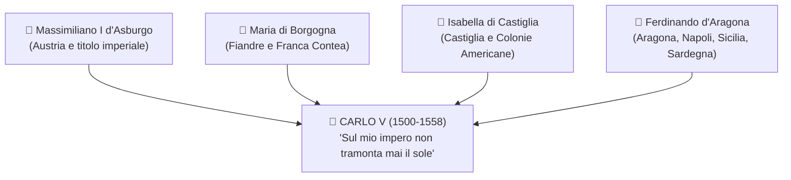

## 1. Il Contesto: Perché l'Italia Diventa un Terreno di Scontro?

- **Debolezza dell'Italia:** Ricca e colta, ma ==🔴 divisa in piccoli stati rivali== (Milano, Venezia, Firenze, Stato della Chiesa, Napoli) privi di eserciti moderni.
- **La fine dell'equilibrio:** Con la morte di Lorenzo il Magnifico (1492) crolla la Pace di Lodi.
- **==🟡 1494 - Discesa di Carlo VIII (Re di Francia):==**
  - Scende per conquistare il Regno di Napoli (rivendicazione angioina).
  - Dimostra che l'Italia è militarmente indifesa: inizia la contesa tra **Francia** e **Spagna** per il controllo della penisola.

---

## 2. L'Impero di Carlo V: I Territori dei 4 Nonni

Carlo d'Asburgo (figlio di Filippo il Bello e Giovanna la Pazza) concentra nelle sue mani un impero immenso ereditato direttamente dai **quattro nonni**:



### 🗺️ Tabella Rapida dei Territori Ereditati

| Da Chi Eredita? | Territori Precisi | Perché Sono Importanti? |
| :--- | :--- | :--- |
| **Massimiliano I d'Asburgo** *(nonno paterno)* | ==🔵 Austria, Tirolo, Stiria, Carinzia== | Baluardo tedesco contro l'avanzata dei Turchi Ottomani nei Balcani. |
| **Maria di Borgogna** *(nonna paterna)* | ==🔵 Paesi Bassi (Fiandre, Olanda)== e ==🔵 Franca Contea== | Regione più ricca d'Europa per manifatture tessili e commercio marittimo. |
| **Isabella di Castiglia** *(nonna materna)* | ==🔵 Corona di Castiglia== e ==🔵 Colonie Americane== | Fanteria scelta (*Tercios*) e ==🟠 carichi di oro e argento== dal Nuovo Mondo. |
| **Ferdinando d'Aragona** *(nonno materno)* | ==🔵 Aragona, Regno di Napoli, Sicilia, Sardegna== | Controllo navale del Mediterraneo e "granaio d'Europa" (grano del Sud). |

- **==🟡 1519 - Elezione a Imperatore del SRI:==** Il titolo imperiale è elettivo. Carlo V batte Francesco I comprando i voti dei **7 Principi Elettori** con 850.000 fiorini d'oro prestati dai banchieri **Fugger** e **Welser**.

![[european-inheritances-of-charles-v-in-1519-v0-4eurpnwzganh1.webp|700]]

---

## 3. Lo Scontro con Francesco I di Francia

- **Causa strategica:** La Francia si sente **accerchiata** dai territori asburgici.
- **L'obiettivo conteso:** Il **Ducato di Milano**. Per Carlo V è la cerniera vitale del **Camino Español** (permette di spostare truppe da Genova e Napoli verso Germania e Fiandre via terra).

### I Fatti Salienti (Da Ricordare per l'Interrogazione)
1. **==🟡 1525 - Battaglia di Pavia:==** Carlo V sconfigge i francesi; **Francesco I viene fatto prigioniero** e deve cedere Milano.
2. **1526 - Lega di Cognac:** Il papa **Clemente VII Medici**, terrorizzato dal troppo potere di Carlo V, si allea con la Francia.
3. **==🟡 1527 - Il Sacco di Roma:==**
   - Carlo V invia in Italia 12.000 **Lanzichenecchi** (fanti tedeschi in gran parte luterani).
   - Rimasti senza paga, assediano e saccheggiano Roma per 9 mesi: chiese profanate, massacri e fuga del Papa a Castel Sant'Angelo.
   - Shock in tutta Europa: evento visto come punizione divina sulla corruzione papale.
1. **1529 - 1530: La Pace e l'Incoronazione:** Pace delle Due Dame (Cambrai); Clemente VII fa pace con Carlo V e lo incorona solennemente **Imperatore a Bologna (1530)**.

![[Pasted image 20261027125334.jpg]]

---

## 4. L'Abdicazione di Carlo V e la Divisione dell'Impero (1555-1556)

Consapevole che il sogno di un impero universale unito è fallito (troppi nemici contemporanei: Francia, Ottomani di Solimano il Magnifico e principi protestanti tedeschi), Carlo V abdica e **divide l'impero in due parti**:

- Al figlio **==🔵 Filippo II==**: ==Spagna, Colonie Americane, Paesi Bassi, Milano, Napoli, Sicilia e Sardegna==.
- Al fratello **==🔵 Ferdinando I==**: ==Terre asburgiche d'Austria, Boemia, Ungheria== e il titolo di **Imperatore del Sacro Romano Impero**.

---

## 5. La Pace di Cateau-Cambrésis (1559): L'Italia Spagnola

Firmata tra **Filippo II di Spagna** ed **Enrico II di Francia**:
- **==🟢 Fine delle Guerre d'Italia:==** Sancisce l'inizio dell'**egemonia spagnola sull'Italia** per 150 anni (fino al 1713).
- **Assetto politico dell'Italia:**
  - **Domini diretti spagnoli:** Milano, Regno di Napoli, Sicilia, Sardegna e lo **Stato dei Presìdi** (basi militari costiere in Toscana).
  - **Stati sotto influenza spagnola:** Genova (banchieri della Spagna), Granducato di Toscana (Medici), Ducato di Savoia.
  - **Unico stato davvero indipendente:** la **Repubblica di Venezia**.

```
╔══════════════════════════════════════════════════════════════════════════════════════════╗
║ 🖼️ PLACEHOLDER: L'ITALIA DOPO CATEAU-CAMBRÉSIS (1559)                                    ║
╠══════════════════════════════════════════════════════════════════════════════════════════╣
║ ![[italia_cateau_cambresis_1559.png|700]]                                                ║
║ Cerca: "Carta Italia dopo la pace di Cateau-Cambrésis 1559"                              ║
╚══════════════════════════════════════════════════════════════════════════════════════════╝
```

---

## 🖼️ Confronto Immagini del Libro (pp. 378-379)

> [!NOTE] Carlo V vs Francesco I
> - **Carlo V (dipinto da Tiziano a cavallo a Mühlberg):** Appare come imperatore-soldato cristiano (*Miles Christianus*), armatura da battaglia, austero e stanco per le continue guerre.
> - **Francesco I (dipinto da Clouet):** Appare come principe rinascimentale sfarzoso, vesti di seta e velluto dorato, posa rilassata che ostenta lusso e potere mondano.

---

## 🎯 Punti Chiave da Sapere per l'Interrogazione

> [!INTERROGAZIONE] Domande Secche della Prof
> 1. **Quali territori eredita Carlo V e da chi?** *Austria e corona imperiale dagli Asburgo; Fiandre e Franca Contea da Maria di Borgogna; Castiglia e colonie americane da Isabella; Aragona, Napoli, Sicilia e Sardegna da Ferdinando.*
> 2. **Perché Milano era fondamentale per Carlo V?** *Perché permetteva il corridoio terrestre (Camino Español) per collegare i porti di Spagna/Genova con l'Austria e le Fiandre, isolando la Francia.*
> 3. **Cosa fu il Sacco di Roma del 1527?** *L'invasione e devastazione di Roma da parte dei Lanzichenecchi luterani inviati da Carlo V contro papa Clemente VII (Lega di Cognac).*
> 4. **Cosa stabilisce la Pace di Cateau-Cambrésis (1559)?** *La vittoria spagnola e il dominio diretto della Spagna su Milano, Napoli, Sicilia, Sardegna e Presìdi fino al 1713.*
