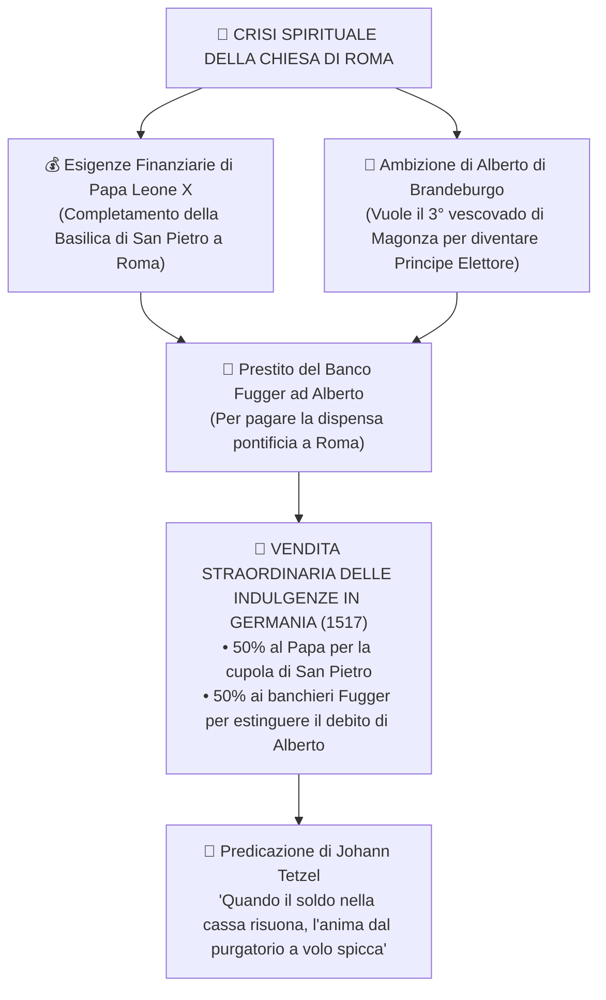
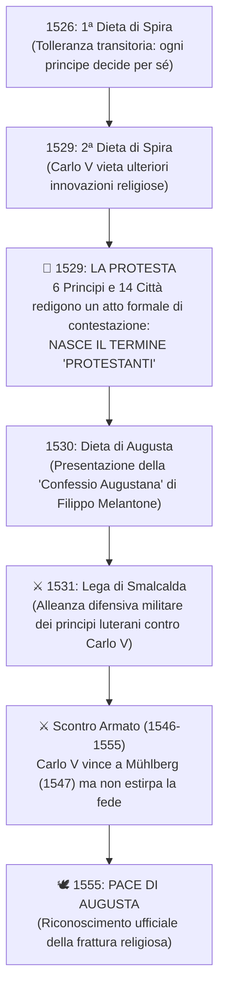

# ✝️ La Riforma Protestante e la Frattura Religiosa d'Europa

> [!NOTE] Riferimenti Manuale
> **Pagine di studio:** pag. 394 - 409 (*La Riforma di Martin Lutero e le sue conseguenze politiche e sociali*); pag. 411 - 414 (*La Riforma in Svizzera: Zwingli e Giovanni Calvino*).

---

## 1. Le Cause Profonde e la Scintilla: Lo Scandalo delle Indulgenze

All'inizio del Cinquecento, la Chiesa cattolica di Roma attraversava una ==🔴 gravissima crisi morale e spirituale==:
- **Simonia:** compravendita di cariche ecclesiastiche e benefici sacri.
- **Concubinato e Nepotismo:** prelati che convivevano apertamente e assegnavano feudi e ricchezze a figli e nipoti (es. i papi Borgia e Medici).
- **Assenteismo dei vescovi:** i vescovi cumulavano più diocesi per riscuoterne le rendite senza mai risiedere nei territori pastorali affidati.



> [!DEFINIZIONE] Cos'è l'Indulgenza?
> Nella dottrina cattolica, la remissione della pena temporale che l'anima del peccatore deve scontare in Purgatorio dopo la morte. Nel 1517 divenne una vera e propria **transazione finanziaria**: pagando una somma di denaro, la Chiesa rilasciava un certificato pergamenaceo che garantiva l'abbreviazione del Purgatorio per sé o per i propri defunti.

---

## 2. Martin Lutero e la Svolta di Wittenberg (1517)

**Martin Lutero** (1483-1546), monaco agostiniano tedesco e professore di teologia all'Università di Wittenberg, viveva un tormentoso senso del peccato e il terrore della dannazione divina. Trovò la risposta leggendo una frase dell'Apostolo Paolo nella *Lettera ai Romani*: **"Il giusto vivrà per fede"**.

Il **==🟡 31 ottobre 1517==**, Lutero affisse sul portale della chiesa del castello di Wittenberg le sue celebri **95 Tesi**:
- Condanna violenta della vendita delle indulgenze.
- Negazione dell'autorità del Papa di rimettere le pene ultraterrene stabilite da Dio.
- Rivendicazione che l'oro della cristianità doveva servire ai poveri, non alla fastosa corte romana.

```
╔══════════════════════════════════════════════════════════════════════════════════════════╗
║ 🖼️ PLACEHOLDER IMMAGINE: LUTERO E LE 95 TESI A WITTENBERG (1517)                        ║
╠══════════════════════════════════════════════════════════════════════════════════════════╣
║ ![[lutero_95_tesi_wittenberg.png|750]]                                                   ║
║ COSA CERCARE SU GOOGLE / ARCHIVI: "Ferdinand Pauwels Martin Luther 95 Theses painting"   ║
║ DESCRIZIONE: Dipinto storico che ritrae Martin Lutero con l'abito agostiniano mentre     ║
║ inchioda il foglio con le 95 tesi al portone ligneo della chiesa di Wittenberg.          ║
╚══════════════════════════════════════════════════════════════════════════════════════════╝
```

---

## 3. I 4 Pilastri Teologici della Dottrina Luterana

Lutero demolì sistematicamente l'intera impalcatura dogmatica e istituzionale della Chiesa medievale basandosi su quattro principi cardine:

```
┌────────────────────────────────────────────────────────────────────────────────────────┐
│                   I QUATTRO PRINCIPI DELLA TEOLOGIA LUTERANA                           │
├────────────────────────────────────────────────────────────────────────────────────────┤
│ 1. SOLA FIDE (La Giustificazione per Sola Fede)                                        │
│    L'uomo nasce irrimediabilmente corrotto dal peccato originale e non possiede il     │
│    libero arbitrio per salvarsi. Le opere buone, i digiuni, i pellegrinaggi e le       │
│    donazioni non servono a comprare il Paradiso: SOLO LA FEDE in Cristo salva.         │
├────────────────────────────────────────────────────────────────────────────────────────┤
│ 2. SOLA SCRIPTURA (L'Autorità Esclusiva della Sacra Scrittura)                         │
│    L'unica fonte della fede è la Bibbia (Antico e Nuovo Testamento). La tradizione     │
│    ecclesiastica, i concili e i decreti del Papa non hanno alcun valore divino.        │
│    ==> Principio del "Libero Esame": ogni fedele può e deve leggere la Bibbia.        │
├────────────────────────────────────────────────────────────────────────────────────────┤
│ 3. SACERDOZIO UNIVERSALE DEI CREDENTI                                                  │
│    Non esiste alcuna differenza ontologica o sacra tra sacerdoti e laici. Con il       │
│    Battesimo, ogni cristiano diventa sacerdote di se stesso. La Chiesa visibile non    │
│    è mediatrice tra Dio e l'uomo. I pastori sono solo guide della comunità, possono    │
│    sposarsi e non impartiscono la grazia divina.                                       │
├────────────────────────────────────────────────────────────────────────────────────────┤
│ 4. RIDUZIONE DEI SACRAMENTI A DUE SOLI (Battesimo ed Eucaristia)                       │
│    Lutero abolisce 5 dei 7 sacramenti cattolici, mantenendo solo quelli istituiti      │
│    direttamente da Cristo nei Vangeli: BATTESIMO ed EUCARISTIA.                        │
│    Rifiuta la Transustanziazione cattolica a favore della "Consustanziazione"          │
│    (pane e vino coesistono insieme con il corpo e il sangue di Cristo).                │
└────────────────────────────────────────────────────────────────────────────────────────┘
```

> [!INTERROGAZIONE] Differenza Dogmatica Cruciale: Transustanziazione vs Consustanziazione
> - **Transustanziazione (Cattolicesimo):** Durante la consacrazione sacerdotale, la sostanza del pane e del vino si trasforma *totalmente e miracolosamente* nel vero corpo e nel vero sangue di Cristo; rimangono solo le specie (apparenze) esteriori.
> - **Consustanziazione (Luteranesimo):** Il corpo e il sangue di Cristo sono realmente presenti *insieme* alla sostanza fisica del pane e del vino, che non mutano la loro natura terrena. Non occorre il potere sacerdotale di un prete per compiere il miracolo.

---

## 4. Dalla Scomunica alla Dieta di Worms (1520 - 1521)

La rottura con Roma fu rapida e insanabile:
1. **La Bolla papale *Exsurge Domine* (1520):** Papa Leone X minacciò di scomunicare Lutero se non avesse ritrattato entro 60 giorni. Per tutta risposta, Lutero **==🔴 bruciò pubblicamente la bolla pontificia==** sulla piazza di Wittenberg insieme ai volumi di diritto canonico. Nel gennaio 1521 venne ufficialmente scomunicato.
2. **La Dieta di Worms (aprile ==🟡 1521==):** Il giovane imperatore Carlo V convocò Lutero davanti all'assemblea dei principi tedeschi per chiedergli una formale ritrattazione.
   - Lutero pronunciò la sua memorabile risposta: *"A meno che non venga convinto con le prove della Sacra Scrittura o con chiari ragionamenti... la mia coscienza è prigioniera della Parola di Dio. Non posso e non voglio ritrattare nulla. Qui sto, non posso fare altrimenti!"*.
   - Carlo V emanò l'**Editto di Worms**, dichiarando Lutero fuorilegge e nemico pubblico dell'Impero.
3. **Il Rifugio a Wartburg:** Il protettore politico di Lutero, il principe **Federico il Saggio di Sassonia**, inscenò un finto rapimento e nascose il riformatore nella fortezza sicura di **Wartburg**. Qui Lutero trascorse dieci mesi traducendo l'intero **Nuovo Testamento dal greco al tedesco volgare**, ponendo le fondamenta della moderna lingua e identità nazionale tedesca.

---

## 5. Le Rivolte Sociali: Cavalieri e la Guerra dei Contadini (1524 - 1525)

Il messaggio di libertà evangelica di Lutero venne interpretato dalle classi sociali subalterne come una promessa di **emancipazione economica e riscatto sociale**, innescando violentissime rivolte:

### 1. La Rivolta dei Cavalieri (1522 - 1523)
I piccoli nobili decaduti (*Ritter*), guidati da Franz von Sickingen e Ulrich von Hutten, tentarono di impadronirsi con le armi delle terre dei vescovi-principi cattolici (assedio di Treviri). Furono rapidamente schiacciati dalla coalizione dei principi territoriali.

### 2. La Guerra dei Contadini e Thomas Müntzer (1524 - 1525)
Le comunità contadine della Germania meridionale e centrale, oppresse dai vincoli feudali imposti dai signori, insorsero in massa redigendo i celebri **Dodici Articoli**:
- Richiesta di abolizione della servitù della gleba.
- Ripristino dei diritti comunitari sui boschi, pascoli e corsi d'acqua (contro le recinzioni signorili).
- Diritto delle parrocchie di eleggere democraticamente i propri pastori.

A capo dell'ala più radicale si pose il teologo **Thomas Müntzer**, che propugnava una società anabattista egualitaria senza classi, senza proprietà privata e senza signori.

> [!TRAPPOLA] La Posizione di Lutero: Tradimento o Coerenza?
> Molti contadini pensavano che Lutero si sarebbe messo alla loro guida. Al contrario, Lutero pubblicò un trattato dal titolo spietato: **"Contro le empie e scellerate bande dei contadini"**, in cui incitava i principi a: *"Sgozzarli, scannarli, pugnalarli in segreto o in pubblico, come si fa con i cani rabbiosi!"*.
> 
> **Perché Lutero reagì così duramente?**
> 1. **Motivazione Teologica:** Per Lutero la libertà cristiana è puramente **interiore e spirituale**, non un ribaltamento dell'ordine sociale terreno. L'autorità politica secolare è voluta da Dio per frenare la malvagità umana.
> 2. **Motivazione Politica:** La Riforma poteva sopravvivere alla vendetta dell'Imperatore Carlo V e del Papa SOLO se appoggiata militarmente e finanziariamente dai **principi territoriali tedeschi**. Se Lutero avesse appoggiato i contadini, i principi avrebbero distrutto la Riforma.

Nel maggio **1525**, nella tragica **Battaglia di Frankenhausen**, gli eserciti principeschi massacrarono oltre 5.000 contadini mal armati. Thomas Müntzer fu torturato e decapitato.

---

## 6. Dalle Diete di Spira alla Pace di Augusta (1555)



### I Due Principi Fondamentali della Pace di Augusta (1555)

La Pace di Augusta, stipulata tra il fratello di Carlo V (Ferdinando d'Asburgo) e i principi protestanti nel **==🟡 1555==**, pose fine a trent'anni di guerre di religione in Germania stabilendo due storici principi:

1. **`Cuius regio, eius religio` ("Di chi è la regione, di lui sia la religione"):**
   - I sudditi non erano liberi di scegliere la propria confessione religiosa: dovevano obbligatoriamente conformarsi alla scelta del sovrano del loro territorio.
   - Ai dissidenti religiosi era concessa un'unica libertà: vendere i propri beni ed **emigrare** in un altro stato che professasse la loro fede.
2. **`Reservatum ecclesiasticum` ("Riserva ecclesiastica"):**
   - Se un principe-vescovo cattolico decideva di convertirsi al luteranesimo dopo l'anno di riferimento (1552), non poteva secolarizzare il principato: doveva rinunciare alla carica e lasciare intatte terre e rendite alla Chiesa cattolica.

> [!IMPORTANTE] Limite Gravissimo della Pace di Augusta
> La Pace di Augusta riconobbe **solo due confessioni: Cattolicesimo e Luteranesimo**. Il **Calvinismo venne totalmente escluso**, creando le premesse per i violentissimi conflitti che culmineranno nel secolo successivo nella Guerra dei Trent'Anni (1618-1648).

---

## 7. La Riforma in Svizzera: Zwingli e Giovanni Calvino

Parallelamente alla Germania, la Svizzera divenne l'altro grande laboratorio del protestantesimo radicale.

```
╔══════════════════════════════════════════════════════════════════════════════════════════╗
║ 🖼️ PLACEHOLDER: I GRANDI RIFORMATORI (LUTERO, CALVINO, ZWINGLI)                         ║
╠══════════════════════════════════════════════════════════════════════════════════════════╣
║ ![[riformatori_confronto.png|750]]                                                       ║
║ COSA CERCARE: "Ritratti Lutero Cranach, Calvino ritratto Ginevra, Zwingli Zurigo"        ║
║ DESCRIZIONE: Trittico iconografico che mette a confronto i volti severi dei tre massimi  ║
║ teologi della Riforma protestante cinquecentesca.                                        ║
╚══════════════════════════════════════════════════════════════════════════════════════════╝
```

### Ulrich Zwingli a Zurigo
A Zurigo il sacerdote umanista **Ulrich Zwingli** (1484-1531) portò la riforma a conseguenze ancora più radicali di Lutero:
- Abolizione totale di immagini sacre, statue, affreschi, organi e canti (iconoclastia).
- L'Eucaristia venne intesa come un **puro rito simbolico commemorativo** dell'Ultima Cena (smentendo sia la transustanziazione cattolica che la consustanziazione luterana). Zwingli morì armato sul campo di battaglia a Kappel (1531) contro i cantoni cattolici svizzeri.

### Giovanni Calvino e la Teocrazia di Ginevra (pp. 411 - 414)
Il francese **Giovanni Calvino** (Jean Cauvin, 1509-1564), rifugiatosi a Ginevra, pubblicò nel 1536 l'opera monumentale della teologia riformata: la *Christianae Religionis Institutio*.

#### 1. La Dottrina della Doppia Predestinazione Assoluta
La teologia calvinista porta alle estreme conseguenze la sovranità di Dio:
- ==🟣 Prima ancora della creazione del mondo, Dio ha già stabilito imperscrutabilmente il destino eterno di ogni uomo: chi sarà salvato (gli Eletti) e chi sarà condannato alla dannazione eterna==.
- L'uomo non può fare nulla per meritare o cambiare questo decreto divino.

#### 2. Il Valore del Lavoro e la Tesi di Max Weber
Se la salvezza è già decisa, perché darsi da fare?
- Calvino insegna che il fedele deve cercare nella propria vita terrena i **segni della grazia divina**.
- Il dovere professionale quotidiano (**Beruf**, inteso come autentica "vocazione divina"), l'impegno infaticabile nel commercio e nell'artigianato, e il successo economico ottenuto onestamente sono indizi visibili che Dio ha scelto quel credente tra gli eletti.
- **La Tesi di Max Weber (*L'etica protestante e lo spirito del capitalismo*, 1904):** Il sociologo Weber ha evidenziato come l'etica calvinista (disciplina rigida, rifiuto del lusso mondano e reinvestimento continuo dei profitti nelle attività produttive) abbia costituito la spinta psicologica fondamentale per la nascita del **capitalismo moderno** in Inghilterra, Olanda e colonie americane.

#### 3. La Repubblica Teocratica di Ginevra
A Ginevra Calvino realizzò una ferrea compenetrazione tra potere religioso e governo civile:
- Il supremo organo di vigilanza cittadino era il **Concistoro** (composto da pastori e laici anziani).
- Imposizione di una moralità pubblica ossessiva: banditi il gioco d'azzardo, i balli, i teatri, il lusso nelle vesti e persino i canti profani nelle osterie.
- **Intolleranza religiosa assoluta:** Ginevra divenne intollerante quanto Roma. Nel **1553**, il celebre medico e teologo spagnolo **Michele Serveto**, rifugiatosi a Ginevra per sfuggire all'Inquisizione cattolica, fu condannato al rogo dai calvinisti per aver negato il dogma della Trinità.

---

## 📊 Quadro Comparativo Sinottico delle Fedi Religiose

| Aspetto Dogmatico | Cattolicesimo Romano | Luteranesimo | Calvinismo |
| :--- | :--- | :--- | :--- |
| **Come ci si salva?** | Fede + Opere buone (Merito) | ==Sola Fide== (Sola Fede in Cristo) | ==Doppia Predestinazione Assoluta== |
| **Fonte della Rivelazione** | Bibbia + Tradizione della Chiesa e Decreti Papali | ==Sola Scriptura== (Libero Esame individuale) | ==Sola Scriptura== (Bibbia come legge politica e morale) |
| **Numero di Sacramenti** | **7 Sacramenti** | **2 Sacramenti** (Battesimo ed Eucaristia) | **2 Sacramenti** (Battesimo ed Eucaristia simbolica) |
| **Presenza nell'Eucaristia** | **Transustanziazione** (conversione totale e miracolosa) | **Consustanziazione** (reale coesistenza di pane e corpo) | **Presenza puramente spirituale / simbolica** |
| **Ruolo del Clero** | Sacerdozio ministeriale sacro e gerarchico (Papa al vertice) | Sacerdozio universale; pastori sposati e revocabili | Pastori eletti e laici integrati nel Concistoro |
| **Diffusione Geografica** | Italia, Spagna, Portogallo, Austria, Francia (prevalente) | Germania settentrionale, Danimarca, Svezia, Norvegia | Svizzera, Olanda, Scozia (Presbiteriani), Francia (Ugonotti), Inghilterra (Puritani) |

---

## 🎯 Domande Chiave per l'Interrogazione

> [!INTERROGAZIONE] Simulazione Interrogazione: I Punti Irrinunciabili
> 1. **Quale meccanismo finanziario e politico diede origine allo scandalo delle indulgenze nel 1517?**
>    *Il patto tra papa Leone X e Alberto di Brandeburgo, finanziato dal bando Fugger, per completare San Pietro e comprare l'arcivescovado di Magonza spartendosi i proventi delle indulgenze.*
> 2. **Cosa significano le formule "Sola Fide" e "Sola Scriptura"?**
>    *Sola Fide: l'uomo si salva solo per grazia divina attraverso la fede, le opere buone non comprano la salvezza. Sola Scriptura: l'unica autorità religiosa infallibile è la Bibbia, senza mediazione di papi o concili.*
> 3. **Perché Lutero si schierò con i principi contro i contadini di Müntzer?**
>    *Perché distingueva la libertà spirituale interiore dall'ordine politico esteriore voluto da Dio, e perché la Riforma aveva bisogno dell'appoggio militare e politico dei principi per non essere distrutta.*
> 4. **In cosa differisce radicalmente la dottrina della Predestinazione di Calvino dal Luteranesimo?**
>    *Calvino teorizza che Dio ha già decretato ab aeterno chi è eletto e chi dannato; il successo lavorativo e il dovere professionale (Beruf) diventano segni terreni di tale predilezione divina.*
> 5. **Cosa stabilì la Pace di Augusta del 1555?**
>    *Il principio del "Cuius regio, eius religio" (la religione dei sudditi è decisa dal principe) e il "Reservatum ecclesiasticum", riconoscendo però solo cattolici e luterani ed escludendo i calvinisti.*
