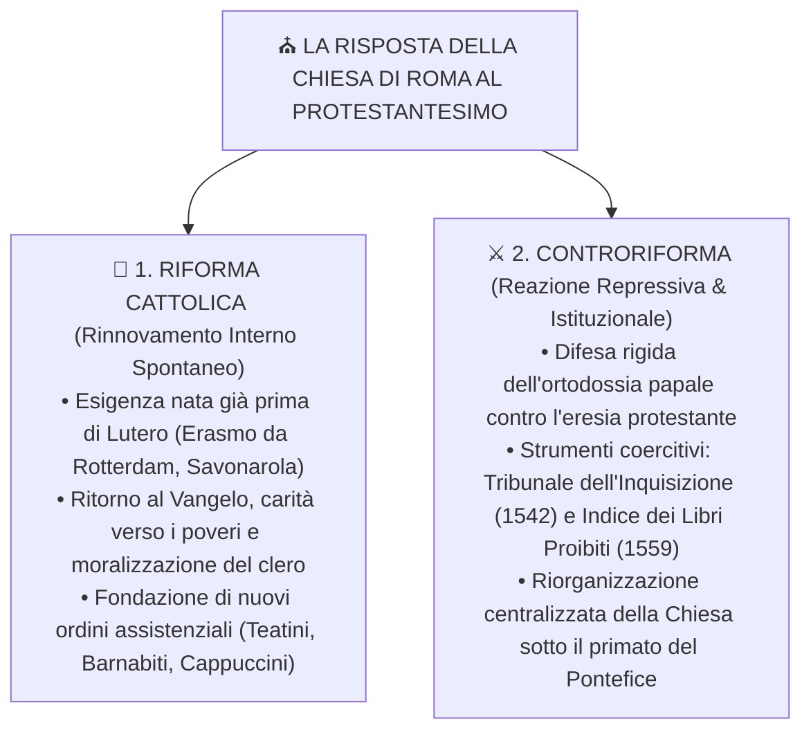
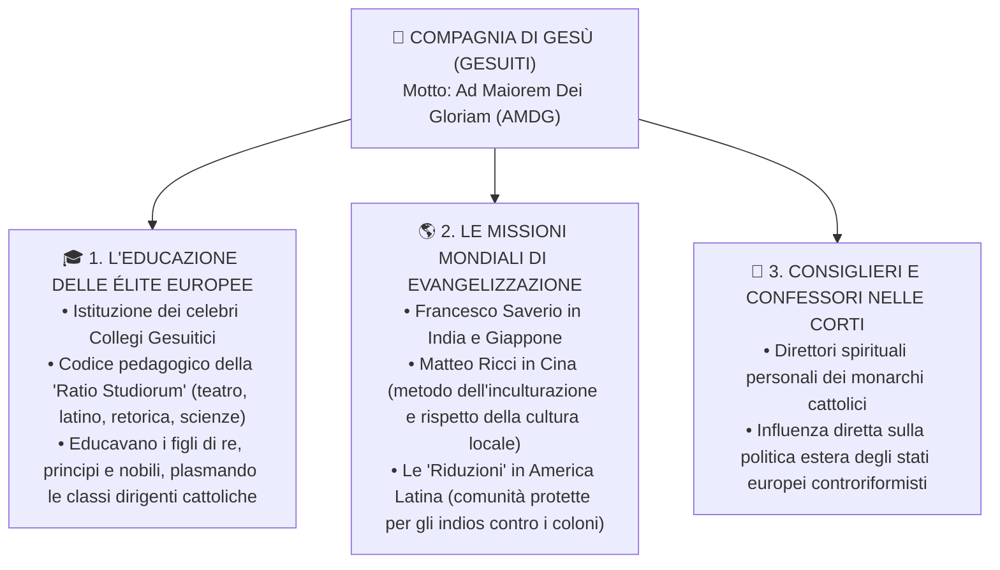

# 🛡️ La Controriforma Cattolica e il Concilio di Trento

> [!NOTE] Riferimenti Manuale
> **Pagine di studio:** pag. 414 - 422 (*Elementi salienti della Controriforma e della Riforma Cattolica*).

---

## 1. Il Dibattito Storiografico: "Controriforma" o "Riforma Cattolica"?

La reazione della Chiesa di Roma alla rottura protestante non fu un fenomeno a senso unico, ma un processo duplice e complesso:



> [!DEFINIZIONE] La Sintesi dello Storico Hubert Jedin
> Lo storico tedesco Hubert Jedin ha chiarito che non si può parlare di un unico movimento: la Chiesa visse contemporaneamente una **Riforma Cattolica** (autoriforma spirituale e morale volta a sanare le proprie ferite) e una **Controriforma** (contrattacco dogmatico, politico e militare contro l'avanzata luterana e calvinista).

---

## 2. Il Concilio di Trento (1545 - 1563)

Sollecitato con insistenza da Carlo V (che sperava disperatamente di ricucire la frattura religiosa per salvare l'unità dell'Impero), papa **Paolo III Farnese** indisse nel **==🟡 1545==** il XIX Concilio Ecumenico a **Trento**.

> [!TRUCCO] Perché Proprio la Città di Trento?
> Trento fu scelta come perfetto compromesso geopolitico:
> 1. Era un **Principato Vescovile** (governato da un principe della Chiesa fedele a Roma).
> 2. Geograficamente si trovava in Italia, ma politicamente apparteneva al territorio del **Sacro Romano Impero Germanico**, rassicurando sia i prelati italiani sia l'imperatore Carlo V.

I protestanti, tuttavia, rifiutarono di partecipare: non riconoscevano l'autorità del Papa come giudice supremo del concilio. Quello che doveva essere un concilio di pacificazione universale si trasformò nella **massima assise di riarmo dottrinale e dogmatico del cattolicesimo romano**.

```
╔══════════════════════════════════════════════════════════════════════════════════════════╗
║ 🖼️ PLACEHOLDER IMMAGINE: IL CONCILIO DI TRENTO IN SESSIONE                               ║
╠══════════════════════════════════════════════════════════════════════════════════════════╣
║ ![[concilio_di_trento_chiesa_santa_maria.png|750]]                                       ║
║ COSA CERCARE SU GOOGLE / ARCHIVI: "Concilio di Trento dipinto Museo Diocesano Trento"    ║
║ DESCRIZIONE: Dipinto storico raffigurante l'assemblea solenne dei padri conciliari       ║
║ riuniti nella cattedrale di Santa Maria Maggiore a Trento, con cardinali e vescovi.     ║
╚══════════════════════════════════════════════════════════════════════════════════════════╝
```

### La Struttura dei Decreti Tridentini
Il Concilio durò ben 18 anni (**1545 - 1563**), tra interruzioni belliche, pestilenze e il trasferimento provvisorio a Bologna. Si concluse sotto il pontificato di **Pio IV** producendo due ordini distinti di decreti:

---

### A. I Decreti Dottrinali (Chiusura Totale al Protestantesimo)

Sul piano teologico, la Chiesa cattolica respinse categoricamente ogni tesi di Lutero e Calvino:

1. **Fede e Opere:** La giustificazione dell'uomo avviene per grazia divina, ma richiede la **cooperazione del libero arbitrio umano**: le opere buone (elemosina, carità, sacramenti) sono necessarie per ottenere la salvezza eterna.
2. **Conferma dei Sette Sacramenti:** Riaffermata l'istituzione divina di tutti e sette i sacramenti cattolici (Battesimo, Cresima, Eucaristia, Penitenza, Estrema Unzione, Ordine Sacro, Matrimonio).
3. **Dogma della Transustanziazione:** Confermata la trasformazione reale e sostanziale del pane e del vino nel corpo e nel sangue di Cristo durante la Messa.
4. **Autorità della Vulgata e della Tradizione:** L'unica traduzione biblica ufficiale autorizzata è la **Vulgata latina di San Girolamo**. La Tradizione apostolica della Chiesa ha lo stesso valore normativo della Sacra Scrittura. ==🔴 Divieto assoluto del "libero esame" individuale== delle Scritture.
5. **Messa in Latino:** Il latino resta l'unica lingua liturgica universale, per preservare il mistero sacro e l'unità della Chiesa romana.
6. **Purgatorio, Culto dei Santi e Indulgenze:** Riaffermata l'esistenza del Purgatorio, la legittimità delle indulgenze (condannandone solo gli abusi commerciali) e la devozione alla Vergine Maria, ai santi e alle loro reliquie.
7. **Primato Papale Assoluto:** Il Vescovo di Roma è il vicario di Cristo in terra, infallibile guida spirituale e vertice gerarchico intoccabile di tutta la cristianità.

---

### B. I Decreti Disciplinari (Riforma e Moralizzazione del Clero)

Per strappare ai protestanti le armi della critica morale, il Concilio impose una rigida riorganizzazione pastorale:

| Riforma Disciplinare | Contenuto e Obiettivo Operativo |
| :--- | :--- |
| **Obbligo di Residenza** | Vescovi e parroci hanno l'==obbligo tassativo di risiedere nella propria diocesi o parrocchia==, per vigilare costantemente sui fedeli (pena la decadenza dalle rendite). |
| **Divieto di Cumulo dei Benefici** | Nessun ecclesiastico può possedere o ricevere le rendite di più di una diocesi o parrocchia contemporaneamente (fine della simonia nobiliare). |
| **Istituzione dei Seminari** | In ogni diocesi viene fondata una scuola superiore obbligatoria (**seminario**) per educare, formare teologicamente e moralizzare i giovani candidati al sacerdozio (fine dell'ignoranza del clero). |
| **Visite Pastorali Periodiche** | I vescovi devono ispezionare regolarmente tutte le parrocchie del territorio diocesano per verificare la condotta morale dei sacerdoti e l'ortodossia del popolo. |
| **Istituzione dei Registri Parrocchiali** | I parroci devono compilare accuratamente i registri obbligatori dei **Battesimi, Matrimoni, Sepolture** e lo *Status animarum* (censimento pasquale dei fedeli). |
| **Celibato Ecclesiastico** | Riaffermato l'obbligo assoluto del celibato e della castità per tutti i sacerdoti cattolici. |
| **Il Catechismo Romano (1566)** | Pubblicazione di un manuale dottrinale unificato (*Catechismus Romanus* di papa Pio V) per insegnare le verità di fede al popolo attraverso l'omelia domenicale. |

---

## 3. Gli Strumenti della Repressione e del Controllo

Per impedire la penetrazione delle idee riformate nei paesi cattolici (soprattutto in Italia e Spagna), la Chiesa eresse un imponente apparato di coercizione poliziesca e censura ideologica:

```
┌────────────────────────────────────────────────────────────────────────────────────────┐
│                   I DUE BRACCI ARMATI DEL CONTROLLO RELIGIOSO                          │
├────────────────────────────────────────────────────────────────────────────────────────┤
│ 1. IL TRIBUNALE DEL SANT'UFFIZIO (INQUISIZIONE ROMANA - 1542)                          │
│    Istituito da papa Paolo III su spinta del cardinale Gian Pietro Carafa (poi papa    │
│    Paolo IV). Era un tribunale centrale supremo diretto da una congregazione di        │
│    cardinali a Roma, con il potere di indagare, arrestare, torturare e processare      │
│    chiunque fosse sospettato di deviazione dottrinale (eresia).                        │
│    ==> Se l'eretico non ritrattava, veniva consegnato al "braccio secolare"            │
│        (autorità civile) per essere bruciato vivo sul rogo (es. Giordano Bruno nel     │
│        1600 in Campo de' Fiori a Roma).                                                │
├────────────────────────────────────────────────────────────────────────────────────────┤
│ 2. L'INDICE DEI LIBRI PROIBITI (INDEX LIBRORUM PROHIBITORUM - 1559)                    │
│    Elenco ufficiale e costantemente aggiornato dei volumi di cui era vietata con la   │
│    scomunica la lettura, il possesso, la vendita e la stampa.                          │
│    ==> Vennero proibite: tutte le opere dei riformatori (Lutero, Calvino, Zwingli),     │
│        tutte le traduzioni della Bibbia in lingua volgare (il popolo non doveva        │
│        leggere la Scrittura autonomamente!), le opere di scienziati (Copernico,        │
│        poi Galileo), filosofi (Machiavelli, Erasmo, Bruno) e persino novellieri        │
│        come Boccaccio (Decameron censurato).                                           │
└────────────────────────────────────────────────────────────────────────────────────────┘
```

> [!INTERROGAZIONE] Differenza tra Inquisizione Spagnola e Inquisizione Romana
> - **Inquisizione Spagnola (1478):** Dipendeva direttamente dalla Corona spagnola (usata dai Re Cattolici come strumento politico per perseguitare ebrei e musulmani convertiti).
> - **Inquisizione Romana / Sant'Uffizio (1542):** Dipendeva direttamente dal Papa a Roma, con giurisdizione mirata a stanare l'eresia protestante e vigilare sulla purezza della fede cattolica, soprattutto nella penisola italiana.

---

## 4. L'Esercito della Controriforma: La Compagnia di Gesù (Gesuiti)

La Chiesa non si limitò a reprimere, ma seppe mobilitare un nuovo straordinario slancio missionario ed educativo grazie alla nascita della **Compagnia di Gesù (Gesuiti)**.

```
╔══════════════════════════════════════════════════════════════════════════════════════════╗
║ 🖼️ PLACEHOLDER IMMAGINE: SANT'IGNAZIO DI LOYOLA E I GESUITI                            ║
╠══════════════════════════════════════════════════════════════════════════════════════════╣
║ ![[ignazio_di_loyola_gesuiti.png|750]]                                                   ║
║ COSA CERCARE SU GOOGLE / ARCHIVI: "Ritratto di Sant'Ignazio di Loyola Rubens o anonimo"  ║
║ DESCRIZIONE: Ritratto solenne di Ignazio di Loyola in tonaca nera che regge il libro      ║
║ della Regola della Compagnia con il motto "Ad maiorem Dei gloriam" (AMDG).              ║
╚══════════════════════════════════════════════════════════════════════════════════════════╝
```

### Fondazione e Struttura Militare
Fondata nel **1534** dall'ex soldato basco **Ignazio di Loyola** e approvata da Paolo III nel 1540 con la bolla *Regimini militantis Ecclesiae*:
- I membri si concepivano come una vera e propria **milizia scelta al servizio di Cristo e del Papa**.
- Al vertice sedeva un **Generale Preposto** a vita (chiamato informalmente il "Papa Nero").
- Oltre ai tre tradizionali voti monastici (povertà, castità, obbedienza), i Gesuiti prestavano un **Quarto Voto**: ==🟣 Obbedienza totale e incondizionata al Papa==, da eseguirsi *"perinde ac cadaver"* (alla lettera: "ciecamente, come se si fosse un cadavere privo di volontà propria").

### I Tre Campi d'Azione Strategica dei Gesuiti



---

## 🎯 Sintesi per l'Interrogazione

> [!INTERROGAZIONE] Domande Frequenti su Concilio di Trento e Controriforma
> 1. **Quali furono le principali decisioni dottrinali prese al Concilio di Trento?**
>    *La Chiesa ribadì tutti i dogmi contestati dai protestanti: 7 sacramenti, transustanziazione, cooperazione tra fede e opere per la salvezza, culto dei santi e della Vergine, autorità esclusiva della Vulgata e primato papale.*
> 2. **In cosa consistette la riforma disciplinare e morale dei costumi ecclesiastici?**
>    *Obbligo di residenza per vescovi e parroci, divieto di cumulo dei benefici, fondazione dei seminari diocesani per formare i sacerdoti, tenuta obbligatoria dei registri parrocchiali e riaffermazione del celibato.*
> 3. **Quale ruolo svolsero il Sant'Uffizio e l'Indice dei Libri Proibiti?**
>    *Furono gli strumenti centralizzati della repressione controriformista: il Sant'Uffizio perseguiva e condannava gli eretici con processi e torture; l'Indice censurava la circolazione di testi luterani, scientifici e persino la Bibbia in volgare.*
> 4. **Quali caratteristiche rendevano unica la Compagnia di Gesù rispetto agli ordini medievali?**
>    *La rigida disciplina militare, il quarto voto di obbedienza assoluta al Papa (perinde ac cadaver), il monopolio dell'istruzione superiore della nobiltà europea nei collegi e le grandi missioni evangelizzatrici in Asia e nelle Americhe.*
