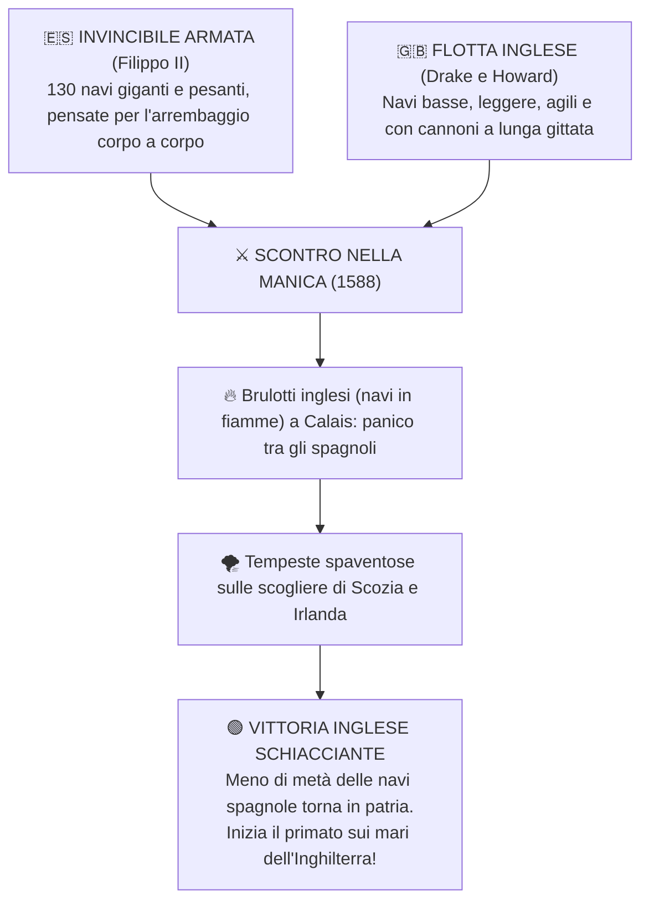

# 👑 L'Inghilterra dei Tudor: Da Enrico VIII a Elisabetta I

> [!NOTE] Riferimento Libro
> **Pagine:** 413 - 415 (La Riforma in Inghilterra) | 465 - 473 (Elisabetta I e scontro con la Spagna)

---

## 1. Enrico VIII e lo Scisma Anglicano (1534)

La rottura di **Enrico VIII Tudor** con la Chiesa cattolica non nacque da motivi religiosi, ma da un **==🔵 problema dinastico e politico==**:

- **Il motivo:** Enrico VIII è sposato con **Caterina d'Aragona** (zia dell'imperatore Carlo V) e non riesce ad avere un erede maschio (hanno solo una figlia, Maria).
- **La richiesta al Papa:** Si innamora della dama di corte **Anna Bolena** e chiede a papa Clemente VII l'annullamento del matrimonio.
- **Il rifiuto del Papa:** Clemente VII rifiuta per non offendere l'imperatore Carlo V, che ha appena saccheggiato Roma nel 1527.
- **==🟡 1534 - L'Atto di Supremazia (Act of Supremacy):==**
  - Enrico VIII fa approvare dal Parlamento la legge che dichiara il Re: **"L'unico Capo Supremo sulla terra della Chiesa d'Inghilterra"** (*Anglicana Ecclesia*).
  - **Non è un'eresia, ma uno scisma politico:** dottrina e sacramenti restano inizialmente cattolici. Chi si oppone viene decapitato per tradimento (es. l'umanista **Tommaso Moro**).

---

## 2. La Conseguenza Economica: La Nascita della "Gentry"

- **Soppressione dei Monasteri (1536-1540):** Il Re confisca tutti i conventi e le terre della Chiesa (circa **1/5 di tutte le terre coltivabili inglesi**).
- **Ascesa della Gentry:** La Corona vende queste terre alla piccola e media nobiltà rurale (**gentry**) e ai ricchi mercanti borghesi.
- **Le Recinzioni (*Enclosures*):** I nuovi proprietari recintano i campi aperti per allevarvi pecore da lana per il commercio tessile. Chi ha comprato terre della Chiesa diventa un fedelissimo sostenitore della nuova Chiesa anglicana (per non dover restituire i campi al clero!).

---

## 3. Da Edoardo VI a Maria la Sanguinaria

1. **Edoardo VI (1547-1553):** Salito al trono a 9 anni, trasforma l'anglicanesimo in senso **calvinista** e introduce il testo liturgico obbligatorio: il ***Book of Common Prayer*** (1549).
2. **Maria I Tudor detta "La Sanguinaria" (*Bloody Mary*, 1553-1558):**
   - Figlia di Caterina d'Aragona e cattolica devota, sposa **Filippo II di Spagna**.
   - Tenta di restaurare a forza il cattolicesimo mandando al rogo circa 300 protestanti (tra cui l'arcivescovo Cranmer), lasciando negli inglesi un odio viscerale verso il papato e la Spagna.

---

## 4. Elisabetta I Tudor e l'Età dell'Oro (1558-1603)

Figlia di Enrico VIII e Anna Bolena, sale al trono a 25 anni e regna per 45 anni. Si proclama la **"Regina Vergine"** (*Virgin Queen*) rifiutando ogni matrimonio per preservare l'indipendenza dell'Inghilterra.

### Le Azioni Chiave di Elisabetta I:
- **Compromesso Religioso (1559):** Trova una via di mezzo: teologia protestante moderata (Trentanove Articoli) ma mantiene la gerarchia dei vescovi (*episcopale*) nominati dalla Corona. Reprime sia i cattolici ribelli che i **Puritani** (calvinisti radicali).
- **La Questione di Maria Stuart (1587):** La cugina cattolica **Maria Stuart** (regina di Scozia fuggita a Londra) complotta con il Papa e la Spagna per rovesciare Elisabetta. Scoperti i carteggi segreti, Elisabetta la fa **==🔴 decapitare nel 1587==**, scatenando la reazione di Filippo II.
- **I Corsari di Elisabetta (*Sea Dogs*):** La Regina finanzia corsari patrioti come **Sir Francis Drake** per attaccare e depredare i galeoni spagnoli carichi di argento americano. Nel 1584 nasce la colonia della **Virginia**.
- **Commercio Mondiale:** Nel **1600** fonda la potente **Compagnia delle Indie Orientali**. Fiorisce il teatro rinascimentale di **William Shakespeare**.

```
╔══════════════════════════════════════════════════════════════════════════════════════════╗
║ 🖼️ PLACEHOLDER: RITRATTO DI ELISABETTA I ("DITCHLEY PORTRAIT")                           ║
╠══════════════════════════════════════════════════════════════════════════════════════════╣
║ ![[elisabetta_i_ritratto_ditchley.png|700]]                                              ║
║ Cerca: "Queen Elizabeth I Marcus Gheeraerts Ditchley portrait"                           ║
╚══════════════════════════════════════════════════════════════════════════════════════════╝
```

---

## 5. La Disfatta dell'Invincibile Armata (1588)

Nel **==🟡 1588==**, Filippo II di Spagna invia una flotta gigantesca (130 enormi galeoni e 30.000 soldati) per invadere l'Inghilterra eretica.



> [!IMPORTANTE] Conseguenza Storica del 1588
> La vittoria segna il **declino militare della Spagna** e consacra l'**Inghilterra come nuova regina indiscussa dei mari e dei commerci mondiali**.

```
╔══════════════════════════════════════════════════════════════════════════════════════════╗
║ 🖼️ PLACEHOLDER: LA DISFATTA DELL'INVINCIBILE ARMATA (1588)                               ║
╠══════════════════════════════════════════════════════════════════════════════════════════╣
║ ![[disfatta_invincibile_armata_1588.png|700]]                                            ║
║ Cerca: "Defeat of the Spanish Armada Loutherbourg painting"                              ║
╚══════════════════════════════════════════════════════════════════════════════════════════╝
```

---

## 🎯 Punti Chiave da Sapere per l'Interrogazione

> [!INTERROGAZIONE] Domande Secche della Prof
> 1. **Perché nasce la Chiesa Anglicana nel 1534?** *Enrico VIII voleva un erede maschio da Anna Bolena; al rifiuto del Papa di annullare il matrimonio con Caterina d'Aragona, promulgò l'Atto di Supremazia diventando capo della Chiesa d'Inghilterra.*
> 2. **Chi era la "gentry" e come si arricchì?** *La piccola e media nobiltà rurale che acquistò le terre confiscate ai monasteri cattolici, recintandole (enclosures) per l'allevamento della lana.*
> 3. **Cosa fece Elisabetta I con Maria Stuart?** *La tenne prigioniera per 19 anni e nel 1587 la fece decapitare per aver complottato con Spagna e Papa per assassinarla.*
> 4. **Quali furono le cause della sconfitta dell'Invincibile Armata spagnola nel 1588?** *Le navi inglesi più agili armate di cannoni a lungo raggio, l'attacco dei brulotti a Calais e le violentissime tempeste sulle coste scozzesi e irlandesi.*
