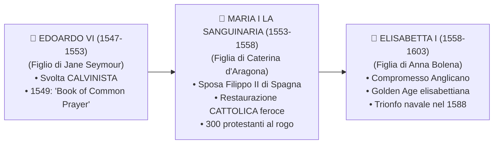

# 👑 L'Inghilterra dei Tudor: Dallo Scisma Anglicano all'Età Elisabettiana

> [!NOTE] Riferimenti Manuale
> **Pagine di studio:** pag. 413 - 415 (*La Riforma in Inghilterra ed Enrico VIII*); pag. 465 - 473 (*L'Inghilterra nell'Età Elisabettiana, il conflitto con la Spagna e lo scontro sui mari*).

---

## 1. Enrico VIII e la Genesi dello Scisma Anglicano (1509 - 1534)

All'inizio del suo regno, **Enrico VIII Tudor** (1491-1547) era un fervente cattolico: nel 1521 aveva scritto un trattato in difesa dei sette sacramenti contro Lutero, ricevendo da papa Leone X l'onorifico titolo di **Defensor Fidei** ("Difensore della Fede").

La rottura con la Chiesa di Roma non nacque da un dissenso teologico, ma da un **==🔵 problema dinastico e politico==**:

```mermaid
flowchart TD
    E["👑 ENRICO VIII TUDOR<br/>(Re d'Inghilterra, ossessionato dall'avere un erede maschio)"]
    C["👸 Caterina d'Aragona<br/>(Moglie legittima, zia dell'imperatore Carlo V)<br/>• Ha partorito solo una femmina: Maria Tudor"]
    A["🌹 Anna Bolena<br/>(Dama di corte di cui Enrico è innamorato)"]

    E -->|1527: Chiede l'Annullamento del Matrimonio| PAPA["⛪ Papa Clemente VII (Medici)<br/>A Roma"]
    
    CARLO["⚔️ CARLO V D'ASBURGO<br/>(Nipote di Caterina d'Aragona)<br/>• Ha appena saccheggiato Roma nel 1527<br/>• Tiene il Papa sotto scacco militare"]
    
    CARLO -.->|Pressione Diplomatica & Minaccia| PAPA
    PAPA -->|RIFIUTO TASSATIVO| E
    
    E -->|Sposa segretamente Anna Bolena (1533)| SCISMA["📜 1534: ATTO DI SUPREMAZIA<br/>Rottura definitiva con Roma e nascita della Chiesa Anglicana"]
```

### L'Atto di Supremazia (1534)
Nel **==🟡 1534==**, con l'approvazione del Parlamento inglese, Enrico VIII promulgò l'**Atto di Supremazia** (*Act of Supremacy*):
- Il Re fu proclamato ufficialmente: **"L'unico Capo Supremo sulla terra della Chiesa d'Inghilterra"** (*Anglicana Ecclesia*).
- Venne interrotto ogni legame politico, finanziario e giurisdizionale con il Papa a Roma.
- **Carattere iniziale dello Scisma:** Non fu un'eresia dottrinale, ma uno **scisma politico e istituzionale**. I dogmi, i riti e i sacramenti cattolici rimasero immutati (l'Eucaristia e il celibato dei preti furono confermati con i *Sei Articoli* del 1539; chi negava la transustanziazione veniva condannato a morte come eretico!).
- **La repressione degli oppositori:** Chi rifiutava di prestare il giuramento di fedeltà al re (*Oath of Supremacy*) veniva giustiziato per alto tradimento. Tra le vittime illustri figurano l'umanista ed ex Cancelliere del Regno **Thomas More (Tommaso Moro)**, autore di *Utopia*, e il vescovo John Fisher (entrambi decapitati nel 1535).

---

## 2. Le Conseguenze Economiche: La Nascita della "Gentry"

L'evento che trasformò irreversibilmente la società inglese fu la **Soppressione dei Monasteri (1536 - 1540)**:
- Enrico VIII ordinò la chiusura di tutte le abbazie, conventi e monasteri cattolici del regno.
- La Corona incamerò un'estensione immensa di terre (circa **un quinto di tutte le terre coltivabili d'Inghilterra**) e ricchezze preziose.

```
╔══════════════════════════════════════════════════════════════════════════════════════════╗
║                    LA TRASFORMAZIONE SOCIALE ED ECONOMICA INGLESE                       ║
╠══════════════════════════════════════════════════════════════════════════════════════════╣
║ 1. VENDITA DELLE TERRE DELLA CHIESA: Enrico VIII non mantenne le terre, ma le mise in    ║
║    vendita per finanziare guerre ed esercito.                                            ║
║ 2. ASCESA DELLA GENTRY: Le terre furono comprate in blocco dalla piccola e media         ║
║    nobiltà terriera (gentry) e da ricchi mercanti borghesi di Londra.                    ║
║ 3. AGRICOLTURA CAPITALISTICA & ENCLOSURES: La gentry recintò i campi aperti              ║
║    (open fields) trasformandoli in proprietà private chiuse (enclosures), destinate al   ║
║    pascolo intensivo delle pecore per produrre lana per il mercato europeo.              ║
║ 4. PATTO DINASTICO IRREVERSIBILE: Chi aveva acquistato terre della Chiesa divenne il più ║
║    ferreo sostenitore dello Scisma Anglicano (un ritorno al Cattolicesimo avrebbe        ║
║    significato restituire le terre ai monaci!).                                          ║
╚══════════════════════════════════════════════════════════════════════════════════════════╝
```

---

## 3. La Fase di Instabilità: Da Edoardo VI a Maria la Sanguinaria

Alla morte di Enrico VIII (1547), il trono passò ai suoi tre figli in rapida successione:



### Edoardo VI e la Svolta Teologica Calvinista (1547 - 1553)
Salito al trono a soli 9 anni sotto la reggenza di consiglieri protestanti, l'arcivescovo di Canterbury **Thomas Cranmer** impresse alla Chiesa anglicana una decisa virata dottrinale calvinista:
- Nel **1549** venne pubblicato il celebre ***Book of Common Prayer*** (Libro della Preghiera Comune), che divenne il testo liturgico obbligatorio in lingua inglese.

### Maria I Tudor "La Sanguinaria" (*Bloody Mary*, 1553 - 1558)
Cattolica intransigente e figlia di Caterina d'Aragona, Maria salì al trono con l'obiettivo ossessivo di restaurare l'obbedienza a Roma:
- Sposò nel 1554 il re cattolico **Filippo II di Spagna**, suscitando l'ostilità del popolo che temeva la sottomissione dell'Inghilterra alla corona iberica.
- Scatenò una violenta ondata di persecuzioni contro i protestanti: quasi 300 personalità riformate (tra cui lo stesso arcivescovo Cranmer) furono bruciate vive sul rogo, facendole guadagnare l'infamante epiteto di **"Bloody Mary"** e radicando per sempre nella cultura popolare inglese l'odio viscerale verso il cattolicesimo e la Spagna.

---

## 4. Elisabetta I Tudor: L'Età dell'Oro (*Golden Age*, 1558 - 1603)

Nel **==🟡 1558==**, alla morte di Maria, salì al trono la venticinquenne **Elisabetta I**, figlia di Enrico VIII e Anna Bolena. Non si sposò mai per preservare l'indipendenza del paese dalle potenze straniere, presentandosi al popolo come la **"Regina Vergine"** (*Virgin Queen*). Il suo regno durò 45 anni e segnò la straordinaria ascesa dell'Inghilterra a potenza mondiale.

```
╔══════════════════════════════════════════════════════════════════════════════════════════╗
║ 🖼️ PLACEHOLDER IMMAGINE: IL "DITCHLEY PORTRAIT" DI ELISABETTA I                         ║
╠══════════════════════════════════════════════════════════════════════════════════════════╣
║ ![[elisabetta_i_ritratto_ditchley.png|750]]                                              ║
║ COSA CERCARE SU GOOGLE / ARCHIVI: "Queen Elizabeth I Marcus Gheeraerts Ditchley portrait"║
║ DESCRIZIONE: Il celebre ritratto in cui la Regina Elisabetta I, in sontuoso abito bianco ║
║ ricamato di perle, si erge sopra la mappa geografica dell'Inghilterra, con il cielo      ║
║ tempestoso a sinistra e il sereno a destra.                                             ║
╚══════════════════════════════════════════════════════════════════════════════════════════╝
```

### Il "Compromesso Elisabettiano" in Materia Religiosa
Elisabetta capì che l'Inghilterra non poteva sopravvivere se dilaniata dall'odio confessionale. Costruì un capolavoro di pragmatismo politico:
- **1559: Secondo Atto di Supremazia e Atto di Uniformità:** Elisabetta si nominò "Supremo Governatore" (*Supreme Governor*) della Chiesa, reintroducendo il *Book of Common Prayer*.
- **1563: I Trentanove Articoli di Fede:** La dottrina della salvezza accolse l'impostazione protestante calvinista, ma l'organizzazione della Chiesa mantenne la **struttura episcopale** gerarchica con vescovi nominati dalla Corona e un apparato cerimoniale solenne.
- Elisabetta represse fermamente sia i cattolici ribelli (che la consideravano figlia illegittima di un matrimonio nullo) sia i **Puritani** (calvinisti radicali che chiedevano l'eliminazione totale di ogni traccia papista e dei vescovi).

---

## 5. La Spina nel Fianco: Maria Stuart e la Decapitazione (1587)

Il principale polo di attrazione dei complotti cattolici fu la cugina di Elisabetta: **Maria Stuart (Mary Queen of Scots)**, regina di Scozia e cattolica.

```
       IL DRAMMA DI MARIA STUART (1568 - 1587)
┌────────────────────────────────────────────────────────┐
│ 1. 1568: Cacciata dalla Scozia dai nobili calvinisti   │
│    (presbiteriani di John Knox), Maria Stuart fugge     │
│    in Inghilterra cercando rifugio presso Elisabetta.   │
│ 2. Elisabetta la confina agli arresti domiciliari      │
│    in castelli isolati per ben 19 anni.                 │
│ 3. Maria Stuart diventa il centro di cospirazioni       │
│    appoggiate dal Papa e da Filippo II di Spagna        │
│    per assassinare Elisabetta (Complotto Babington).    │
│ 4. Scoperti i carteggi segreti compromettenti, nel      │
│    1587 Elisabetta firma la condanna a morte:           │
│    ==> MARIA STUART VIENE DECAPITATA.                   │
└────────────────────────────────────────────────────────┘
```

> [!IMPORTANTE] L'Impatto Politico della Decapitazione di Maria Stuart
> L'esecuzione di una regina cattolica consacrata per diritto divino fu uno shock senza precedenti per l'Europa. Per **Filippo II di Spagna**, fu il pretesto (*casus belli*) definitivo per dichiarare guerra aperta all'Inghilterra e lanciare la sua colossale spedizione navale.

---

## 6. L'Espansione Economica, i Corsari e il Teatro

Sotto Elisabetta l'Inghilterra compì un balzo economico e culturale straordinario:
- **La Guerra di Corsa Autorizzata:** La Regina finanziava segretamente e proteggeva i suoi "lupi di mare" (*Sea Dogs*): corsari patrioti come **Sir Francis Drake** e **Sir John Hawkins**. Armati di regolari *lettere di corsa*, assaltavano i convogli spagnoli carichi d'argento nel Mar dei Caraibi e nell'Atlantico. Tra il 1577 e il 1580, Francis Drake compì la seconda circumnavigazione del globo della storia.
- **Le Colonie Americane:** Nel 1584 **Sir Walter Raleigh** fondò il primo insediamento inglese sulle coste del Nord America, ribattezzando la regione **Virginia** in onore della Regina.
- **Il Grande Commercio:** Nel **==🟡 1600==** nacque la **Compagnia Inglese delle Indie Orientali** (*East India Company*), una potente società per azioni a cui la Corona concesse il monopolio dei commerci con l'Asia.
- **Il Rinascimento Teatrale:** Fioritura senza pari della letteratura e delle arti: a Londra nacquero i teatri pubblici (tra cui il *Globe Theatre*) e l'opera immortale di **William Shakespeare** e Christopher Marlowe.

---

## 7. Lo Scontro Navale del Secolo: L'Invincibile Armata (1588)

Nel **==🟡 1588==**, Filippo II decise di chiudere i conti con l'Inghilterra eretica, allestendo la più imponente flotta mai vista in Europa: l'**Invincibile Armata** (*Armada Invencible*).

### Il Piano Spagnolo vs La Realtà dei Fatti
- **Le Forze Spagnole:** 130 enormi galeoni da guerra, 30.000 uomini tra marinai e soldati d'élite, centinaia di cannoni d'assedio. Il piano prevedeva di attraversare la Manica, imbarcare nelle Fiandre l'esperto esercito del duca Alessandro Farnese e sbarcare sull'estuario del Tamigi per marciare su Londra.
- **La Tattica Inglese:** La flotta elisabettiana (guidata da Lord Howard e Francis Drake) disponeva di navi più piccole, basse e agili, dotate di **cannoni a lunga gittata** capaci di sparare raffiche continue rimanendo fuori dal raggio d'azione spagnolo (gli spagnoli combattevano ancora cercando l'arrembaggio corpo a corpo).

```
╔══════════════════════════════════════════════════════════════════════════════════════════╗
║ 🖼️ PLACEHOLDER IMMAGINE: LA DISFATTA DELL'INVINCIBILE ARMATA (1588)                      ║
╠══════════════════════════════════════════════════════════════════════════════════════════╣
║ ![[disfatta_invincibile_armata_1588.png|750]]                                            ║
║ COSA CERCARE SU GOOGLE / ARCHIVI: "Defeat of the Spanish Armada Philip de Loutherbourg"  ║
║ DESCRIZIONE: Dipinto dinamico che ritrae lo scontro notturno nella Manica, con l'attacco║
║ dei brulotti inglesi in fiamme che disperdono i giganteschi galeoni spagnoli.            ║
╚══════════════════════════════════════════════════════════════════════════════════════════╝
```

### Lo Scontro nella Manica e la Catastrofe Spagnola
1. Nello stretto di Calais, gli inglesi lanciarono contro la flotta nemica ancorata i **brulotti** (navi cariche di pece e polvere da sparo incendiate), provocando il panico generale e costringendo le navi spagnole a tagliare le ancore e disperdersi.
2. Nella **Battaglia di Gravelines (8 agosto 1588)**, la precisione dell'artiglieria inglese sbaragliò le formazioni spagnole, impedendo il ricongiungimento con l'esercito di terra.
3. Impossibilitata a tornare indietro per i venti contrari, l'Armata spagnola fu costretta a fare rotta verso nord, tentando di circumnavigare la Scozia e l'Irlanda.
4. Lungo le scogliere atlantiche scozzesi e irlandesi, **tempeste oceaniche devastanti** colarono a picco decine di galeoni sprovvisti di ancore e carte nautiche adeguate. Meno della metà delle navi e degli uomini riuscì a rientrare in Spagna distrutta dalla fame e dalle ferite.

> [!IMPORTANTE] Conseguenze Epocali del 1588
> La disfatta dell'Invincibile Armata rappresentò una pietra miliare della storia europea:
> - **Inizio del declino inarrestabile della potenza imperiale spagnola**, dissanguata dai costi titanici della spedizione.
> - **Consacrazione dell'Inghilterra come prima potenza marittima e commerciale del mondo**, libera per sempre dalla minaccia di un'invasione cattolica.
> - Celebre la medaglia commemorativa coniata da Elisabetta: *"Flavit Deus et dissipati sunt"* ("Dio soffiò ed essi furono dispersi").

---

## 🎯 Domande Chiave per l'Interrogazione

> [!INTERROGAZIONE] Domande Frequenti su Enrico VIII ed Elisabetta I
> 1. **Quali furono le cause dell'Atto di Supremazia del 1534 e chi ne fu l'artefice?**
>    *La volontà di Enrico VIII di ottenere un erede maschio sposando Anna Bolena dopo il rifiuto papale di annullare le nozze con Caterina d'Aragona. L'Atto proclamò il Re capo supremo della Chiesa d'Inghilterra.*
> 2. **Cosa provocò sul piano sociale la soppressione dei monasteri cattolici?**
>    *L'incameramento di 1/5 delle terre del regno da parte della Corona e la loro successiva vendita alla gentry e alla borghesia mercantile, che avviarono le recinzioni (enclosures) e lo sviluppo capitalistico della lana.*
> 3. **Come gestì Elisabetta I il contrasto religioso durante il suo regno?**
>    *Attraverso il "compromesso elisabettiano" (1559-1563): teologia calvinista e liturgia/gerarchia episcopale cattolica moderata, garantendo la pace interna e reprimendo gli estremismi di cattolici e puritani.*
> 4. **Quali furono le cause dello scontro tra Inghilterra e Spagna nel 1588?**
>    *L'appoggio inglese ai ribelli calvinisti dei Paesi Bassi, le incursioni corsare di Drake contro l'argento spagnolo, l'esecuzione della regina cattolica Maria Stuart (1587) e la rivalità per il controllo delle rotte atlantiche.*
> 5. **Perché la vittoria sull'Invincibile Armata segna un passaggio storico epocale?**
>    *Perché infranse il mito dell'invincibilità militare spagnola e sancì la nascita della supremazia navale, commerciale e coloniale dell'Inghilterra moderna sui mari del pianeta.*
