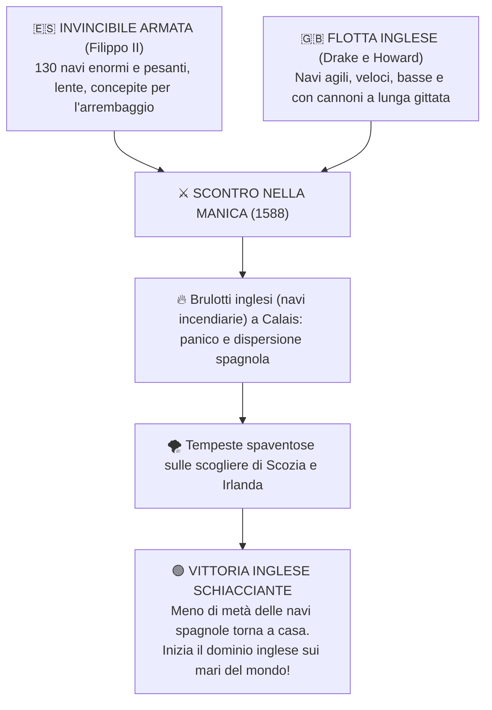

## 1. Enrico VIII e lo Scisma Anglicano (1534)

La rottura di **Enrico VIII Tudor** con la Chiesa cattolica non nacque da motivi religiosi, ma da un        **==🔵 problema dinastico e geopolitico==**:

- **Il motivo dinastico:** Enrico VIII è sposato con **Caterina d'Aragona** e non riesce ad avere un erede maschio (hanno solo una figlia femmina, Maria Tudor).
- **La richiesta al Papa:** Innamorato della dama di corte **Anna Bolena**, chiede a Papa Clemente VII l'annullamento del matrimonio.
- **🔗 Il Rifiuto del Papa e il Legame con Carlo V:**  
  Clemente VII rifiuta per ragioni puramente politiche: dopo il Sacco di Roma del 1527, il Papa è letteralmente sotto il controllo militare dell'imperatore Carlo V; concedere il divorzio avrebbe significato fare un torto intollerabile a Carlo V, che era il **nipote diretto di Caterina d'Aragona**!
- **==🟡 1534 - L'Atto di Supremazia (Act of Supremacy):==**
  - Enrico VIII fa approvare dal Parlamento la legge che dichiara il Re: **"L'unico Capo Supremo sulla terra della Chiesa d'Inghilterra"** (*Anglicana Ecclesia*).
  - **È uno scisma politico, non un'eresia dottrinale:** riti e dogmi restano cattolici. Chi rifiuta il giuramento viene decapitato per tradimento (es. l'umanista **Tommaso Moro**).

![[Pasted image 20261104111240.png]]

---

## 2. La Conseguenza Economica: La Nascita della "Gentry"

- **Soppressione dei Monasteri (1536-1540):** Enrico VIII confisca tutti i conventi e le terre della Chiesa cattolica (circa **1/5 di tutte le terre coltivabili d'Inghilterra**).
- **Vendita alla Gentry:** La Corona vende queste terre alla piccola e media nobiltà rurale (**gentry**) e ai ricchi mercanti borghesi di Londra.
- **Le Recinzioni (*Enclosures*):** I nuovi proprietari recintano i campi aperti trasformandoli in pascoli per pecore da lana, arricchendosi con il commercio tessile. Chi ha comprato terre della Chiesa diventa un fedelissimo difensore dell'anglicanesimo (per non dover restituire i campi al clero cattolico!).

---

## 3. La Fase Intermedia: Edoardo VI e Maria la Sanguinaria

1. **Edoardo VI (1547-1553):** Salito al trono a soli 9 anni, apre la Chiesa anglicana al calvinismo e introduce il testo liturgico obbligatorio in lingua inglese: il ***Book of Common Prayer*** (1549).
2. **Maria I Tudor detta "La Sanguinaria" (*Bloody Mary*, 1553-1558):**
   - Figlia di Caterina d'Aragona e cattolica devota, sposa **Filippo II di Spagna** (il sovrano protagonista della Lezione 05).
   - Tenta di restaurare a forza il cattolicesimo mandando al rogo circa 300 protestanti (tra cui l'arcivescovo Cranmer), lasciando negli inglesi un odio profondo verso il cattolicesimo e verso la Spagna.

> [!TRAPPOLA] ⚠️ ATTENZIONE AL TRANELLO: Non Confondere le Due Marie!
> - **Maria I TUDOR ("Bloody Mary"):** È la figlia di Enrico VIII e Caterina d'Aragona. È la **sorellastra di Elisabetta I** ed è la **moglie di Filippo II di Spagna**. Regna in Inghilterra dal 1553 al 1558 perseguitando i protestanti.
> - **Maria STUART (Mary Queen of Scots):** È la **cugina cattolica di Elisabetta I** e regina di Scozia. Fuggita in Inghilterra, complotta con il Papa e con Filippo II per assassinare Elisabetta. Verrà **decapitata nel 1587**!

![[Pasted image 20261104111419.png|419]]

---

## 4. Elisabetta I Tudor e l'Età dell'Oro (1558-1603)

Figlia di Enrico VIII e Anna Bolena, sale al trono a 25 anni e regna per 45 anni. Si proclama la **"Regina Vergine"** (*Virgin Queen*) rifiutando ogni matrimonio dinastico per preservare l'indipendenza dell'Inghilterra.

### I Punti Cardine del Suo Regno:
- **Il Compromesso Religioso (1559):** Confermato l'Atto di Supremazia e l'Atto di Uniformità; teologia protestante moderata (39 Articoli) unita alla gerarchia dei vescovi (*episcopale*). Reprime sia i cattolici ribelli sia i **Puritani** (i calvinisti radicali ispirati a Calvino).
- **La Decapitazione di Maria Stuart (1587):** Dopo 19 anni di prigionia dorata, scoperte le lettere del complotto papista per assassinarla, Elisabetta fa decapitare la cugina cattolica Maria Stuart, offrendo a Filippo II il pretesto per la guerra.
- **La Guerra di Corsa (I *Sea Dogs*):** Elisabetta finanzia corsari patrioti con regolari lettere di corsa: **Sir Francis Drake** assalta i galeoni spagnoli carichi di argento americano provenienti dalle miniere di Potosí. Nel 1584 nasce la colonia della **Virginia**.
- **Commercio e Cultura:** Nel **1600** nasce la potente **Compagnia delle Indie Orientali**. Fiorisce il teatro di **William Shakespeare**.

![[Pasted image 20261028132026.png|392]]

---

## 5. La Disfatta dell'Invincibile Armata (1588)

Nel **==🟡 1588==**, il re di Spagna Filippo II invia una flotta colossale (130 enormi galeoni e 30.000 soldati) per invadere l'Inghilterra eretica.

- **🔗 Perché Filippo II Attacca Proprio Ora? I 3 Motivi Interconnessi:**
  1. **Religioso:** Elisabetta è il simbolo del protestantesimo europeo contro la Controriforma cattolica e ha appena giustiziato la regina cattolica Maria Stuart (1587).
  2. **Economico:** I corsari inglesi di Francis Drake saccheggiano costantemente le rotte dell'argento americano della Spagna.
  3. **Geopolitico:** Elisabetta invia truppe e denaro per **sostenere i ribelli calvinisti dell'Olanda** nella loro Guerra d'Indipendenza contro la Spagna. Filippo II deve prima abbattere l'Inghilterra per poter domare i Paesi Bassi!

![[Pasted image 20261028132054.png|700]]