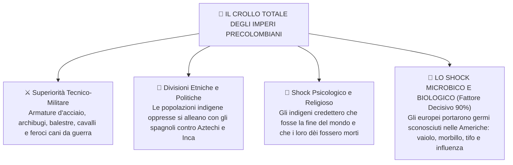
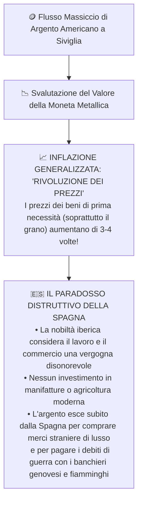

# 🌎 La Spagna Imperiale di Filippo II e l'Impero Coloniale

> [!NOTE] Riferimenti Manuale
> **Pagine di studio:** pag. 345 - 355 (*La conquista dell'America e la società coloniale*); pag. 359 (*L'argento americano e la rivoluzione dei prezzi*); pag. 456 - 466 (*Filippo II, Lepanto e la rivolta dei Paesi Bassi*).

---

## 1. La Conquista del Nuovo Mondo: I Conquistadores

Nel primo trentennio del Cinquecento, la Spagna trasformò le scoperte colombiane in una gigantesca impresa di conquista militare del continente americano. I protagonisti furono i **Conquistadores**, avventurieri della nobiltà cadetta iberica (*hidalgos*), veterani di guerra spinti da una brama inestinguibile di oro, terre e conversione forzata al cristianesimo:

```
┌────────────────────────────────────────────────────────────────────────────────────────┐
│                        I DUE GRANDI EMPIERI PRECOLOMBIANI                              │
├────────────────────────────────────────────────────────────────────────────────────────┤
│ 🇲🇽 HERNÁN CORTÉS & L'IMPERO AZTECO (MESSICO, 1519 - 1521)                              │
│ • Sbarcato con appena 500 fanti, 16 cavalli e 10 cannoncini.                           │
│ • Sfrutta il mito azteco del ritorno del dio barbuto Quetzalcóatl per farsi accogliere │
│   nella capitale lacustre Tenochtitlán.                                                │
│ • Fa prigioniero l'imperatore Montezuma II; si allea con le tribù sottomesse dagli     │
│   Aztechi (Tlaxcaltechi); rade al suolo la capitale e fonda Città del Messico.        │
├────────────────────────────────────────────────────────────────────────────────────────┤
│ 🇵🇪 FRANCISCO PIZARRO & L'IMPERO INCA (PERÙ, 1531 - 1533)                               │
│ • Con appena 180 uomini penetra nel cuore delle Ande.                                  │
│ • Sfrutta la sanguinosa guerra civile tra i due fratelli inca Huáscar e Atahualpa.     │
│ • A Cajamarca tende un agguato all'imperatore Atahualpa: chiede come riscatto una      │
│   stanza intera ricolma d'oro, intasca il bottino e poi fa strangolare il sovrano.     │
│ • Conquista la capitale Cuzco e fonda la nuova capitale costiera: Lima.                │
└────────────────────────────────────────────────────────────────────────────────────────┘
```

```
╔══════════════════════════════════════════════════════════════════════════════════════════╗
║ 🖼️ PLACEHOLDER IMMAGINE: L'INCONTRO TRA CORTÉS E MONTEZUMA (1519)                       ║
╠══════════════════════════════════════════════════════════════════════════════════════════╣
║ ![[cortes_montezuma_messico.png|750]]                                                    ║
║ COSA CERCARE SU GOOGLE / ARCHIVI: "Meeting of Cortes and Montezuma painting Jay I. Kislak"║
║ DESCRIZIONE: Dipinto storico che raffigura lo sfarzoso incontro a Tenochtitlán tra il   ║
║ generale spagnolo in armatura e l'imperatore azteco su una lettiga dorata con piume.    ║
╚══════════════════════════════════════════════════════════════════════════════════════════╝
```

---

## 2. Le Ragioni della Conquista e la Catastrofe Demografica

Come fu possibile per poche centinaia di soldati europei sbaragliare imperi popolati da milioni di individui?



> [!IMPORTANTE] Lo Shock Biologico: Il Più Grande Genocidio Involontario della Storia
> Gli indigeni d'America erano rimasti isolati per millenni e **non possedevano anticorpi** contro le patologie portate dai colonizzatori europei.
> - La popolazione indigena crollò di oltre l'**80 - 90%** nell'arco di appena mezzo secolo (in Messico da circa 25 milioni a meno di 2 milioni!).
> - Questa ecatombe demografica rese impossibile la resistenza e provocò una tragica penuria di manodopera, aprendo la strada alla **tratta degli schiavi neri dall'Africa**.

---

## 3. L'Organizzazione Coloniale: L'Encomienda e le Miniere d'Argento

Per governare i territori sterminati, la Corona spagnola creò due immensi **Vicereami**:
1. **Vicereame della Nuova Spagna** (1535): Messico e America Centrale.
2. **Vicereame del Perù** (1542): tutta l'America meridionale andina.

Il monopolio commerciale atlantico fu affidato a un unico ente statale con sede in Andalusia: la **Casa de Contratación di Siviglia (1503)**: qualunque nave o merce diretta verso il Nuovo Mondo o proveniente da esso doveva obbligatoriamente transitare e pagare i dazi doganali a Siviglia.

### L'Istituto dell'Encomienda
> [!DEFINIZIONE] Cos'era l'Encomienda?
> L'affidamento regio (*encomendar* = affidare) di una comunità di indigeni a un colono spagnolo (*encomendero*). 
> - **Dovere teorico del colono:** proteggere gli indios, istruirli nella fede cattolica ed educarli civilmente.
> - **Realtà dei fatti:** gli indios vennero trasformati in veri e propri **schiavi feudali**, costretti a turni massacranti nei campi e nelle miniere, privati di ogni diritto umano e sterminati dalla fatica e dai maltrattamenti.

### Le Miniere d'Argento di Potosí e la "Mita"
Nel 1545 venne scoperto in Bolivia il **Cerro Rico di Potosí**, la più mostruosa montagna d'argento del pianeta (a oltre 4000 metri di quota):
- Per estrarre e raffinare l'argento tramite l'amalgama con il **mercurio** (altamente tossico), gli spagnoli ripristinarono l'antico tributo incaico del lavoro a turno obbligatorio: la **mita**.
- Centinaia di migliaia di indigeni morirono intossicati dai vapori di mercurio e sepolti dalle frane nei cunicoli sotterranei.

---

## 4. Il Dibattito Etico: Bartolomé de Las Casas contro Sepúlveda

La barbarie del trattamento inflitto agli indigeni accese un accesissimo scontro morale nella teologia europea:

```
┌────────────────────────────────────────────────────────────────────────────────────────┐
│                   LA CONTROVERSIA DI VALLADOLID (1550 - 1551)                          │
├────────────────────────────────────────────────────────────────────────────────────────┤
│ BARTOLOMÉ DE LAS CASAS (Frate Domenicano)                                              │
│ • Autore della 'Brevissima relazione sulla distruzione delle Indie' (1552).            │
│ • Difende gli indigeni: sono esseri umani razionali, miti e dotati di anima; vivevano │
│   in pace secondo natura prima dell'arrivo degli spagnoli.                             │
│ • La conversione deve avvenire con la persuasione e l'amore evangelico, non con il     │
│   sangue. L'Encomienda è un crimine contro Dio e l'umanità.                            │
├────────────────────────────────────────────────────────────────────────────────────────┤
│ JUAN GINÉS DE SEPÚLVEDA (Umanista e Giurista Aristotelico)                             │
│ • Gli indios sono "omuncoli", barbari inferiori privi di civiltà, che praticavano il   │
│   cannibalismo e i sacrifici umani.                                                    │
│ • In base alla filosofia di Aristotele, esistono uomini che sono "schiavi per natura"  │
│   (servi a natura).                                                                    │
│ • La sottomissione con le armi (la "guerra giusta") è un dovere cristiano per piegare   │
│   la loro bestialità ed estirpare l'idolatria.                                         │
└────────────────────────────────────────────────────────────────────────────────────────┘
```

> [!NOTE] Le "Leggi Nuove" (Leyes Nuevas, 1542) di Carlo V
> Sensibile alle denunce di Las Casas, Carlo V promulgò nel 1542 le *Leyes Nuevas*: vietavano la riduzione in schiavitù degli indigeni e stabilivano che l'encomienda non fosse ereditaria. Tuttavia, la violenta ribellione armata dei coloni in Perù costrinse la Corona a depotenziare grandemente l'applicazione della legge.

### La Tratta Atlantica degli Schiavi (*Asiento*)
Per colmare il vuoto provocato dal tracollo demografico degli indios nelle piantagioni tropicali di canna da zucchero e nelle miniere, i coloni iberici iniziarono a deportare in massa gli africani attraverso l'Atlantico.
La Corona spagnola concedeva l'**Asiento**: un contratto di monopolio statale esclusivo venduto all'asta a compagnie mercantili per la fornitura di decine di migliaia di schiavi neri all'anno (la cosiddetta *Tratta Atlantica*).

---

## 5. L'Argento Americano e la "Rivoluzione dei Prezzi" in Europa (p. 359)

Durante il XVI secolo affluirono in Europa fiumi d'oro e soprattutto d'argento attraverso la celebre **Flota de Indias** scortata da galeoni da guerra. Questo fenomeno ebbe un effetto paradosso disastroso:



> [!DEFINIZIONE] La Teoria Quantitativa della Moneta (Jean Bodin)
> Il filosofo ed economista francese Jean Bodin spiegò che il prezzo delle merci è legato alla quantità di moneta circolante: se la quantità d'argento in circolazione aumenta esponenzialmente mentre la produzione agricola e manifatturiera rimane costante, il potere d'acquisto della moneta crolla e il prezzo delle merci lievita inevitabilmente.

---

## 6. Filippo II di Spagna: "El Rey Prudente" ed El Escorial (pp. 456 - 466)

Succeduto al padre Carlo V nel 1556 sulla corona di Spagna, **Filippo II** (1527-1598) fu l'esatto opposto del padre:
- **Spagnolo al 100%:** non si mosse quasi mai dalla Castiglia. Nel **1561** elesse la sperduta cittadina di **Madrid** come capitale unica e permanente del regno.
- **La Reggia-Monastero dell'Escorial:** fece costruire a nord di Madrid un immenso e austero palazzo a forma di graticola (in onore di San Lorenzo martirizzato sul fuoco), dove viveva in una cella monacale circondato da archivi e reliquie di santi.
- **"El Rey Papelero" (Il Re delle Carte):** governava attraverso una burocrazia elefantiaca e centralizzata. Voleva leggere e siglare personalmente ogni dispaccio, supplica o fascicolo dell'impero: questa mania causava **ritardi catastrofici** (le decisioni arrivavano a destinazione nelle colonie o nelle Fiandre dopo mesi o anni!).

```
╔══════════════════════════════════════════════════════════════════════════════════════════╗
║ 🖼️ PLACEHOLDER IMMAGINE: IL COMPLESSO DELL'ESCORIAL A MADRID                             ║
╠══════════════════════════════════════════════════════════════════════════════════════════╣
║ ![[san_lorenzo_de_el_escorial.png|750]]                                                  ║
║ COSA CERCARE SU GOOGLE / ARCHIVI: "Monastero San Lorenzo de El Escorial veduta aerea"    ║
║ DESCRIZIONE: Fotografia o stampa dell'imponente e severo palazzo-fortezza in granito     ║
║ grigio fatto erigere da Filippo II ai piedi della Sierra de Guadarrama.                  ║
╚══════════════════════════════════════════════════════════════════════════════════════════╝
```

### Il Fanatismo Religioso e la "Limpieza de Sangre"
Filippo II considerò la Spagna come il bastione sacro dell'ortodossia cattolica:
- Strumento cardine del potere regio fu l'**Inquisizione Spagnola**.
- Ossessione maniacale per la **Limpieza de sangre** ("purezza del sangue"): l'accesso a cariche pubbliche, università e ordini cavallereschi richiedeva la prova documentaria di non avere antenati ebrei o musulmani.
- **Persecuzione dei Moriscos:** I discendenti dei musulmani forzatamente battezzati (*moriscos*) insorsero nell'aspra rivolta delle Alpujarras (1568-1570). Vennero deportati e infine espulsi in massa: una tragedia umanitaria che inferse un **colpo mortale all'agricoltura irrigua e all'artigianato** dell'Andalusia e di Valencia.

---

## 7. I Tre Grandi Teatri di Scontro di Filippo II

Filippo II impegnò la Spagna su tre fronti titanici contemporaneamente:

```
┌────────────────────────────────────────────────────────────────────────────────────────┐
│                        I TRE FRONTI DI GUERRA DI FILIPPO II                            │
├────────────────────────────────────────────────────────────────────────────────────────┤
│ 1. IL MEDITERRANEO: LA BATTAGLIA DI LEPANTO (1571)                                     │
│    • 1570: L'Impero Ottomano strappa Cipro a Venezia.                                  │
│    • Papa Pio V forma la LEGA SANTA (Spagna, Venezia, Genova, Savoia).                 │
│    • ==🟡 7 OTTOBRE 1571: BATTAGLIA DI LEPANTO== (Golfo di Patrasso, Grecia).          │
│    • La flotta cristiana guidata da Don Giovanni d'Austria sbaraglia 200 galee turche. │
│    • Significato: Fine del mito dell'invincibilità navale turca; il Mediterraneo si   │
│      divide stabilmente tra sfera cristiana e ottomana.                                │
├────────────────────────────────────────────────────────────────────────────────────────┤
│ 2. I PAESI BASSI: LA GUERRA DEGLI OTTANT'ANNI (1568 - 1648)                            │
│    • Diffusione del Calvinismo tra mercanti e nobiltà fiamminga.                       │
│    • Filippo II impone l'Inquisizione spagnola e tasse strangolatorie (la "decima").   │
│    • 1567: Filippo invia lo spietato Duca d'Alba col "Tribunale dei Tumulti".          │
│    • Svolta: Spaccatura tra province del Sud cattoliche (Unione di Arras, fedeli)      │
│      e le 7 province del Nord calviniste guidate da Guglielmo d'Orange (Unione di      │
│      Utrecht, 1579).                                                                   │
│    • ==🟡 1581: DICHIARAZIONE D'INDIPENDENZA (Nascita delle Province Unite / Olanda)==.│
├────────────────────────────────────────────────────────────────────────────────────────┤
│ 3. L'INGHILTERRA ELISABETTIANA: L'INVINCIBILE ARMATA (1588)                            │
│    • Disfatta epocale della flotta spagnola nella Manica.                              │
│    • Inizio del declino definitivo della potenza imperiale spagnola.                   │
└────────────────────────────────────────────────────────────────────────────────────────┘
```

```
╔══════════════════════════════════════════════════════════════════════════════════════════╗
║ 🖼️ PLACEHOLDER IMMAGINE: LA BATTAGLIA DI LEPANTO (1571)                                  ║
╠══════════════════════════════════════════════════════════════════════════════════════════╣
║ ![[battaglia_di_lepanto_1571.png|750]]                                                   ║
║ COSA CERCARE SU GOOGLE / ARCHIVI: "Battaglia di Lepanto dipinto Andrea Vicentino"       ║
║ DESCRIZIONE: Celebre tela monumentale di Palazzo Ducale a Venezia che mostra lo scontro ║
║ caotico tra le galee con stendardi con il crocifisso e le navi con la mezzaluna ottomana.║
╚══════════════════════════════════════════════════════════════════════════════════════════╝
```

---

## 8. Il Paradosso Economico: Le Tre Bancarotte della Corona Spagnola

Nonostante l'impero coloniale più ricco del pianeta, la Corona di Spagna fu costretta a dichiarare ufficialmente **bancarotta** (sospensione unilaterale dei pagamenti dei debiti) per ben tre volte durante il regno di Filippo II: **nel 1557, nel 1575 e nel 1596**.

**Perché un impero ricolmo d'oro andò in bancarotta?**
1. **Spese militari insostenibili:** Filippo II manteneva contemporaneamente eserciti mercenari nei Paesi Bassi, guarnigioni in Italia e flotte nel Mediterraneo e nell'Atlantico.
2. **Debito con tassi usurai:** Per pagare i soldati sul posto, la Corona chiedeva continui anticipi di denaro liquido ai banchieri genovesi e tedeschi (**asientos** finanziari) a tassi d'interesse vertiginosi.
3. Nel 1576, il mancato pagamento delle paghe provocò l'ammutinamento dell'esercito spagnolo nelle Fiandre e il tremendo **Sacco di Anversa**, che distrusse la più importante piazza finanziaria del Nord Europa.

---

## 🎯 Domande Chiave per l'Interrogazione

> [!INTERROGAZIONE] Domande Frequenti su Filippo II e l'Impero Coloniale
> 1. **Quali furono le cause della fulminea caduta degli imperi Azteco e Inca?**
>    *La superiorità militare tecnologica degli spagnoli, le rivalità interne indigene abilmente sfruttate, il collasso psicologico-religioso e, sopra ogni altra cosa, lo shock biologico delle epidemie europee (vaiolo, morbillo).*
> 2. **Come funzionava l'istituto dell'Encomienda e perché fu duramente criticato?**
>    *Affidava villaggi indigeni a un colono per evangelizzarli in cambio di manodopera, ma si tradusse in una brutale schiavitù de facto nelle miniere e nei campi, denunciata dal frate domenicano Las Casas.*
> 3. **Perché l'afflusso di argento americano provocò la "Rivoluzione dei Prezzi" e la bancarotta spagnola?**
>    *Perché svalutò la moneta provocando un'inflazione incontrollata dei beni primari. Inoltre la Spagna non investì nelle manifatture, spendendo tutto l'argento per merci estere e per le costosissime guerre di Filippo II.*
> 4. **Quale fu il significato storico della Battaglia di Lepanto del 1571?**
>    *La Lega Santa sbaragliò la flotta turca, infrangendo il mito dell'invincibilità ottomana nel Mediterraneo e bloccandone per sempre l'espansione verso l'Europa occidentale.*
> 5. **Come e perché nacque la Repubblica delle Province Unite (Olanda)?**
>    *I Paesi Bassi calvinisti insorsero contro l'intolleranza religiosa e fiscale di Filippo II e del Duca d'Alba; nel 1579 le 7 province settentrionali (Unione di Utrecht) si unirono sotto Guglielmo d'Orange e nel 1581 proclamarono l'indipendenza dalla Spagna.*
