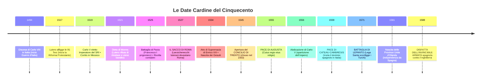

# 🗺️ Linea del Tempo e Mappa dei Territori del '500

Questa guida contiene solo gli **elementi di orientamento essenziali**: le date che la prof chiede all'interrogazione, lo schema a colpo d'occhio dei territori di Carlo V e le cartine storiche da visualizzare.

---

## ⏳ 1. La Linea del Tempo Essenziale (Le Date da Sapere)



### 📋 Tabella Riassuntiva ad Alta Leggibilità

| Anno | Evento Chiave | Perché è Fondamentale? |
| :---: | :--- | :--- |
| **==🟡 1494==** | **Discesa di Carlo VIII in Italia** | Dimostra la fragilità italiana; iniziano 65 anni di guerre tra Francia e Spagna. |
| **==🟡 1517==** | **95 Tesi di Martin Lutero** | Rompe l'unità religiosa d'Europa contro lo scandalo delle indulgenze. |
| **==🟡 1519==** | **Carlo V Imperatore** | Concentra Spagna, Americhe, Fiandre, Austria e Germania con l'oro dei Fugger. |
| **==🟡 1521==** | **Dieta di Worms** | Lutero condannato al bando; traduce la Bibbia in tedesco a Wartburg. |
| **==🟡 1525==** | **Battaglia di Pavia** | Carlo V cattura il re francese Francesco I e prende il Ducato di Milano. |
| **==🟡 1527==** | **Il Sacco di Roma** | I Lanzichenecchi saccheggiano la capitale papale: shock religioso epocale. |
| **==🟡 1534==** | **Atto di Supremazia (Enrico VIII)** | Scisma anglicano politico per sposare Anna Bolena e confisca dei monasteri. |
| **==🟡 1545-63==** | **Concilio di Trento** | Riorganizzazione cattolica: 7 sacramenti, Vulgata, seminari e Inquisizione. |
| **==🟡 1555==** | **Pace di Augusta** | *Cuius regio, eius religio*: i principi scelgono tra cattolicesimo e luteranesimo. |
| **==🟡 1556==** | **Abdicazione di Carlo V** | Impero diviso: ramo spagnolo a Filippo II, ramo austriaco a Ferdinando I. |
| **==🟡 1559==** | **Pace di Cateau-Cambrésis** | Milano, Napoli, Sicilia, Sardegna e Presìdi passano sotto il dominio spagnolo. |
| **==🟡 1571==** | **Battaglia di Lepanto** | La Lega Santa cristiana ferma l'avanzata navale dell'Impero Ottomano. |
| **==🟡 1581==** | **Indipendenza dell'Olanda** | Le 7 province calviniste del Nord si ribellano a Filippo II e formano le Province Unite. |
| **==🟡 1588==** | **Disfatta dell'Invincibile Armata** | La flotta di Filippo II distrutta nella Manica: l'Inghilterra domina i mari. |

---

## 🏛️ 2. I Territori di Carlo V a Colpo d'Occhio

```
┌────────────────────────────────────────────────────────────────────────────────────────┐
│                        COME CARLO V HA EREDITATO IL MONDO                              │
├────────────────────────────────────────────────────────────────────────────────────────┤
│ 1. DA ISABELLA DI CASTIGLIA (Nonna Materna):                                          │
│    ==🔵 Castiglia + Colonie Americane (Messico e Perù)==                              │
│ 2. DA FERDINANDO D'ARAGONA (Nonno Materno):                                           │
│    ==🔵 Aragona + Regno di Napoli + Sicilia + Sardegna==                              │
│ 3. DA MARIA DI BORGOGNA (Nonna Paterna):                                              │
│    ==🔵 Paesi Bassi (Fiandre, Olanda) + Franca Contea==                               │
│ 4. DA MASSIMILIANO I D'ASBURGO (Nonno Paterno):                                       │
│    ==🔵 Austria, Tirolo, Stiria + Candidatura al Sacro Romano Impero==                 │
│ 5. DALLE GUERRE D'ITALIA (Conquista militare del 1525):                                │
│    ==🔵 Ducato di Milano== (il "Camino Español" per collegare Genova con le Fiandre). │
└────────────────────────────────────────────────────────────────────────────────────────┘
```

---

## 🇮🇹 3. L'Assetto dell'Italia dopo Cateau-Cambrésis (1559)

- **Sotto dominazione diretta spagnola (Viceré e Governatori):**
  - **Ducato di Milano**
  - **Regno di Napoli**
  - **Regno di Sicilia**
  - **Regno di Sardegna**
  - **Stato dei Presìdi** (basi militari costiere in Toscana: Orbetello, Porto Ercole, Piombino).
- **Stati alleati/satelliti della Spagna:**
  - Repubblica di Genova (banchieri dell'impero).
  - Granducato di Toscana (Medici).
  - Ducato di Savoia (Emanuele Filiberto).
- **Unico Stato Indipendente:**
  - **Repubblica di Venezia** (concentrata nella difesa navale contro i Turchi in Oriente).

---

## 🎨 4. Guida Pratica alle Cartine Storiche da Cercare

Salva queste 4 cartine essenziali nella cartella `content/Storia/Il Cinquecento/Zimmagini/`:

```
╔══════════════════════════════════════════════════════════════════════════════════════════╗
║ 📌 LISTA CARTINE DA SALVARE IN: content/Storia/Il Cinquecento/Zimmagini/                  ║
╠══════════════════════════════════════════════════════════════════════════════════════════╣
║ 1. cartina_impero_carlo_v.png                                                            ║
║    • Cerca: "Mappa impero Carlo V 1519 territori ereditari"                              ║
║    • Mostra visivamente come i possedimenti di Carlo V accerchiavano la Francia.         ║
║                                                                                          ║
║ 2. italia_cateau_cambresis_1559.png                                                      ║
║    • Cerca: "Carta Italia pace di Cateau-Cambrésis 1559"                                 ║
║    • Mostra l'Italia con Milano, Napoli e le isole sotto il colore della Spagna.         ║
║                                                                                          ║
║ 3. paesi_bassi_arras_utrecht.png                                                         ║
║    • Cerca: "Mappa Unione di Utrecht e Arras 1579"                                       ║
║    • Mostra la divisione tra Olanda indipendente (nord) e Belgio cattolico (sud).        ║
║                                                                                          ║
║ 4. rotte_argento_potosi.png                                                              ║
║    • Cerca: "Rotte commerciali argento Potosi Siviglia Flota de Indias"                  ║
║    • Mostra la rotta marittima dei galeoni dall'America alla Spagna.                     ║
╚══════════════════════════════════════════════════════════════════════════════════════════╝
```
