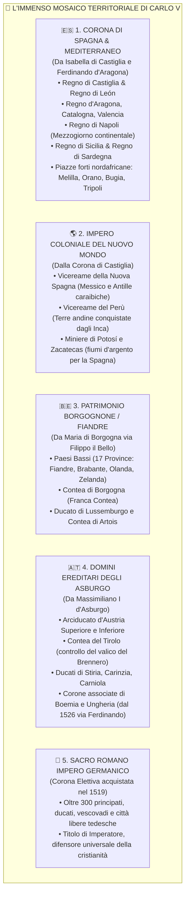

# 🗺️ Linea del Tempo Comparata e Atlante dei Territori del '500

Questa lezione costituisce lo **strumento operativo di orientamento spazio-temporale** del modulo. Contiene la cronologia comparata parallela per collegare tra loro tutti gli avvenimenti del secolo e l'atlante geopolitico dei territori, con particolare focus sui domini di Carlo V e le mappe storiche da consultare.

---

## ⏳ 1. Cronologia Comparata Sinottica (1492 - 1603)

La seguente tabella incrocia i quattro grandi teatri storici contemporanei, permettendo di capire cosa accadeva nel medesimo anno in punti diversi d'Europa e del Mondo:

| Anno | ⚔️ Guerre d'Italia & Carlo V | ✝️ Riforma & Chiesa | 👑 Inghilterra dei Tudor | 🌎 Spagna & Nuovo Mondo |
| :---: | :--- | :--- | :--- | :--- |
| **==🟡 1492==** | Morte di Lorenzo il Magnifico; fine dell'equilibrio italiano | Papa Alessandro VI Borgia sul soglio pontificio | Regno di Enrico VII Tudor | Cristoforo Colombo approda in America; cacciata dei Mori da Granada |
| **==🟡 1494==** | ==🔴 Discesa di Carlo VIII in Italia==; cacciata dei Medici e Repubblica di Savonarola | Predicazione apocalittica di Savonarola a Firenze | Consolidamento Tudor post Guerra delle Due Rose | **Trattato di Tordesillas** (spartizione dell'Atlantico tra Spagna e Portogallo) |
| **1500** | Nascita di Carlo d'Asburgo a Gand (Fiandre) | Erasmo da Rotterdam pubblica gli *Adagia* | Dinastia Tudor si imparenta con gli Aragona | Cabral scopre il Brasile per il Portogallo |
| **1509** | Battaglia di Agnadello: la Lega di Cambrai sconfigge Venezia | Papa Giulio II "il Papa guerriero" | Salita al trono di **Enrico VIII** | Fondazione dei primi insediamenti stabili nei Caraibi |
| **==🟡 1516==** | **Pace di Noyon**: Milano alla Francia, Napoli alla Spagna | Erasmo pubblica il Nuovo Testamento in greco | More pubblica *Utopia*; Enrico VIII alleato col Papa | Carlo d'Asburgo diventa **Carlo I Re di Spagna** |
| **==🟡 1517==** | Carlo sbarca in Spagna tra le diffidenze castigliane | **Affissione delle 95 Tesi di Lutero a Wittenberg**; scandalo delle indulgenze | Enrico VIII è fervente cattolico | Inizio delle spedizioni esplorative verso il Messico |
| **==🟡 1519==** | **Carlo V eletto Imperatore del SRI** (grazie all'oro dei Fugger) | Disputa di Lipsia: Lutero nega l'infallibilità papale | Enrico VIII si candida senza successo al titolo imperiale | **Hernán Cortés sbarca in Messico**; Magellano salpa per la prima circumnavigazione |
| **1520** | Rivolta dei *Comuneros* in Castiglia contro Carlo V | Lutero brucia la bolla papale *Exsurge Domine* | Enrico VIII riceve da Leone X il titolo di *Defensor Fidei* | Massacro al Templo Mayor di Tenochtitlán; *Noche Triste* |
| **==🟡 1521==** | Inizio della guerra aperta tra Carlo V e Francesco I | **Dieta di Worms**: Lutero al bando; rifugio nel castello di Wartburg | Enrico VIII scrive l'*Assertio Septem Sacramentorum* | **Cortés distrugge Tenochtitlán**: crollo definitivo dell'Impero Azteco |
| **1524 - 1525** | **Battaglia di Pavia (1525)**: Francesco I prigioniero di Carlo V | **Guerra dei Contadini** in Germania; Lutero condanna le bande; massacro di Frankenhausen | Primi dubbi di Enrico VIII sulla validità delle nozze con Caterina | Spedizioni di Francisco Pizarro lungo le coste pacifiche del Sud America |
| **1526** | Trattato di Madrid; Papa Clemente VII forma la **Lega di Cognac** | 1ª Dieta di Spira: momentanea tolleranza ai principi luterani | Incontro e innamoramento tra Enrico VIII e Anna Bolena | Carlo V sposa Isabella di Portogallo a Siviglia |
| **==🟡 1527==** | **IL SACCO DI ROMA**: i Lanzichenecchi devastano la città papale | La catastrofe di Roma vista come giudizio divino sui peccati papali | Enrico VIII chiede al Papa l'annullamento delle nozze con Caterina | Pizarro ottiene l'autorizzazione reale per la conquista del Perù |
| **1529** | **Pace delle Due Dame (Cambrai)**; Assedio ottomano a Vienna | 2ª Dieta di Spira: "Protesta" dei principi (nascono i **Protestanti**) | Caduta in disgrazia del cardinale Wolsey; ascesa di Thomas Cromwell | Creazione formale della flotta dei galeoni spagnoli (*Flota de Indias*) |
| **==🟡 1530==** | **Incoronazione imperiale di Carlo V a Bologna** per mano del Papa | **Dieta di Augusta**: presentazione della *Confessio Augustana* di Melantone | Parlamento della Riforma comincia a limitare i poteri del clero cattolico | Carlo V nomina Cortés marchese della Valle di Oaxaca |
| **1531 - 1533** | Carlo V affronta la Lega di Smalcalda dei principi tedeschi | Zwingli muore nella battaglia di Kappel (1531) | Cranmer arcivescovo di Canterbury; nozze segrete con Anna Bolena | **Pizarro cattura Atahualpa a Cajamarca (1532)** e conquista Cuzco (1533) |
| **==🟡 1534==** | Carlo V prepara la spedizione navale contro Tunisi | Fondazione della **Compagnia di Gesù** da parte di Ignazio di Loyola | **ATTO DI SUPREMAZIA**: Enrico VIII Capo Supremo della Chiesa Anglicana | Nasce formalmente il Vicereame della Nuova Spagna (Messico) |
| **1535 - 1540** | Nuova guerra tra Carlo V e Francesco I in Provenza e Savoia | Calvino pubblica l'*Institutio Christianae Religionis* (1536) a Basilea | Esecuzione di Tommaso Moro (1535); **Soppressione dei Monasteri (1536-40)** | Pizarro fonda la città di Lima; De Soto esplora la Florida e il Mississippi |
| **==🟡 1542==** | Tregua di Crépy tra Francia e Asburgo | Istituzione del **Tribunale del Sant'Uffizio (Inquisizione Romana)** | Nascita di Maria Stuart regina di Scozia | **Leyes Nuevas di Carlo V** a tutela degli indios; istituzione Vicereame del Perù |
| **==🟡 1545==** | Carlo V cerca la pacificazione religiosa in Germania | **APERTURA SOLENNE DEL CONCILIO DI TRENTO (1545 - 1563)** | Enrico VIII dissangua le finanze per guerre contro Francia e Scozia | Scoperta della mostruosa montagna d'argento del **Cerro Rico di Potosí** |
| **1547** | **Battaglia di Mühlberg**: Carlo V sconfigge la Lega di Smalcalda; muore Francesco I | Il Concilio di Trento si trasferisce temporaneamente a Bologna | Morte di Enrico VIII; sale al trono il figlio bambino **Edoardo VI** | Inizio della corsa all'argento e diffusione del sistema della *mita* |
| **1549 - 1553** | Carlo V logorato dalle rivolte dei principi tedeschi alleati con la Francia | Michele Serveto bruciato al rogo dai calvinisti a Ginevra (1553) | Cranmer introduce il ***Book of Common Prayer*** (1549); muore Edoardo VI | Controversia di Valladolid (1550-51): scontro tra Las Casas e Sepúlveda |
| **==🟡 1555==** | **PACE DI AUGUSTA**: Principio *Cuius regio, eius religio*; Carlo V cede | Luteranesimo riconosciuto nell'Impero; calvinismo escluso | **Maria I Tudor la Sanguinaria** sposa Filippo II e brucia i protestanti | Diffusione del metodo dell'amalgama col mercurio per l'argento |
| **==🟡 1556==** | **Abdicazione di Carlo V**: impero diviso tra Filippo II e Ferdinando I | Elezione di papa Paolo IV Carafa (intransigenza controriformista) | Roghi di Cranmer e dei vescovi riformati inglesi a Oxford | Filippo II sale al trono di Spagna; bancarotta regia del 1557 |
| **==🟡 1558==** | Morte di Carlo V nel monastero di Yuste in Spagna | Muore papa Paolo IV; ripresa dei lavori a Trento | Morte di Maria I; **Sale al trono Elisabetta I Tudor (Golden Age)** | Filippo II sceglie Madrid come capitale fissa |
| **==🟡 1559==** | **PACE DI CATEAU-CAMBRÉSIS**: Fine delle Guerre d'Italia; egemonia spagnola | Pubblicazione del primo **Indice dei Libri Proibiti** | **Secondo Atto di Supremazia e Atto di Uniformità** elisabettiano | Morte di Enrico II di Francia in giostra: inizio guerre di religione in Francia |
| **1563** | Emanuele Filiberto trasferisce la capitale sabauda a Torino | **Chiusura solenne del Concilio di Trento** e approvazione dei decreti | Approvazione dei **Trentanove Articoli di Religione** anglicani | Inizio della costruzione della reggia-monastero dell'Escorial a Madrid |
| **1566 - 1568** | Scoppio della rivolta iconoclasta nei Paesi Bassi contro la Spagna | Pio V promulga il *Catechismo Romano*; papa austero | Maria Stuart fugge in Inghilterra: Elisabetta la fa incarcerare | Filippo II invia il Duca d'Alba a Bruxelles (Tribunale dei Tumulti) |
| **==🟡 1571==** | Gli Ottomani conquistano Cipro strappandola a Venezia | Papa Pio V proclama la Lega Santa contro l'Islam | Papa Pio V scomunica Elisabetta I sciogliendo i sudditi dall'obbedienza | **BATTAGLIA DI LEPANTO (7 ottobre)**: la flotta cristiana distrugge i Turchi |
| **1572 - 1576** | Guglielmo d'Orange guida i ribelli fiamminghi (*Gueux*) | Notte di San Bartolomeo in Francia: massacro degli Ugonotti | Francis Drake compie le prime audaci razzie nei Caraibi spagnoli | Seconda bancarotta spagnola (1575); **Sacco di Anversa (1576)** |
| **==🟡 1579 - 1581==** | Spaccatura Paesi Bassi: Unione di Arras (sud) e Unione di Utrecht (nord) | Diffusione travolgente dei collegi gesuitici in tutta Europa | Drake completa il giro del mondo (1580); nominato cavaliere | **1581: Atto di Abiura: Le Province Unite proclamano l'indipendenza** |
| **1585 - 1587** | Alessandro Farnese riconquista le province cattoliche del Belgio | Sisto V riorganizza la Curia papale in 15 congregazioni | **Decapitazione di Maria Stuart (1587)** accusata di cospirazione | Filippo II decide l'invasione navale dell'Inghilterra eretica |
| **==🟡 1588==** | Spedizione titanica organizzata nei porti di Lisbona e Cadice | Giordano Bruno viaggia in Europa insegnando l'universo infinito | Battaglia navale nella Manica guidata da Drake e Lord Howard | **DISFATTA DELL'INVINCIBILE ARMATA SPAGNOLA**: tempeste e disfatta |
| **1598** | Morte di Filippo II nell'austero palazzo dell'Escorial | Editto di Nantes in Francia: Enrico IV concede libertà agli ugonotti | Fioritura del teatro di William Shakespeare (costruzione del Globe) | Filippo III sale al trono di Spagna; crisi finanziaria ed economica |
| **1603** | Morte di Elisabetta I Tudor; fine della dinastia; sale Giacomo I Stuart | Giordano Bruno arso al rogo dall'Inquisizione a Roma (1600) | Nascita della Compagnia Britannica delle Indie Orientali (1600) | La Spagna firma tregue provvisorie con Inghilterra e Olanda |

---

## 🏛️ 2. Atlante Geopolitico dei Territori di Carlo V

Per comprendere perché l'Impero di Carlo V fosse una costruzione geopolitica senza precedenti, analizziamo la **dissezione analitica di ogni singolo territorio**, il titolo nobiliare associato, la provenienza ereditaria e il suo valore strategico ed economico:



### 🗺️ Analisi Territorio per Territorio e la Funzione del "Camino Español"

| Territorio | Titolo di Carlo | Capitale / Centri Chiave | Valore Geopolitico ed Economico |
| :--- | :--- | :--- | :--- |
| **Castiglia e León** | *Re di Castiglia* | Toledo, Burgos, Valladolid, Siviglia | Cuore militare della fanteria imperiale (i celebri *Tercios* castigliani). Monopolio esclusivo del commercio americano via Siviglia. |
| **Aragona e Catalogna** | *Re d'Aragona e Conte di Barcellona* | Saragozza, Barcellona, Valencia | Tradizione marittima mercantile nel Mediterraneo occidentale; parlamento autonomo (*Cortes*) molto geloso dei propri privilegi. |
| **Regno di Napoli e Sicilia** | *Re di Napoli, Sicilia e Gerusalemme* | Napoli, Palermo, Messina | Il **granaio d'Europa** (produzione massiccia di frumento) e prima linea di difesa navale contro le incursioni della flotta turco-barbaresca. |
| **Paesi Bassi e Fiandre** | *Duca di Brabante, Conte di Fiandra* | Bruxelles, Gand, Anversa, Bruges | Il polo industriale tessile e finanziario più ricco d'Europa. Anversa è la borsa del commercio mondiale delle spezie e dei panni-lana. |
| **Franca Contea** | *Conte di Borgogna* | Besançon, Dole | Corridoio cuscinetto montuoso a ridosso del confine orientale della Francia, pedina fondamentale per l'accerchiamento dei Valois. |
| **Domini Austriaci** | *Arciduca d'Austria* | Vienna, Innsbruck, Graz | Baluardo militare invalicabile dell'Europa cristiana contro l'avanzata delle armate ottomane nei Balcani (assedio di Vienna del 1529). |
| **Ducato di Milano** *(Conquistato)* | *Signore di Milano* | Milano, Pavia, Cremona | Conquistato con la forza alla Francia (Pavia, 1525). È la "chiave d'Italia", cerniera di collegamento terrestre tra Spagna, Germania e Fiandre. |

```
╔══════════════════════════════════════════════════════════════════════════════════════════╗
║ 🖼️ PLACEHOLDER: MAPPA DEL "CAMINO ESPAÑOL" (LA VIA MILITARE SPAGNOLA)                   ║
╠══════════════════════════════════════════════════════════════════════════════════════════╣
║ ![[camino_espanol_mappa.png|750]]                                                        ║
║ COSA CERCARE SU ATLAS / WEB: "Camino Español Spanish Road corridor map 16th century"    ║
║ DESCRIZIONE: Mappa dettagliata dell'Europa occidentale che traccia con una linea rossa   ║
║ la rotta di terra: Genova -> Milano -> Valichi Alpini -> Franca Contea -> Fiandre.       ║
║ Dimostra visivamente perché Milano era vitale per gli Asburgo e soffocava la Francia.    ║
╚══════════════════════════════════════════════════════════════════════════════════════════╝
```

---

## 🇮🇹 3. L'Assetto dell'Italia dopo la Pace di Cateau-Cambrésis (1559)

Con la Pace di Cateau-Cambrésis (1559), la mappa politica dell'Italia si congelò per oltre 150 anni nell'orbita del dominio spagnolo:

```
┌────────────────────────────────────────────────────────────────────────────────────────┐
│                   LA GEOPOLITICA ITALIANA DOPO CATEAU-CAMBRÉSIS (1559)                 │
├────────────────────────────────────────────────────────────────────────────────────────┤
│ 🇪🇸 DOMINI DIRETTI DELLA CORONA SPAGNOLA (Governati da Viceré e Governatori):           │
│ • DUCATO DI MILANO: retto da un Governatore militare spagnolo; snodo strategico.       │
│ • REGNO DI NAPOLI: retto da un Viceré spagnolo; granaio e tributi fiscali.             │
│ • REGNO DI SICILIA & REGNO DI SARDEGNA: retti da rispettivi Viceré spagnoli.           │
│ • STATO DEI PRESÌDI: guarnigioni militari fortificate sulle coste toscane              │
│   (Orbetello, Talamone, Porto Ercole, Porto Santo Stefano e Piombino) per controllare │
│   militarmente il Mar Tirreno e vigilare sul Granducato di Toscana e sul Papa.        │
├────────────────────────────────────────────────────────────────────────────────────────┤
│ 🤝 STATI INDIPENDENTI MA NELL'ORBITA E SATELLITI DELLA SPAGNA:                         │
│ • GRANDUCATO DI TOSCANA (Medici): Cosimo I ottiene Siena con l'aiuto spagnolo ed è     │
│   legato a filo doppio a Madrid.                                                       │
│ • REPUBBLICA DI GENOVA: i banchieri genovesi (Doria, Spinola) finanziano l'Impero      │
│   spagnolo; il porto di Genova è il capolinea navale delle truppe iberiche.            │
│ • DUCATO DI SAVOIA: restituito a Emanuele Filiberto per la vittoria di San Quintino    │
│   (inizia l'italianizzazione del ducato con lo spostamento della capitale a Torino).   │
│ • DUCATO DI PARMA E PIACENZA (Farnese), DUCATO DI MODENA E REGGIO (Este),              │
│   DUCATO DI MANTOVA (Gonzaga): piccoli principati padani fedeli all'Impero.            │
├────────────────────────────────────────────────────────────────────────────────────────┤
│ 🦁 GLI UNICI DUE STATI AUTONOMI:                                                       │
│ • STATO DELLA CHIESA: potenza spirituale della Controriforma, territorialmente intatto │
│   ma diplomaticamente attento a non rompere con la cattolicissima Spagna.              │
│ • REPUBBLICA DI VENEZIA: l'UNICA VERA POTENZA TOTALMENTE INDIPENDENTE, neutrale nei   │
│   conflitti europei, concentrata sulla disperata difesa delle rotte e basi d'Oriente.  │
└────────────────────────────────────────────────────────────────────────────────────────┘
```

---

## 🎨 4. Guida Pratica alle Cartine Storiche da Cercare e Inserire

Per completare i tuoi appunti su Obsidian e avere una memorizzazione visiva infallibile per le verifiche scritte e orali, cerca e inserisci nella cartella `content/Storia/Il Cinquecento/Zimmagini/` le seguenti **5 carte tematiche fondamentali**:

```
╔══════════════════════════════════════════════════════════════════════════════════════════╗
║ 📌 LISTA GUIDA CARTINE DA SALVARE IN: content/Storia/Il Cinquecento/Zimmagini/           ║
╠══════════════════════════════════════════════════════════════════════════════════════════╣
║ 1. cartina_impero_carlo_v.png                                                            ║
║    • Ricerca Google Immagini: "Mappa impero Carlo V 1519 territori ereditari colori"     ║
║    • Cosa deve mostrare: La Spagna, i Paesi Bassi, la Franca Contea, l'Austria e le      ║
║      Americhe colorate a tinte uniformi per rendere visibile l'accerchiamento francese.  ║
║                                                                                          ║
║ 2. italia_cateau_cambresis_1559.png                                                      ║
║    • Ricerca Google Immagini: "Carta Italia dopo la pace di Cateau-Cambrésis 1559"       ║
║    • Cosa deve mostrare: L'Italia con Milano, Napoli e le Isole evidenziate sotto la     ║
║      Spagna, e l'isolamento autonomo della Repubblica di Venezia e dello Stato Pontificio║
║                                                                                          ║
║ 3. europa_religioni_pace_augusta.png                                                     ║
║    • Ricerca Google Immagini: "Mappa diffusione Riforma luterana calvinista Europa 1560" ║
║    • Cosa deve mostrare: La spaccatura tra Nord protestante (Luterani in Scandinavia e   ║
║      Germania nord, Calvinisti in Svizzera, Olanda e Scozia, Anglicani in Inghilterra)   ║
║      e Sud cattolico compatto (Spagna, Italia, Austria, Polonia).                        ║
║                                                                                          ║
║ 4. paesi_bassi_arras_utrecht.png                                                         ║
║    • Ricerca Google Immagini: "Mappa Unione di Utrecht e Unione di Arras 1579"           ║
║    • Cosa deve mostrare: Le 7 Province Unite del Nord (Olanda calvinista) distinte dalle ║
║      10 province del Sud rimaste fedeli a Filippo II (futuro Belgio cattolico).          ║
║                                                                                          ║
║ 5. rotte_oceaniche_argento_spagna.png                                                    ║
║    • Ricerca Google Immagini: "Rotte commerciali Flota de Indias argento Potosi Siviglia"║
║    • Cosa deve mostrare: La rotta atlantica tra Siviglia, i Caraibi, Veracruz (Messico)  ║
║      e Portobelo/Lima (Perù), con le zone di attacco dei corsari inglesi.                ║
╚══════════════════════════════════════════════════════════════════════════════════════════╝
```
