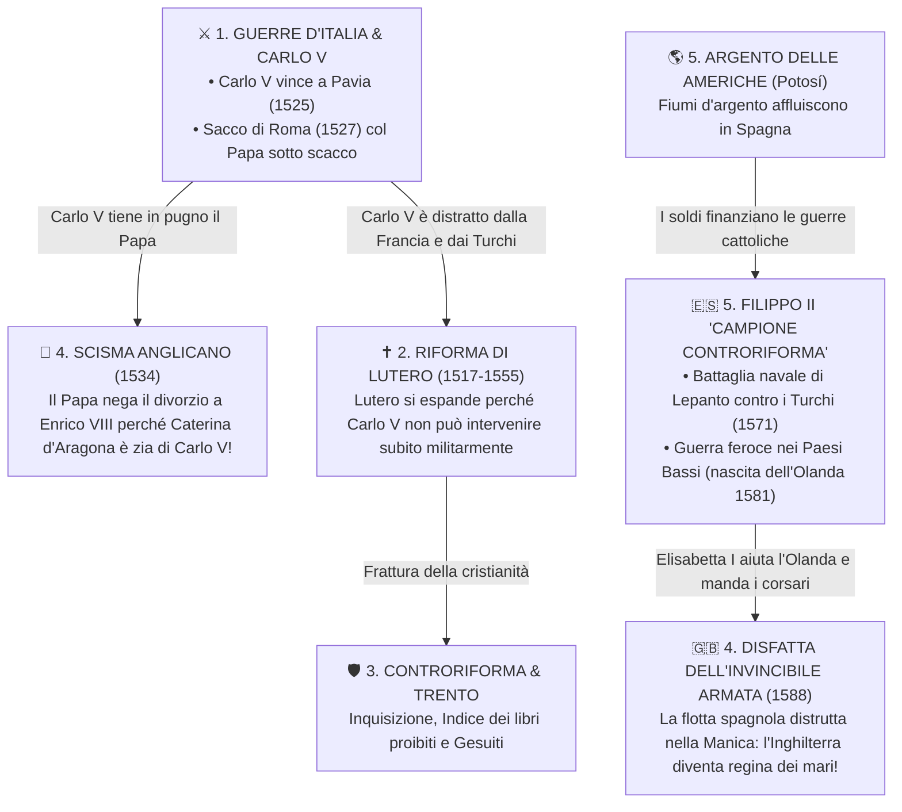

# 🗺️ Linea del Tempo e del '500

| Anno | Evento Chiave | Perché è Fondamentale? |
| :---: | :--- | :--- |
| **==🟡 1494==** | **Discesa di Carlo VIII in Italia** | Dimostra la fragilità italiana; iniziano 65 anni di guerre tra Francia e Spagna. |
| **==🟡 1517==** | **95 Tesi di Martin Lutero** | Rompe l'unità religiosa d'Europa contro lo scandalo delle indulgenze papali. |
| **==🟡 1519==** | **Carlo V Imperatore** | Concentra Spagna, Americhe, Fiandre, Austria e Germania grazie ai banchieri Fugger. |
| **==🟡 1521==** | **Dieta di Worms** | Lutero rifiuta di ritrattare, viene bandito e traduce la Bibbia in tedesco a Wartburg. |
| **==🟡 1525==** | **Battaglia di Pavia** | Carlo V cattura il re francese Francesco I e strappa il Ducato di Milano. |
| **==🟡 1527==** | **Il Sacco di Roma** | I Lanzichenecchi saccheggiano la capitale papale: Clemente VII si rifugia a Castel Sant'Angelo. |
| **==🟡 1534==** | **Atto di Supremazia (Enrico VIII)** | Scisma anglicano politico per sposare Anna Bolena e confisca dei beni ecclesiastici. |
| **==🟡 1545-63==** | **Concilio di Trento** | Riorganizzazione cattolica: 7 sacramenti, Vulgata, obbligo di seminari e Inquisizione. |
| **==🟡 1555==** | **Pace di Augusta** | *Cuius regio, eius religio*: i principi tedeschi scelgono tra cattolicesimo e luteranesimo. |
| **==🟡 1556==** | **Abdicazione di Carlo V** | L'impero si divide: ramo spagnolo a Filippo II, ramo austriaco a Ferdinando I. |
| **==🟡 1559==** | **Pace di Cateau-Cambrésis** | Milano, Napoli, Sicilia, Sardegna e Presìdi passano sotto il dominio diretto spagnolo. |
| **==🟡 1571==** | **Battaglia di Lepanto** | La Lega Santa cristiana ferma l'avanzata navale dell'Impero Ottomano nel Mediterraneo. |
| **==🟡 1581==** | **Indipendenza dell'Olanda** | Le 7 province calviniste del Nord si ribellano a Filippo II e formano le Province Unite. |
| **==🟡 1588==** | **Disfatta dell'Invincibile Armata** | La flotta spagnola distrutta nella Manica: l'Inghilterra elisabettiana domina le rotte oceaniche. |

## 🔗 La Rete dei Collegamenti Storici del '500

I professori valutano soprattutto la capacità di collegare eventi che avvengono contemporaneamente in paesi diversi. Ecco la mappa logica del modulo:

