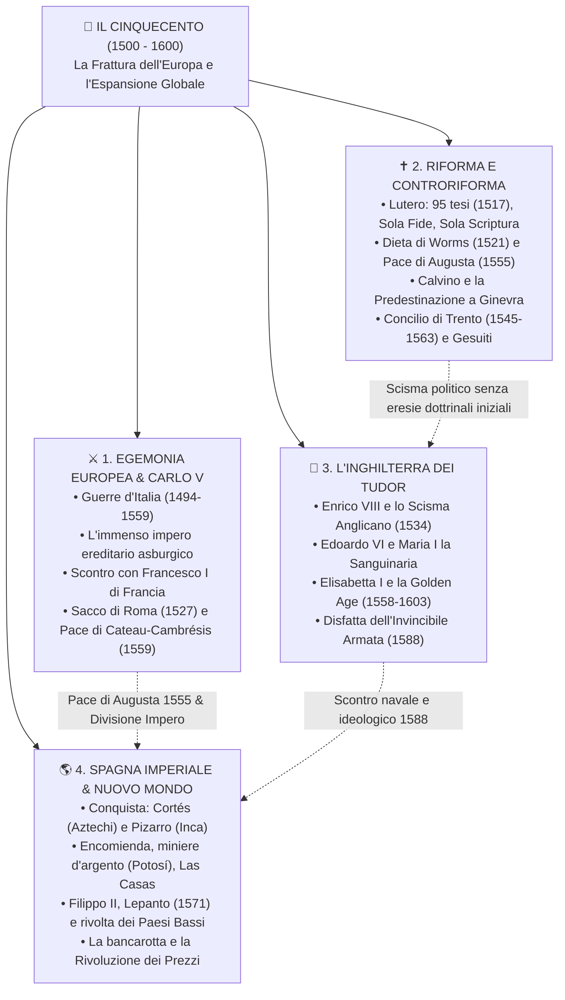

# 👑 Il Cinquecento: La Nascita del Mondo Moderno

Benvenuto nel modulo di studio dedicato al **XVI Secolo (Il Cinquecento)**. Questo secolo segna una frattura irreversibile con il Medioevo: l'Europa assiste alla fine dell'unità religiosa della cristianità occidentale, al sogno infranto di una monarchia universale con Carlo V, allo scontro tra imperi per il controllo dell'Italia e degli oceani, e alla brutale colonizzazione del Nuovo Mondo.

Il modulo è strutturato in una sequenza ordinata di **lezioni modulari**, ciascuna focalizzata su uno dei grandi assi tematici del programma ministeriale e del manuale, corredata da schemi visuali, tabelle comparative, indicazioni per le interrogazioni e coordinate cartografiche precise.

---

## 🎨 Guida alle Evidenziazioni Cromatiche per lo Studio

In tutto il modulo è adottato il sistema di evidenziazione visiva e semantica a colori con emoji guida:

| Evidenziazione | Categoria Concettuale | Significato e Utilizzo |
| :--- | :--- | :--- |
| `==🟡 Testo==` | **Giallo - Date Cardine & Principi** | Date di svolta (es. 1517, 1527, 1555, 1588), principi giuridici (es. *Cuius regio, eius religio*). |
| `==🟢 Testo==` | **Verde - Accordi, Vittorie & Successi** | Trattati di pace (Cateau-Cambrésis), trionfi navali (Lepanto), riforme positive e accordi. |
| `==🔴 Testo==` | **Rosso - Guerre, Crisi & Repressione** | Sacchi, battaglie cruente, tribunali dell'Inquisizione, persecuzioni, bancarotte statali. |
| `==🔵 Testo==` | **Blu - Sovrani, Dinastie & Territori** | Figure di potere (Carlo V, Filippo II, Elisabetta I), casate (Asburgo, Tudor, Valois), stati e vicereami. |
| `==🟣 Testo==` | **Viola - Teologia, Dogmi & Decreti** | Questioni dottrinali (*Sola Fide*, predestinazione, sacramenti, decreti del Concilio di Trento). |
| `==🟠 Testo==` | **Arancione - Economia, Oro & Commerci** | Flussi d'argento da Potosí, inflazione, *encomienda*, commercio atlantico, *Casa de Contratación*. |

---

## 🗺️ Mappa Concettuale Globale del Cinquecento

---

## 📚 Indice Sequenziale delle Lezioni

1. **[[01_Guerre d'Italia e il Dominio di Carlo V|⚔️ Lezione 1: Le Guerre d'Italia e l'Impero di Carlo V]]**
   - La discesa di Carlo VIII e il crollo dell'equilibrio italiano.
   - La composizione dell'incredibile impero ereditario di Carlo V (i 4 rami dinastici) e l'elezione imperiale del 1519.
   - Il duello mortale con Francesco I di Francia: Pavia (1525), la Lega di Cognac e il drammatico **Sacco di Roma (1527)**.
   - L'abdicazione di Carlo V, la spartizione dell'impero e la **Pace di Cateau-Cambrésis (1559)**: l'inizio della dominazione spagnola in Italia.

2. **[[02_Riforma Protestante e la Frattura Religiosa|✝️ Lezione 2: La Riforma Protestante e la Frattura Religiosa]]**
   - Le cause scatenanti: corruzione ecclesiastica, vendita delle indulgenze e Leone X.
   - **Martin Lutero** e le 95 Tesi di Wittenberg (1517): *Sola Fide*, *Sola Scriptura*, sacerdozio universale e i 2 sacramenti.
   - Dalla Dieta di Worms (1521) alle rivolte sociali (cavalieri e guerra contadina di Münzer).
   - Le Diete di Spira, la Lega di Smalcalda e la **Pace di Augusta (1555)** con il principio *Cuius regio, eius religio*.
   - La Riforma Svizzera: Zwingli e la dottrina della **Predestinazione di Giovanni Calvino** a Ginevra.

3. **[[03_Controriforma Cattolica e Concilio di Trento|🛡️ Lezione 3: La Controriforma Cattolica e il Concilio di Trento]]**
   - Il dibattito storiografico: "Controriforma" repressiva o "Riforma Cattolica" autoctona?
   - Il **Concilio di Trento (1545-1563)**: decreti dottrinali (chiusura netta) e decreti disciplinari (seminari, residenza, registri).
   - Gli strumenti del controllo: Tribunale del Sant'Uffizio (Inquisizione romana) e Indice dei Libri Proibiti.
   - L'esercito spirituale del Papa: la **Compagnia di Gesù (Gesuiti)** di Ignazio di Loyola, i collegi e le missioni globali.

4. **[[04_L'Inghilterra dei Tudor - Da Enrico VIII a Elisabetta I|👑 Lezione 4: L'Inghilterra dei Tudor - Da Enrico VIII a Elisabetta I]]**
   - La genesi dello Scisma Anglicano: il matrimonio con Caterina d'Aragona, Anna Bolena e l'**Atto di Supremazia (1534)**.
   - La soppressione dei monasteri e l'ascesa socio-economica della *gentry*.
   - Il periodo di transizione: il calvinismo di Edoardo VI e le persecuzioni cattoliche di Maria I ("Bloody Mary").
   - Il regno di **Elisabetta I Tudor (1558-1603)**: il compromesso religioso, il complotto di Maria Stuart, i corsari (Drake), lo sviluppo commerciale e lo scontro trionfale contro l'**Invincibile Armata (1588)**.

5. **[[05_La Spagna Imperiale di Filippo II e le Colonie del Nuovo Mondo|🌎 Lezione 5: La Spagna Imperiale di Filippo II e le Colonie del Nuovo Mondo]]**
   - I *Conquistadores*: la caduta degli Aztechi (Cortés) e degli Inca (Pizarro); lo shock biologico e la catastrofe demografica indigena.
   - L'istituto dell'**Encomienda**, l'estrazione mineraria a Potosí e la disputa teologica: Las Casas contro Sepúlveda.
   - La tratta degli schiavi (*asiento*) e la "Rivoluzione dei Prezzi" in Europa.
   - Il governo di **Filippo II**: centralizzazione a Madrid, *limpieza de sangre*, la **Battaglia di Lepanto (1571)** contro gli Ottomani, la sanguinosa **Rivolta dei Paesi Bassi** e la nascita dell'Olanda indipendente.

6. **[[06_Linea del Tempo e Mappa dei Territori del Cinquecento|🗺️ Lezione 6: Linea del Tempo Comparata e Atlante Geografico dei Territori]]**
   - Cronologia parallela anno per anno (1492-1603) che incrocia tutti i quattro assi.
   - Guida dettagliata alle cartine storiche: elenco completo dei territori di Carlo V, la via spagnola (*Camino Español*), e le mappe da reperire e incollare nei placeholder.
