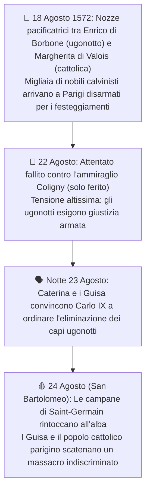

# 🩸 Le Guerre di Religione e la Notte di San Bartolomeo (1562-1572)

> [!NOTE] Coordinate Storiche
> **Periodo:** 1559 - 1572 | **Contesto:** Francia dilaniata da 8 guerre civili religiose

---

## 1. Chi erano gli Ugonotti? La Spaccatura della Società Francese

**Origine del termine:** I protestanti francesi di fede **calvinista** venivano chiamati **==🟣 Ugonotti==** (dall'antico termine tedesco *Eidgenossen*, cioè "confederati legati da giuramento").

**Presenza sociale ed economica:**
  - Rappresentavano circa il **10-15% della popolazione** totale (circa 2 milioni su 20), concentrati soprattutto nel sud e nell'ovest della Francia.
  - Erano fortemente presenti tra i ceti produttivi dinamici (**mercanti, artigiani, banchieri**) e, fatto politicamente esplosivo, **avevano convertito quasi metà della nobiltà feudale francese** (circa il 40%).

**Il pericolo per la Corona:** Convertendosi al calvinismo, i nobili ugonotti intendevano riaffermare la propria autonomia contro il centralismo della monarchia dei Valois (iniziato con Francesco I).

![[Pasted image 20261029131731.png|700]]

---

## 2. La Crisi Dinastica dei Valois e la Reggenza di Caterina de' Medici

Nel 1559 la monarchia francese piomba all'improvviso in una gravissima crisi dinastica:

**La morte improvvisa di Enrico II (1559):**  
  Durante i tornei cavallereschi per festeggiare la [[Il Cinquecento/01_Guerre d'Italia e il Dominio di Carlo V#5. La Pace di Cateau-Cambrésis (1559) e l'Egemonia Spagnola in Italia|Pace di Cateau-Cambrésis (1559)]] e il matrimonio della figlia Elisabetta di Valois con [[Il Cinquecento/05_La Spagna Imperiale di Filippo II e le Colonie del Nuovo Mondo#4. Filippo II: Il 'Campione della Controriforma' (1556-1598)|Filippo II di Spagna]], Enrico II viene trafitto all'occhio da una lancia spezzata e muore pochi giorni dopo.
  
**I sovrani fanciulli:**
  - Il primogenito **Francesco II** sale al trono a soli 15 anni ma muore nel 1560 per un'infezione.
  - La corona passa al fratello minore **Carlo IX**, un bambino di appena 10 anni.

**La Reggente: Caterina de' Medici:**
  - La madre **==🔵 Caterina de' Medici==** (fiorentina, nipote di papa Clemente VII) assume la reggenza del regno.
  - Situazione di estrema debolezza: donna, straniera (disprezzata dalla corte come "l'italiana intrigante e machiavellica"), si trova a gestire uno Stato sull'orlo della bancarotta.

![[Pasted image 20261029131802.png|308]]

---

## 3. Le Due Fazioni Aristocratiche e lo Schieramento Internazionale

Approfittando del vuoto di potere, le due famiglie nobiliari più potenti si armano per contendersi il controllo del trono:

| Fazione | Capi della Fazione | Religione | Sostegno Internazionale | Obiettivo Politico |
| :--- | :--- | :--- | :--- | :--- |
| **I GUISA** | Duca Francesco di Guisa, poi Enrico di Guisa | **==🟣 Cattolici Intransigenti==** | **Spagna di Filippo II** e Papato | Estirpare il calvinismo con la forza e dominare la Corona. |
| **I BORBONE** | Antonio di Borbone, Enrico di Borbone e **Gaspard de Coligny** | **==🟣 Ugonotti (Calvinisti)==** | **Inghilterra di Elisabetta I**, principi protestanti tedeschi e ribelli olandesi | Libertà di culto e limitazione del potere assolutistico regio. |

---

## 4. Dalla Tolleranza al Sangue: Il Massacro di Vassy (1562)

**La strategia del compromesso di Caterina:**
   - Per impedire che i Guisa prendano il sopravvento assoluto sulla monarchia, Caterina adotta una linea di equilibrio politico.
   - **Gennaio 1562 - Editto di Saint-Germain:** Concede agli ugonotti **libertà di coscienza** e **libertà di culto pubblico solo fuori dalle mura delle città** (e nei feudi nobiliari privati).

**La reazione armata cattolica:**
   - I Guisa rifiutano categoricamente qualsiasi tolleranza verso "gli eretici".
   - **==🔴 1° marzo 1562 - Il Massacro di Vassy:==** I soldati del Duca di Guisa assaltano un fienile a Vassy (in Champagne) dove centinaia di ugonotti stavano celebrando il loro culto in preghiera: vengono trucidati decine di calvinisti inermi.

**Inizio delle Guerre di Religione:**
   - Il massacro di Vassy scatena la guerra civile: tra il 1562 e il 1598 la Francia sarà devastata da ben **otto guerre civili di religione**.

---

## 5. L'Ascesa di Gaspard de Coligny e la Crisi del 1572

**Chi era Coligny:** L'ammiraglio **==🔵 Gaspard de Coligny==** diventa il leader militare e spirituale indiscusso degli ugonotti.

**L'influenza sul giovane re Carlo IX:** Coligny entra nel Consiglio della Corona e si guadagna la fiducia del re, convincendolo che l'unico modo per riunificare la Francia è intraprendere una **guerra patriottica contro la Spagna di Filippo II**, inviando aiuti ai fratelli calvinisti insorti nei [[Il Cinquecento/05_La Spagna Imperiale di Filippo II e le Colonie del Nuovo Mondo#2. La Rivolta dei Paesi Bassi e la Nascita dell'Olanda (1581)|Paesi Bassi]].

**La paura di Caterina:** Caterina de' Medici teme che una guerra contro l'invincibile esercito spagnolo annienti definitivamente la Francia.

**L'attentato fallito (22 agosto 1572):** Caterina e i Guisa ordinano un attentato con archibugio contro Coligny: l'ammiraglio viene però soltanto ferito a una mano e al braccio. Gli ugonotti, radunati a Parigi, gridano al complotto e minacciano rappresaglie armate.

![[Pasted image 20261029131858.png|357]]

---

## 6. La Notte di San Bartolomeo (23-24 Agosto 1572)

Messa alle strette dalle proteste ugonotte, Caterina de' Medici convince il giovane re Carlo IX che i capi ugonotti stiano per sferrare un colpo di Stato per rapire la famiglia reale: l'unica via d'uscita è eliminarli a tradimento in un colpo solo.



### I Numeri del Massacro
- **A Parigi:** Coligny viene sgozzato nella sua camera da letto e gettato dalla finestra; nelle strade parigine muoiono più di **==🔴 2.000 ugonotti==** in poche ore.
- **Nelle Province:** Nei giorni successivi la violenza fanatica contagia Lione, Rouen, Bordeaux, Tolosa e Orleans: il bilancio finale ammonta a tra **10.000 e 20.000 morti**.
- **La sorte di Enrico di Borbone:** Enrico di Borbone si salva dalla morte solo accettando all'istante di abiurare provvisoriamente il calvinismo a corte.

```
╔══════════════════════════════════════════════════════════════════════════════════════════╗
║ 🖼️ PLACEHOLDER: IL MASSACRO DELLA NOTTE DI SAN BARTOLOMEO (PAG. 476)                     ║
╠══════════════════════════════════════════════════════════════════════════════════════════╣
║ ![[massacro_notte_san_bartolomeo_dubois.png|750]]                                        ║
║ Cerca: "Francois Dubois Il massacro di San Bartolomeo dipinto Losanna pag 476"          ║
║ Descrizione: Il pittore calvinista Dubois raffigura a sinistra Caterina de' Medici       ║
║ vestita di nero che ispeziona impassibile una pila di cadaveri nudi davanti al Louvre.   ║
╚══════════════════════════════════════════════════════════════════════════════════════════╝
```

---

## 🌟 Dettagli da "Effetto Wow" per l'Interrogazione

> [!TIP] Due Dettagli Storici per Stupire la Prof
> 1. **La reazione di Roma e Madrid alla Notte di San Bartolomeo:**  
>    - A Roma, papa **Gregorio XIII** accolse la notizia della strage con entusiasmo: fece celebrare un solenne *Te Deum* di ringraziamento, commissionò al pittore Giorgio Vasari tre grandi affreschi celebrativi in Vaticano (nella Sala Regia) e fece coniare una medaglia pontificia ufficiale con la scritta *Ugonottorum Strages 1572*.
>    - A Madrid, le cronache narrano che l'austero re [[Il Cinquecento/05_La Spagna Imperiale di Filippo II e le Colonie del Nuovo Mondo#4. Filippo II: Il 'Campione della Controriforma' (1556-1598)|Filippo II di Spagna]], freddo e imperturbabile per natura, **sorrise in pubblico per la prima e unica volta nella sua vita** quando ricevette il dispaccio della morte di Coligny.
> 2. **Il valore testimoniale del dipinto di François Dubois (p. 476):**  
>    - Dubois non dipinse una scena allegorica, ma una cronaca testimoniale vissuta in prima persona: fuggito a Losanna, dipinse la tela per denunciare al mondo la ferocia del fanatismo religioso e il tradimento premeditato della monarchia Valois.
