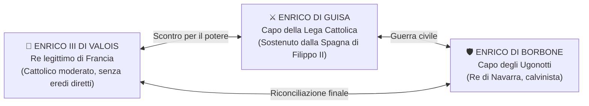

# 👑 Enrico IV, l'Editto di Nantes e la Nobiltà di Toga (1585-1610)

> [!NOTE] Coordinate Storiche
> **Periodo:** 1585 - 1610 | **Contesto:** Dalla Guerra dei Tre Enrichi alla nascita dello Stato moderno francese 

---

## 1. La Guerra dei Tre Enrichi (1585-1589)

Dopo la morte di Carlo IX (1574), sale al trono il fratello **Enrico III di Valois**. La crisi per la successione al trono sfocia nella celebre **Guerra dei Tre Enrichi**:

### La Sequenza Precisa degli Eventi
**La minaccia di Guisa e l'assassinio (1588):**
   - Enrico di Guisa entra trionfalmente a Parigi appoggiato dal popolo cattolico in rivolta contro il re (*Giorno delle Barricate*).
   - Temendo di essere deposto, **Enrico III attira Enrico di Guisa nel castello di Blois** con una falsa convocazione e lo fa assassinare a tradimento dalle proprie guardie del corpo (dicembre 1588).

**Il regicidio di Enrico III (1589):**
   - La fazione cattolica grida vendetta: il 1° agosto 1589 un frate domenicano fanatico, **Jacques Clément**, si finge messaggero e accoltella a morte re Enrico III a Saint-Cloud.

**Il testamento politico:**
   - Prima di spirare, Enrico III non ha discendenti maschi: nomina come unico legittimo erede al trono il cognato **==🔵 Enrico di Borbone==**, a una condizione categorica: **convertirsi alla fede cattolica**.

---

## 2. L'Ascesa di Enrico IV: "Parigi val bene una messa" (1593)

Enrico di Borbone assume la corona con il nome di **==🔵 Enrico IV==** (diventa il capostipite della dinastia dei **Borbone**, che regnerà in Francia fino alla Rivoluzione).

**La resistenza di Parigi e l'invasione spagnola:**
  - I cattolici parigini e il papa rifiutano di obbedire a un re calvinista ("eretico relapso").
  - [[Il Cinquecento/05_La Spagna Imperiale di Filippo II e le Colonie del Nuovo Mondo#4. Filippo II: Il 'Campione della Controriforma' (1556-1598)|Filippo II di Spagna]] interviene militarmente inviando truppe dalle Fiandre per imporre sul trono francese sua figlia Isabella.

**La mossa politica geniale (Luglio 1593):**
  - Enrico IV sconfigge militarmente gli eserciti cattolici ma comprende la realtà dei fatti: **la stragrande maggioranza dei francesi è cattolica e Parigi non accetterà mai un re calvinista**.
  - Nella basilica di Saint-Denis compie solennemente l'**abiura del calvinismo** e si converte al cattolicesimo.
  - La tradizione gli attribuisce la celebre frase:  
    > **==🟣 «Parigi val bene una messa»==** (*Paris vaut bien une messe*)  
    > *(Significato: Rinunciare alla propria fede protestante per celebrare la messa cattolica è un prezzo piccolo da pagare in cambio della corona di Francia e della pacificazione nazionale).*

**L'incoronazione (1594):** Nel 1594 entra pacificamente a Parigi e viene consacrato re nella cattedrale di **Chartres**.

![[Pasted image 20261029132524.png]]

---

## 3. L'Editto di Nantes (13 Aprile 1598): La Nascita della Tolleranza

Con l'**==🟢 Editto di Nantes (1598)==**, Enrico IV pone fine a quasi quarant'anni di guerre civili e firma il primo testo di tolleranza religiosa dello Stato moderno.

> [!NOTE] 📜 I 4 PILASTRI DELL'EDITTO DI NANTES (1598)
> 1. **==🟣 Libertà di coscienza:==** Piena libertà interiore di professare la religione calvinista in tutta la Francia (nessuna persecuzione per la fede privata).
> 2. **==🟣 Libertà di culto pubblico:==** Ammessa in tutti i luoghi dove era già celebrata e nei castelli dei nobili ugonotti (vietata categoricamente solo a Parigi e nel raggio di 5 leghe dalla capitale).
> 3. **==🟣 Parità dei diritti civili e politici:==** Gli ugonotti possono accedere a tutte le cariche pubbliche, uffici statali, magistrature, scuole e università al pari dei cattolici.
> 4. **==🔵 Garanzie militari (piazzeforti di sicurezza):==** Circa 100 fortezze militari difese da proprie guarnigioni armate ugonotte e pagate direttamente dalle casse del re (tra cui la principale è **La Rochelle**).

**La piazzaforte più importante: ==🔵 La Rochelle==**  
Situata sulla costa atlantica, la roccaforte portuale di **La Rochelle** divenne la vera capitale militare e marittima degli ugonotti, capace di ricevere rifornimenti navali diretti dall'Inghilterra in caso di nuovi assedi.

![[Pasted image 20261029132922.png]]

---

## 4. Il Ministro Sully e la Rinascita Economica della Francia

Per risollevare uno Stato stremato da 40 anni di rovine e debiti, Enrico IV nomina come sovrintendente generale delle finanze il fidato **==🔵 Duca di Sully==** (Maximilien de Béthune, nobile calvinista incorruttibile).

![[Pasted image 20261029133023.png|365]]

### Le Riforme Economiche di Sully:
1. **Riorganizzazione del bilancio:** Elimina gli sprechi di corte, recupera le terre della Corona svendute durante le guerre e pareggia il bilancio statale.
2. **Sgravio fiscale sui contadini:** Riduce la *taille* (la gravosa imposta fondiaria diretta sui contadini) per ripopolare le campagne e incentivare la produzione di grano.
3. **Opere pubbliche e bonifiche:** Fa prosciugare le paludi, finanzia la costruzione di canali navigabili, strade alberate, ponti e introduce la gelsibachicoltura (produzione della seta).

---

## 5. La Tassa della "Paulette" (1604) e le Due Nobiltà a Confronto

La riforma più rivoluzionaria e duratura del governo di Enrico IV e Sully fu la vendita istituzionalizzata delle cariche pubbliche (**venalità delle cariche**):

- **Cos'era la ==🟠 Tassa della Paulette (1604)==:**  
  Ideata dal finanziere Charles Paulet, era una **tassa annuale** (pari a circa 1/60 del valore dell'ufficio) che un funzionario pagava alla Corona. Pagando questa tassa, **la carica pubblica (di giudice, magistrato, esattore fiscale) diventava legalmente ereditaria e trasmissibile ai propri figli** (oppure vendibile a terzi).
- **Il doppio vantaggio immediato per la Corona:**
  1. Porta un gettito continuo e cospicuo nelle casse svuotate del re.
  2. Crea un apparato burocratico centralizzato direttamente legato alla monarchia.

### ⚔️ Nobiltà di Spada contro 🎓 Nobiltà di Toga

Questa riforma trasformò per sempre la società francese, creando due nobiltà contrapposte:

| Caratteristica | ==🔵 Nobiltà di Spada== (*Noblesse d'épée*) | ==🟠 Nobiltà di Toga== (*Noblesse de robe*) |
| :--- | :--- | :--- |
| **Origine Sociale** | **Antica aristocrazia feudale di sangue**. | **Ricca borghesia cittadina** (mercanti, giuristi, banchieri). |
| **Come si ottiene il titolo?** | Ereditato per nascita da generazioni cavalleresche medievali. | **Acquistato con il denaro** tramite le cariche statali e la *Paulette*. |
| **Vestiti ed Emblema** | Armature, spade da duello, castelli feudali. | **Toga nera lunga di panno**, cappello magistrale e uffici parlamentari. |
| **Rapporto con il Re** | **Ribelle e gelosa dei privilegi feudali**, ostile al potere assoluto del sovrano. | **Fedelissima alla monarchia**, perché la sua ascesa sociale dipende unicamente dal re. |

---

## 🌟 Dettagli da "Effetto Wow" per l'Interrogazione

> [!TIP] Due Dettagli Storici per Stupire la Prof
> 1. **Perché Enrico IV fu consacrato a Chartres e non a Reims?**  
>    Tutti i sovrani di Francia venivano tradizionalmente consacrati con l'olio santo nella cattedrale di Reims. Tuttavia, nel 1594 Reims era ancora saldamente occupata dalle truppe ultra-cattoliche dei Guisa; per non rimandare l'investitura e dimostrare di essere re a tutti gli effetti, Enrico IV scelse pragmaticamente la splendida cattedrale di **Chartres**, facendosi confezionare abiti e insegne regie nuovi di zecca.
> 2. **La rivoluzione concettuale dell'Editto di Nantes:**  
>    A differenza della [[Il Cinquecento/01_Guerre d'Italia e il Dominio di Carlo V#4. La Pace di Augusta (1555) e l'Abdicazione di Carlo V (1556)|Pace di Augusta (1555)]], dove il suddito era costretto a professare la stessa religione del principe (*Cuius regio, eius religio*), l'Editto di Nantes **separa per la prima volta la cittadinanza civile dalla fede religiosa**: un francese ugonotto è prima di tutto un suddito leale del re e cittadino della Francia, indipendentemente dal modo in cui prega.
> 3. **La fine drammatica di Enrico IV (1610):**  
>    Nonostante la pacificazione e l'amore del popolo (che lo chiamava il "buon re Enrico"), nel **1610** il sovrano fu assassinato a coltellate a Parigi da François Ravaillac, un maestro fanatico cattolico convinto che il re stesse tramando una nuova guerra contro il cattolicesimo asburgico.
