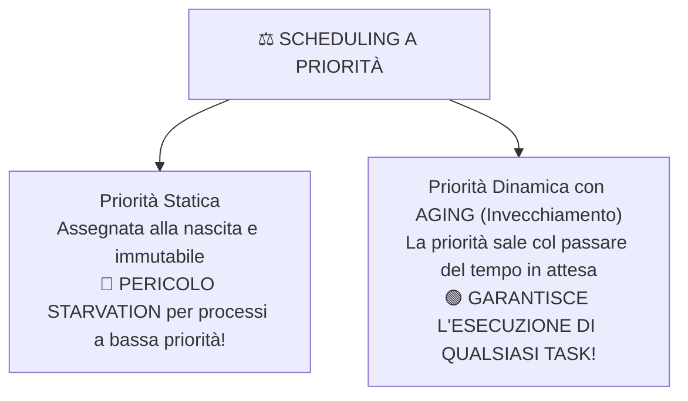

# 🔄 Ciclo di Vita del Processo e Algoritmi di Scheduling

La CPU è il "motore" del calcolatore: in un'architettura monoprocessore (o all'interno di un singolo core), **un solo processo alla volta può trovarsi in esecuzione fisica**. Il coordinamento di tutti gli altri processi presenti nel computer spetta ai moduli specializzati del Kernel e agli **algoritmi di scheduling**.

---

## 3.1 Diagramma degli Stati del Processo e Moduli del Kernel

Durante la propria esistenza, un programma attraversa diverse condizioni operative codificate all'interno del proprio PCB:

![[process_states_lifecycle.jpg|850]]

Gli algoritmi di schedulazione rappresentano la logica con cui il CPU Scheduler decide a quale processo in READY assegnare la CPU. Si dividono in due grandi famiglie:

![[scheduling_algorithms_overview.jpg|850]]

---

### Algoritmi Non-Preemptive (Senza Prelazione)
Un algoritmo è **Non-Preemptive** se, una volta assegnata la CPU a un processo, questo **la mantiene ininterrottamente fino alla sua conclusione naturale o fino a quando non richiede spontaneamente un'operazione di I/O**. Il SO non interviene mai per sottrargli forzatamente il processore.

#### 1. FCFS (First-Come, First-Served)
- **Logica:** I processi vengono serviti rigorosamente nell'ordine cronologico di arrivo nella Ready Queue ($T_A$, politica FIFO - *First In, First Out*).
- **Vantaggi:** Semplicità assoluta di implementazione, overhead quasi nullo.
- **Svantaggio Critico:** ==🔴 Effetto Convoglio (Convoy Effect)==.

> [!QUESTION] 💡 Che cos'è l'Effetto Convoglio in FCFS? (Motivazione per la Prof)
> Immaginiamo una fila a un unico sportello postale in cui la prima persona deve svolgere un'operazione contabile lunghissima che richiede 60 minuti, mentre dietro di lei ci sono dieci persone che devono solo imbucare una cartolina da 10 secondi.
> In FCFS accade lo stesso: se entra per primo un processo lungo ad alta intensità di calcolo (**CPU-bound** con burst da 100 secondi), tutti i processi interattivi brevissimi (**I/O-bound** con burst da 0,1 secondi) rimangono intrappolati dietro di lui in attesa, facendo schizzare il tempo medio di attesa ($TA_M$) a valori inaccettabili.

#### 2. SJF (Shortest Job First - Non-Preemptive)
- **Logica:** Quando la CPU si libera, lo scheduler scorre la Ready Queue e seleziona il processo che possiede il ==🟠 minor tempo di burst ($T_B$)== stimato.
- **Vantaggio Matematico:** È dimostrato matematicamente che l'algoritmo SJF è **ottimo**, poiché garantisce in assoluto il **minimo Tempo di Attesa Medio ($TA_M$)** rispetto a qualsiasi altro algoritmo non-preemptive.
- **I Due Limiti Fatali di SJF:**
  1. ==🔴 Rischio di Starvation (Inedia):== Se nel sistema continuano ad arrivare processi con burst breve, un processo con burst lungo rimarrà perennemente in fondo alla coda e non verrà **mai eseguito**.
  2. ==🔴 Non conoscibilità a priori del tempo di burst ($T_B$):== Nella realtà dei calcolatori moderni, il sistema operativo non può sapere in anticipo quanti millisecondi di calcolo richiederà un programma utente prima di fare I/O; il valore può essere soltanto stimato tramite medie esponenziali delle esecuzioni passate.

---

### Algoritmi Preemptive (Con Prelazione)
Un algoritmo è **Preemptive** quando il Sistema Operativo possiede l'autorità hardware di **interrompere forzatamente il processo attualmente in RUNNING** (sfruttando il timer o i segnali di interrupt), togliergli la CPU, retrocederlo in READY e assegnare il processore a un altro processo più urgente o prioritario.

#### 1. SRTF (Shortest Remaining Time First)
- **Logica:** È la versione **preemptive** dell'algoritmo SJF.
- Quando un nuovo processo arriva nella Ready Queue, lo scheduler confronta il suo burst time con il **tempo residuo rimanente** del processo attualmente in esecuzione sulla CPU:
  - Se il nuovo arrivato richiede meno tempo di quello che manca al processo corrente, **avviene la prelazione immediata**: il processo in RUNNING viene sospeso e la CPU viene data al nuovo arrivato.
  - A parità di tempo residuo, **non si fa preemption** per evitare l'overhead inutile di un context switch.

---

#### 2. Round-Robin (RR)
- **Logica:** È l'algoritmo cardine dei sistemi Time-Sharing. I processi sono gestiti in una coda circolare FIFO. A ciascun processo viene concessa la CPU per un intervallo temporale prefissato pari a un ==🟠 Time-Slice (Quanto di Tempo)==.
- Se il processo termina o fa I/O prima dello scadere del time-slice, rilascia la CPU spontaneamente.
- Se scade il time-slice prima del completamento, un interrupt hardware scollega il processo e lo sposta in coda alla Ready Queue.
- **Punti di Forza:** ==🟢 Massima Equità (Fairness)==, eccellente tempo di risposta per programmi interattivi, e **assenza totale di starvation** (ogni processo ha la certezza matematica di avanzare a ogni giro di ruota).

#### 3. Varianti Evolute di Round-Robin
- ==🔵 Round-Robin Limitato (Multilevel Feedback Queue):== 
  I processi entrano in una prima coda a priorità alta (Ready 1) servita con Round-Robin. A ogni processo è concesso un numero massimo $N$ di time-slice in Ready 1. Se il processo non termina entro questa soglia, viene considerato "pesante" e retrocesso forzatamente in una seconda coda a priorità inferiore (Ready 2), servita dalla CPU solo quando la coda Ready 1 è completamente vuota. Questo preserva la reattività delle app leggere.
- ==🔵 Round-Robin a Percentuale di Tempo:== 
  La CPU suddivide la propria potenza di calcolo in quote percentuali fisse dedicate alle diverse tipologie di processi (es. $70\%$ del tempo ai processi interattivi dell'utente, $20\%$ ai processi di calcolo in background, $10\%$ ai task di manutenzione interna del kernel).

---

#### 4. Scheduling con Priorità e il Rimedio dell'Aging
Negli algoritmi a priorità, a ogni processo viene associato un valore numerico che ne determina l'urgenza di esecuzione:

- **Il Concetto di Niceness in Linux/Unix:**
  Nei sistemi Unix e Linux, la priorità dei processi nello spazio utente è regolata dal valore di ==🔵 Niceness (Gentilezza)==, compreso tra **$-20$ e $+19$**:
  - Un valore di niceness pari a **$-20$** indica priorità **massima** (il processo è "egoista", non è gentile con gli altri e pretende tutta la CPU).
  - Un valore di niceness pari a **$+19$** indica priorità **minima** (il processo è "molto gentile", cede il passo a chiunque).

> [!QUESTION] 💡 Come si risolve la Starvation causata dalle Priorità? (Motivazione per la Prof)
> Se utilizzassimo solo priorità statiche, un processo a bassa priorità potrebbe rimanere bloccato in Ready Queue per giorni o settimane (**Starvation**), non appena il sistema riceve costantemente processi a priorità più alta.
> La soluzione ingegneristica standard si chiama ==🟢 Aging (Invecchiamento)==:
> Il Kernel monitora costantemente il tempo che ciascun processo trascorre fermo nella coda di READY. A intervalli regolari, **il SO incrementa gradualmente la priorità del processo affamato**. Con il passare del tempo, la sua priorità diventerà così elevata da superare anche i processi appena arrivati, garantendo l'esecuzione certa di qualunque elaborazione.
