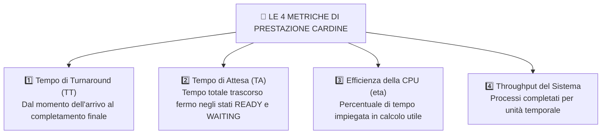

# 📊 Metriche di Prestazione e Caso Reale d'Esame

La valutazione quantitativa di un algoritmo di scheduling si basa su metriche matematiche precise. In questa sezione viene presentato il **formulario formale completo** e la risoluzione analitica guidata di un **tipico problema d'esame** caratterizzato da interruzioni hardware e prelazione della CPU.

---

## 4.1 Formulario Formale delle Metriche di Scheduling



---

### 1. Tempo di Turnaround ($TT_i$ - Tempo di Completamento)
> [!NOTE] Definizione di Turnaround Time
> Il **Tempo di Turnaround ($TT_i$)** rappresenta l'intervallo temporale complessivo che intercorre tra l'istante in cui il processo entra per la prima volta nel sistema (stato *NEW/HOLD*) e l'istante in cui conclude definitivamente la propria esecuzione (stato *TERMINATED*):

$$\mathbf{TT_i = T_{\text{fine}, i} - T_{\text{arrivo}, i}}$$

Il **Tempo di Turnaround Medio ($TT_M$)** su un insieme di $N$ processi è la media aritmetica dei singoli tempi di turnaround:
$$\mathbf{TT_M = \frac{\sum_{i=1}^{N} TT_i}{N} = \frac{TT_1 + TT_2 + \dots + TT_N}{N}}$$

---

### 2. Tempo di Attesa ($TA_i$ - Waiting Time)
> [!NOTE] Definizione di Tempo di Attesa
> Il **Tempo di Attesa ($TA_i$)** è la somma di tutti gli intervalli temporali in cui un processo è rimasto inattivo, in coda nella memoria RAM (stato *READY*) o in attesa del completamento di un'operazione di I/O (stato *WAITING*), senza poter utilizzare la CPU:

$$\mathbf{TA_i = TT_i - T_{\text{burst}, i}}$$

Per i processi che subiscono preemption (interruzioni multiple), il tempo di attesa può essere calcolato anche sommando direttamente i singoli segmenti temporali trascorsi in attesa lungo l'asse dei tempi:
$$\mathbf{TA(P) = (T_{\text{inizio1}} - T_{\text{arrivo}}) + (T_{\text{ripresa1}} - T_{\text{sospensione1}}) + \dots}$$

Il **Tempo di Attesa Medio ($TA_M$)** su $N$ processi è dato da:
$$\mathbf{TA_M = \frac{\sum_{i=1}^{N} TA_i}{N} = \frac{TA_1 + TA_2 + \dots + TA_N}{N}}$$

---

### 3. Efficienza della CPU ($\eta$)
> [!NOTE] Definizione di Efficienza della CPU
> L'**Efficienza della CPU ($\eta$)** rappresenta la frazione percentuale del tempo di osservazione in cui la CPU è stata attivamente impegnata nell'elaborazione del codice utile dei programmi utente:

$$\mathbf{\eta = \frac{\sum_{i=1}^{N} T_{\text{burst}, i}}{T_{\text{totale}}} \times 100\%}$$

Scomponendo il tempo totale di osservazione del sistema nelle sue componenti fisiche reali:
$$\mathbf{T_{\text{totale}} = \sum_{i=1}^{N} T_{\text{burst}, i} + T_{\text{idle}} + T_{\text{overhead}}}$$

Dove:
- $\sum T_{\text{burst}, i}$: somma dei tempi di esecuzione utile dei processi.
- ==🟠 $T_{\text{idle}}$:== tempo in cui la CPU è rimasta completamente inattiva per assenza di processi pronti.
- ==🟠 $T_{\text{overhead}}$:== tempo speso dal sistema operativo per eseguire context switch, aggiornamento dei PCB e routine del kernel.

> [!QUESTION] 💡 Perché nei sistemi reali risulta sempre $\eta < 100\%$? (Motivazione per la Prof)
> È fisicamente impossibile raggiungere un'efficienza del $100\%$ perché il passaggio da un processo all'altro non è istantaneo: richiede il tempo di cambio di contesto del Dispatcher ($T_{\text{overhead}}$). Inoltre, possono verificarsi finestre temporali in cui nessun processo è pronto in RAM ($T_{\text{idle}}$), durante le quali la CPU esegue unicamente il ciclo nullo a basso consumo (*HLT / idle loop*).

---

### 4. Throughput (Produttività del Sistema)
> [!NOTE] Definizione di Throughput
> Il **Throughput** misura il numero di processi che il sistema è in grado di completare con successo all'interno di una determinata unità di tempo (es. processi al secondo o processi per minuto):

$$\mathbf{\text{Throughput} = \frac{\text{Numero di Processi Completati}}{\text{Intervallo di Tempo Osservato}}}$$

---

## 4.2 Analisi Completa del Caso Reale d'Esame: Interruzione Hardware

Questa tipologia di esercizio è tra le più gettonate nei compiti in classe e negli esami di TPSIT, poiché verifica la capacità dello studente di comprendere le **interruzioni hardware**, la **prelazione** e il calcolo rigoroso delle metriche.

### Traccia dello Scenario
All'interno del sistema operano **3 processi distinti**:
- ==🔵 Processo $P_1$ (Browser di navigazione):== processo utente a priorità standard.
  - Istante di arrivo: $T_A = 1$
  - Tempo di burst richiesto: $T_B = 7$
- ==🔴 Processo $P_2$ (Driver della tastiera):== processo di sistema collegato a una periferica fisica ad alta priorità hardware.
  - Istante di arrivo (evento tasto premuto): $T_A = 2$
  - Tempo di burst richiesto: $T_B = 5$
- ==🟢 Processo $P_3$ (Riproduttore audio Spotify):== processo utente standard.
  - Istante di arrivo: $T_A = 3$
  - Tempo di burst richiesto: $T_B = 2$

---

### Diagramma Temporale di Gantt

```
Tempo: 0   1   2   3   4   5   6   7   8   9  10  11  12  13  14  15
       ├───┼───┼───┼───┼───┼───┼───┼───┼───┼───┼───┼───┼───┼───┼───┤
P1     [IDL][RUN][   R E A D Y     ]            [   R U N N I N G (6)   ]
P2             [   R U N N I N G (5)   ]
P3                 [   R E A D Y   ][RUN(2)]
```

> [!TIP] 🖼️ Placeholder Grafico per lo Studio Personale
> *Rappresentazione Visiva Consigliata:* Grafico a barre temporali orizzontali in cui $P_1$ è colorato in blu (con una pausa da $T=2$ a $T=9$), $P_2$ è colorato in rosso evidenziando il fulmine dell'interrupt a $T=2$, e $P_3$ è in verde da $T=7$ a $T=9$.

---

### Cronologia Analitica Istante per Istante con le Motivazioni per la Prof

#### ⏱️ Istante $T = 0$:
- Nel sistema non è ancora giunto alcun processo.
- La CPU si trova nello stato ==🟠 IDLE (Inattività)== per la durata di $1$ unità di tempo.

#### ⏱️ Istante $T = 1$:
- Arriva il processo $P_1$ ($T_A = 1, T_B = 7$).
- Poiché la CPU è libera, il CPU Scheduler e il Dispatcher allocano immediatamente il processore a $P_1$.
- **Stato:** $P_1$ entra in ==⚡ RUNNING==.

#### ⏱️ Istante $T = 2$ (L'Evento Chiave: Interruzione Hardware):
- L'utente preme fisicamente un tasto sulla tastiera.
- Il controller della tastiera invia una linea di interrupt elettrica (**IRQ**) alla CPU.
- L'Interrupt Handler risveglia il driver $P_2$ ($T_A = 2, T_B = 5$).
- **La Decisione di Scheduling (per la Prof):** 
  $P_2$ è un driver di gestione hardware critico del sistema operativo e gode di **priorità hardware assoluta** rispetto al browser utente $P_1$. 
  Di conseguenza, la CPU attiva la ==🔴 prelazione forzata (Preemption)==:
  1. $P_1$ viene sospeso e retrocesso forzatamente nello stato ==🟢 READY==.
  2. $P_1$ ha consumato $1$ sola unità di calcolo (da $T=1$ a $T=2$), quindi il suo **burst residuo rimanente è pari a $7 - 1 = 6$ unità**.
  3. $P_2$ viene caricato nei registri della CPU ed entra in ==⚡ RUNNING==.

#### ⏱️ Istante $T = 3$:
- Entra nel sistema il processo $P_3$ (Spotify, con $T_A = 3$ e $T_B = 2$).
- **La Decisione di Scheduling (per la Prof):** 
  Nonostante $P_3$ sia un processo brevissimo ($T_B = 2$) e in una normale politica SJF avrebbe la precedenza su burst più lunghi, **la routine del driver hardware $P_2$ in esecuzione non può essere interrotta da normali processi utente**. 
  $P_3$ deve pertanto accodarsi pazientemente nella coda di ==🟢 READY== in memoria RAM.

#### ⏱️ Istante $T = 7$:
- Il driver $P_2$ completa l'intero burst di $5$ unità ($2 + 5 = 7$) e transita nello stato ==🔴 TERMINATED== ($T_{F2} = 7$).
- La CPU torna disponibile. Nella Ready Queue sono presenti due processi in attesa:
  - $P_3$ con burst $T_B = 2$
  - $P_1$ con burst residuo $T_{B,\text{residuo}} = 6$
- **La Decisione di Scheduling (per la Prof):** 
  Trattandosi di due normali processi a livello utente, lo Scheduler applica la politica **SJF (Shortest Job First)** per minimizzare il tempo di attesa medio. Poiché il tempo di $P_3$ ($2$) è nettamente inferiore al tempo di $P_1$ ($6$), la CPU viene assegnata a **$P_3$**.
- $P_3$ transita in ==⚡ RUNNING== per $2$ unità di tempo (da $T=7$ a $T=9$).

#### ⏱️ Istante $T = 9$:
- $P_3$ conclude regolarmente il proprio burst e termina ($T_{F3} = 9$).
- L'unico processo rimasto nella Ready Queue è $P_1$.
- Il Dispatcher esegue il Context Switch, ripristina i registri di $P_1$ dal PCB e gli riassegna la CPU.
- $P_1$ esegue le sue rimanenti $6$ unità di burst (da $T=9$ a $T=15$).

#### ⏱️ Istante $T = 15$:
- $P_1$ termina definitivamente la propria esecuzione ($T_{F1} = 15$).

---

## 4.3 Calcoli Matematici Formali del Problema

Raccogliamo tutti i valori all'interno della tabella analitica:

| Processo | Descrizione | Istante Arrivo ($T_A$) | Burst Totale ($T_B$) | Istante Fine ($T_{\text{fine}}$) | Turnaround ($TT = T_{\text{fine}} - T_A$) | Attesa ($TA = TT - T_B$) |
| :---: | :--- | :---: | :---: | :---: | :---: | :---: |
| **$P_1$** | Browser Web (Utente) | $1$ | $7$ | **$15$** | $15 - 1 = \mathbf{14}$ | $14 - 7 = \mathbf{7}$ |
| **$P_2$** | Driver Tastiera (HW) | $2$ | $5$ | **$7$** | $7 - 2 = \mathbf{5}$ | $5 - 5 = \mathbf{0}$ |
| **$P_3$** | Riproduttore Audio | $3$ | $2$ | **$9$** | $9 - 3 = \mathbf{6}$ | $6 - 2 = \mathbf{4}$ |

---

### 1. Calcolo dei Tempi di Turnaround
- $TT_1 = 15 - 1 = \mathbf{14}$
- $TT_2 = 7 - 2 = \mathbf{5}$
- $TT_3 = 9 - 3 = \mathbf{6}$

$$\mathbf{TT_M = \frac{14 + 5 + 6}{3} = \frac{25}{3} \approx 8{,}33 \text{ unità di tempo}}$$

---

### 2. Calcolo dei Tempi di Attesa
- **Verifica diretta del tempo di attesa di $P_1$ sull'asse temporale:**
  - $P_1$ non attende prima di iniziare ($T=1$).
  - Viene sospeso all'istante $T=2$ e riprende all'istante $T=9$.
  - Rimane fermo in READY da $T=2$ a $T=9$, ovvero per $9 - 2 = \mathbf{7 \text{ unità di tempo}}$ (esattamente la durata dell'esecuzione combinata di $P_2$ e $P_3$).
- **Verifica del tempo di attesa di $P_2$:**
  - Arriva a $T=2$ e parte immediatamente a $T=2 \implies TA_2 = \mathbf{0}$.
- **Verifica del tempo di attesa di $P_3$:**
  - Arriva a $T=3$ e rimane bloccato in READY fino a $T=7 \implies 7 - 3 = \mathbf{4 \text{ unità di tempo}}$.

$$\mathbf{TA_M = \frac{7 + 0 + 4}{3} = \frac{11}{3} \approx 3{,}67 \text{ unità di tempo}}$$

---

### 3. Calcolo dell'Efficienza della CPU ($\eta$)
- Somma dei tempi di burst utili eseguiti dalla CPU:
  $$\sum T_B = T_{B1} + T_{B2} + T_{B3} = 7 + 5 + 2 = \mathbf{14 \text{ unità}}$$
- Tempo totale trascorso di osservazione del sistema:
  $$T_{\text{totale}} = 15 \text{ unità}$$
- Tempo di inattività della CPU (*Idle Time*):
  $$T_{\text{idle}} = 1 \text{ unità (da } T=0 \text{ a } T=1)$$

$$\mathbf{\eta = \frac{\sum T_B}{T_{\text{totale}}} \times 100\% = \frac{14}{15} \times 100\% \approx 93{,}33\%}$$

> [!NOTE] Riscontro dell'Efficienza
> La CPU ha lavorato per il $93{,}33\%$ del tempo a disposizione. L'unico momento di inefficienza è stato l'intervallo iniziale da $T=0$ a $T=1$ ($6{,}67\%$), in cui nessun processo era ancora arrivato nel sistema.
