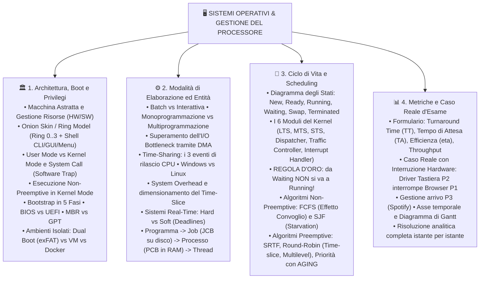

# 🖥️ Sistemi Operativi e Gestione del Processore

Benvenuto nel modulo didattico dedicato all'**Architettura dei Sistemi Operativi e alla Gestione della CPU**, progettato per fornire una padronanza teorica e pratica assoluta per le verifiche scritte e orali di **TPSIT**.

Ogni argomento è corredato non solo da definizioni formali, ma dalle **motivazioni sistemistiche approfondite** ("il *perché* di ogni scelta ingegneristica") richieste dai docenti, schemi grafici ad alta risoluzione e calcoli matematici completi.

---

## 🎨 Guida alle Evidenziazioni Cromatiche (Nuovo Formato Obsidian)

In tutti i documenti di questo modulo è stato adottato il sistema di evidenziazione semantica a colori basato sulle emoji, che rende i concetti immediatamente distinguibili a colpo d'occhio:

| Evidenziazione | Categoria Concettuale | Significato e Utilizzo |
| :--- | :--- | :--- |
| `==🟡 Testo==` | **Giallo - Concetto Chiave** | Definizioni primarie, principi architetturali fondamentali (es. Macchina Astratta, Time-Sharing). |
| `==🟢 Testo==` | **Verde - Vantaggio / Stato Positivo** | Punti di forza, transizioni corrette, stati attivi (es. Stato READY, Isolamento, DMA). |
| `==🔴 Testo==` | **Rosso - Pericolo / Errore / Vincolo** | Crash di sistema (BSOD/Panic), inedia (Starvation), prelazione forzata, deadline rigide. |
| `==🔵 Testo==` | **Blu - Hardware & Strutture Dati** | Moduli fisici, registri della CPU, blocchi di controllo (PCB, JCB, Kernel, GPT, UEFI). |
| `==🟣 Testo==` | **Viola - Meccanismi Interni & Interrupt** | System Call, Trap software (`INT 0x80`), Context Switch atomico, segnali IRQ. |
| `==🟠 Testo==` | **Arancione - Metriche & Formule** | Turnaround time ($TT$), tempi di attesa ($TA$), Time-Slice ($T_Q$), efficienza ($\eta$). |

---

## 🗺️ Mappa Concettuale Generale del Percorso

---

## 📚 Indice dei Fascicoli di Studio

1. **[[01_Architettura del Sistema Operativo, Boot e Privilegi|🏛️ Fascicolo 1: Architettura del Sistema Operativo, Boot e Privilegi]]**
   - Ruolo del SO come macchina astratta e intermediario hardware-software.
   - Architettura a strati concentrici: il modello a Ring (*Ring 0 Kernel, Ring 1 Memory, Ring 2 Device, Ring 3 File System, Shell*).
   - Livelli di privilegio: User Mode vs Kernel Mode, System Call e trap software (`INT 0x80` / `SYSCALL`).
   - La sequenza di Bootstrap in 5 fasi: Reset Vector, POST, tabella partizioni, Bootloader e caricamento del Kernel.
   - Confronti tecnologici fondamentali: BIOS vs UEFI, MBR (limite dei 2 TiB dimostrato) vs GPT.
   - Ambienti isolati: Dual Boot (perché serve exFAT per condividere dati), Virtual Machine con Hypervisor e Container Docker.

2. **[[02_Modalità di Elaborazione e Entità Software|⚙️ Fascicolo 2: Modalità di Elaborazione ed Entità Software]]**
   - Classificazione delle modalità di calcolo: Batch, Interattiva, Monoprogrammazione e Multiprogrammazione.
   - L'I/O Bottleneck e il ruolo del controller DMA (*Direct Memory Access*).
   - I sistemi Time-Sharing: i 3 eventi precisi di rilascio della CPU e differenza tra Windows (monoutente) e Linux (multiutente).
   - Il trade-off vitale del Time-Slice e l'impatto del System Overhead sull'efficienza della CPU.
   - Sistemi Real-Time: vincoli Hard (rischio catastrofico) vs Soft (degrado QoS/SLA).
   - Il ciclo evolutivo: Programma su disco $\to$ Job in HOLD $\to$ Processo in RAM $\to$ Thread (perché i thread sono leggeri).
   - Tabella comparativa dettagliata tra **JCB** (Job Control Block su disco) e **PCB** (Process Control Block in RAM).

3. **[[03_Ciclo di Vita del Processo e Algoritmi di Scheduling|🔄 Fascicolo 3: Ciclo di Vita del Processo e Algoritmi di Scheduling]]**
   - Il diagramma degli stati del processo: *New/Hold, Ready, Running, Waiting, Waiting on Disk, Terminated*.
   - Il ruolo coordinato dei 6 moduli del Kernel: *Job Scheduler (LTS), Medium-Term Scheduler (MTS), CPU Scheduler (STS), Dispatcher, Traffic Controller e Interrupt Handler*.
   - La Regola d'Oro sistemistica: perché da Waiting non si può mai passare direttamente a Running.
   - Algoritmi Non-Preemptive: FCFS (analisi dell'Effetto Convoglio) e SJF (ottimalità teorica e problema della Starvation).
   - Algoritmi Preemptive: SRTF (*Shortest Remaining Time First*), Round-Robin classico, limitato a code multilivello con feedback e a percentuale.
   - Scheduling a Priorità: il concetto di Niceness in Linux ($-20 \dots +19$) e la tecnica dell'**Aging (Invecchiamento)** per eliminare l'inedia dei processi.

4. **[[04_Metriche di Prestazione e Caso Reale d'Esame|📊 Fascicolo 4: Metriche di Prestazione e Caso Reale d'Esame]]**
   - Formulario matematico esplicito: Turnaround Time ($TT$), Tempo di Attesa ($TA$), Efficienza della CPU ($\eta$), Throughput.
   - Traccia completa dell'esercizio tipico d'esame: 3 processi con $P_2$ driver hardware della tastiera che interrompe $P_1$ a $T=2$.
   - Cronologia secondo per secondo con diagramma di Gantt e motivazioni sistemistiche di ogni scelta dell'algoritmo.
   - Calcoli numerici dettagliati passo-passo di $T_{\text{fine}}$, $TT_i$, $TT_M$, $TA_i$, $TA_M$ ed efficienza $\eta \approx 93{,}33\%$.

---

## 🖼️ Galleria delle Illustrazioni Integrate

Tutte le illustrazioni tecniche sono archiviate nella cartella `content/TIPSIT/Zimmagini/`:
- `![[os_ring_model.jpg]]`: Architettura a Ring concentrici (Ring 0 Kernel, Memory, Device, File System, Shell).
- `![[vm_vs_docker_comparison.jpg]]`: Confronto affiancato architettura Virtual Machine (Hypervisor + Guest OS) vs Container Docker.
- `![[process_states_lifecycle.jpg]]`: Diagramma di transizione degli stati del processo con i 6 moduli del Kernel.
- `![[pcb_structure_threads.jpg]]`: Struttura del Process Control Block (PCB) e condivisione memoria nel Multithreading.
